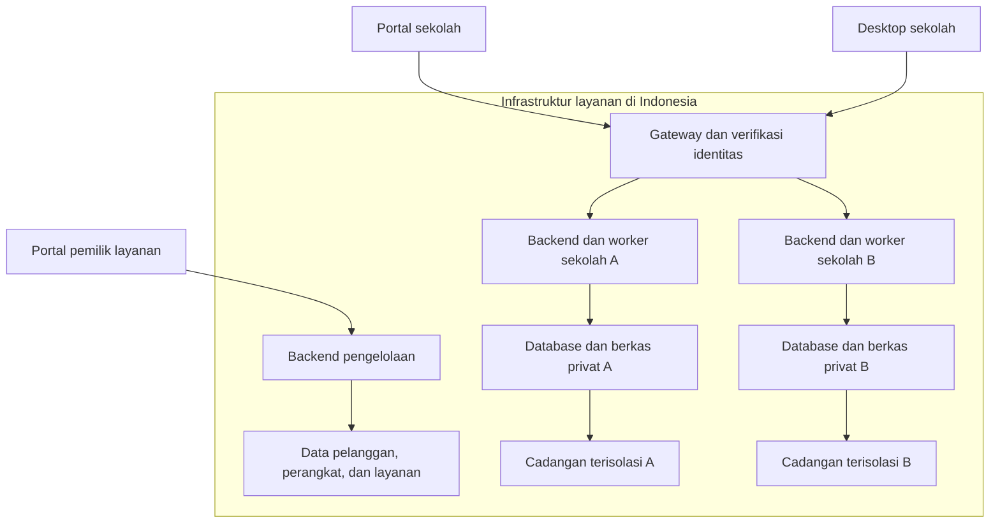

# PRD — Layanan Absensi Siswa dan Guru RFID

**Versi dokumen:** 2.0 — disusun ulang mengikuti aplikasi yang ada; rancangan online tetap dicatat sebagai Rencana
**Tanggal revisi:** 13 November 2026 (WITA)
**Pemilik produk:** penyedia layanan aplikasi absensi untuk sekolah-sekolah pelanggan
**Sekolah rujukan aturan bisnis:** UPT SMP Negeri 1 Pancarijang
**Sumber:** `patahpensil/absensi-siswa` (sebelumnya `absensi-smp1`, diganti nama 14 November 2026), `docs/PRD.md`, cabang `master`
**Status:** aplikasi desktop Windows dan aplikasi web berjalan tanpa server (data lokal). Layanan online multi sekolah (§13, §18, §21–§23) belum dibangun. Keputusan terbuka D-01–D-11 tetap menunggu pemilik (§25.1).
**Utang dan bukti:** [PROGRES-DAN-UTANG.md](PROGRES-DAN-UTANG.md)

> **Cara membaca versi 2.0 (instruksi pemilik, 13 November 2026):** nomor bab tidak diubah karena dirujuk kode dan tes. Setiap bab diawali kotak **Status aplikasi** yang menjelaskan apa yang sudah ada di aplikasi. Label:
> - **[Ada: web + desktop]** — tersedia di kedua bentuk aplikasi;
> - **[Ada: web]** / **[Ada: desktop]** — hanya pada satu bentuk;
> - **[Sebagian]** — sebagian ketentuan bab sudah ada, sisanya dirinci di kotak status;
> - **[Rencana]** — rancangan versi online yang belum dibangun; tetap mengikat bila kelak dibangun.
>
> Aturan bisnis (status, kalender, kartu, koreksi, laporan) berlaku untuk kedua bentuk aplikasi dan dijalankan oleh layanan yang sama di `Absensi.Domain` dan `Absensi.Data`. Ketentuan yang bergantung pada server (backend, MFA, tenant, outbox server, sinkronisasi offline) baru berlaku ketika versi online dibangun. Agen tidak boleh mengisi detail yang belum diputuskan dengan asumsi (§25.1).

---

## 0. Status Aplikasi Saat Ini

Bab ini ditambahkan pada revisi 2.0 dan tidak menggeser nomor bab lain.

| Bentuk | Teknologi | Penyimpanan data | Tempat berjalan |
|---|---|---|---|
| Desktop Windows | .NET 10, WPF/MVVM | SQLite di folder `data/` PC sekolah | PC gerbang sekolah |
| Web — mode uji | .NET 10, Blazor WebAssembly, SQLite di memori browser | IndexedDB browser; data contoh sintetis | tidak diterbitkan; hanya dipakai tes otomatis di GitHub Actions (keputusan pemilik 14 November 2026) |
| Web — mode nyata | sama dengan mode uji, `"Mode": "nyata"` di `wwwroot/appsettings.json` | IndexedDB browser perangkat yang dipakai; tidak ada server | `absensi-uji-real.pages.dev`, dibangun dari repo ini oleh `web-deploy.yml`; repo `patahpensil/Absensi-Uji-Real` dihapus pemilik (satu repo, 14 November 2026) |
| Layanan online multi sekolah | C#/ASP.NET Core, PostgreSQL (rancangan) | AWS region Jakarta (P-23, §21.6) | **[Rencana]** — belum dibangun |

| Area | Web | Desktop | Catatan |
|---|---|---|---|
| Wizard instalasi, login, akun dan peran | Ada | Ada | Login sandi lokal; MFA dan undangan akun = Rencana |
| Master tahun ajaran, kelas, siswa, guru, impor Excel | Ada | Ada | Desktop: layar Kelas → Tahun ajaran (sejak 14 November 2026). Impor foto massal tidak tersedia (dihapus atas instruksi pemilik) |
| Registrasi dan penggantian kartu RFID | Ada | Ada | Satu kartu aktif per orang, unik lintas siswa/guru |
| Tap gerbang, layar TV, aturan status | Ada | Ada | Web: reader keyboard-emulation saja. Desktop: juga mode serial/COM opsional |
| Koreksi, kalender, kunci bulan, jadwal berlaku mulai | Ada | Ada | |
| Kehadiran guru (status oleh Kepala Sekolah atau Admin, P-21) | Ada | Ada | |
| Laporan Excel/PDF | Ada (PDF lewat cetak browser) | Ada (PDF QuestPDF) | |
| Notifikasi orang tua, wali kelas, guru | Pratinjau dan antrean saja, tidak ada pesan terkirim | Telegram dikirim penjadwal desktop selama aplikasi menyala; WhatsApp hanya diantre | Penyedia WhatsApp menunggu D-03 |
| Pairing Telegram (QR) | Tidak ada | Ada | |
| Jejak audit | Ada | Ada | Log keamanan terpisah = Rencana |
| Backup/restore | Unduh/pulihkan berkas `.zip` (database + foto) | Backup lokal 7 berkas, terenkripsi kunci lisensi; tempat "cloud" masih folder lokal | Backup server = Rencana |
| Lisensi | Kunci apa pun diterima (belum ada server lisensi) | sama | Rencana |
| Sinkronisasi offline P-08 | — | — | Rencana (versi online) |

**Isi data uji coba (koreksi pemilik 14 November 2026):** Uji coba di situs mode nyata (`absensi-uji-real`) memakai **data pribadi pemilik sendiri atau nama karangan**, bukan data siswa dan guru sekolah dari Dapodik. Data siswa asli tetap dilarang di kedua situs uji (instruksi proyek §4, D-12) sampai layanan online dengan keamanan dan lokasi data yang disetujui siap (P-23, B-01).

**Batas yang harus diketahui pemakai uji coba (keputusan pemilik 12 November 2026):** data web mode nyata hanya ada di satu browser; hilang bila data situs dihapus, kecuali dipulihkan dari berkas cadangan. Berkas cadangan dan data di browser belum dienkripsi. Keamanan data dan lokasi server diselesaikan pemilik bersama versi online (VPS di Indonesia, PP 71/2019 Pasal 20 untuk lingkup publik; data anak termasuk data pribadi spesifik menurut UU 27/2022 Pasal 4).

---

## 1. Ringkasan Produk

> **Status aplikasi (13 November 2026):** **[Sebagian]** Aplikasi yang ada adalah desktop Windows dan web tanpa server (§0). Tabel di bawah adalah rancangan layanan online multi sekolah **[Rencana]**; baris Desktop, Notifikasi dan aturan bisnis paragraf terakhir sudah berlaku pada aplikasi yang ada.

Layanan absensi siswa dan guru menggunakan kartu RFID untuk banyak sekolah pelanggan. Pemilik aplikasi bertindak sebagai penyedia layanan; setiap sekolah mempunyai ruang data, akun, perangkat dan kewenangannya sendiri. Produk mencakup desktop terpasang di sekolah, website publik, portal sekolah, portal pengelola layanan, serta backend yang terpisah dari frontend.

| Aspek | Ketentuan rancangan |
|---|---|
| Model layanan | SaaS multi sekolah dengan isolasi per tenant |
| Desktop | C# dan WPF; RFID, gerbang dan pekerjaan operator melalui API |
| Backend | C# dan ASP.NET Core; lingkungan eksekusi per sekolah, satu basis kode produk |
| Frontend web | Website publik dan portal pemilik; **tidak ada portal sekolah pada rilis pertama (P-24)**; proyek/deployment terpisah dari backend; teknologi web rinci belum dipilih |
| Database utama | PostgreSQL privat, database dan identitas akses per sekolah |
| Lokasi data | Database, replika, foto, laporan, audit/log sensitif, backup dan pengelolaan kunci yang dikelola layanan di Indonesia |
| Keamanan | Target verifikasi OWASP ASVS v5.0.0 Level 3; desktop/infrastruktur juga diverifikasi sesuai lingkupnya |
| Notifikasi | P-19: layanan mendukung dua kanal, Telegram dan WhatsApp. P-16 tetap ditangguhkan; rincian penyedia WhatsApp, isi pesan dan aliran data mengikuti D-03 |
| Model usaha | Pemilik merupakan penyedia layanan untuk sekolah pelanggan; kebijakan komersial dibahas terpisah |
| Evaluasi biaya | Dana awal, pengeluaran rutin dan cadangan yang harus disiapkan pemilik sebagai penyedia layanan (§23) |
| Koneksi terputus | P-08: tap direkam sementara dalam antrean desktop terenkripsi, Menunggu sinkronisasi; server memeriksa dan mengesahkan setelah koneksi pulih; rincian D-01 masih harus diselesaikan |

Nama sekolah, identitas, kalender, kelas, jadwal dan tahun ajaran merupakan konfigurasi tenant, bukan nilai tertanam di kode. Keputusan server online tidak mengubah status awal Alpa, satu kartu aktif per pemilik, atau urutan penentuan status tanpa revisi bisnis eksplisit.

---

## 2. Tujuan

> **Status aplikasi (13 November 2026):** **[Ada: web + desktop]** untuk tujuan 1 dan 3. Tujuan 2 (kepastian harian orang tua) baru terpenuhi pada desktop yang mengirim Telegram; web belum mengirim pesan. Tujuan 4 menunggu versi online dan paket desktop bertanda tangan.

1. Menghapus absensi manual di buku dan rekap tulis tangan.
2. Memberi orang tua kepastian harian tentang kehadiran anaknya.
3. Menghasilkan laporan kehadiran yang siap diserahkan ke kepala sekolah dan dinas.
4. Menjadi produk yang bisa dipasang di sekolah lain tanpa pendampingan teknis berat.

---

## 3. Pengguna dan Hak Akses

> **Status aplikasi (14 November 2026):** **[Sebagian]** tiga peran di bawah berjalan dengan login username dan sandi lokal (sandi minimal 8 karakter). MFA dan ASVS L3 **[Rencana]**. Pembagian hak di aplikasi sudah mengikuti P-21 dan P-22 (terbukti di tes); pembuatan akun Kepala Sekolah pengganti lewat verifikasi penyedia menunggu versi online (D-10):
> - Kepala Sekolah: semua menu termasuk Audit (P-21, diterapkan 14 November 2026); satu-satunya yang membuat akun Admin/TU; menetapkan status kehadiran guru.
> - Admin/TU: semua menu termasuk Audit; membuat dan mengelola akun Wali Kelas, tidak dapat membuat Admin; menetapkan status kehadiran guru (P-21, diterapkan 14 November 2026).
> - Wali Kelas: tanpa menu Layar gerbang, Notifikasi dan Audit; hanya melihat siswa kelasnya; tidak dapat mengubah master, kartu, foto, kalender atau data guru; koreksi hanya untuk kelasnya tanpa kolom "atas permintaan"; membuka dan mengunduh laporan siswa kelasnya (P-22).
> - Pemeriksaan hak dijalankan layanan `Absensi.Data` (bukan hanya tampilan); "backend" pada bab ini berarti layanan tersebut sampai versi online dibangun.

Satu akun per orang, terikat pada sekolah dan kewenangan yang sah. Untuk sistem online, autentikasi dan pemulihan wajib mengikuti MFA serta kontrol ASVS L3 pada §22; username/password saja bukan desain autentikasi final. Hak akses bisnis sekolah pada tabel berikut dipertahankan. Hak penyedia layanan diatur terpisah pada §21.10.

| Peran | Jumlah | Kewenangan |
|---|---|---|
| Kepala Sekolah | 1 | Penuh |
| Admin / TU | 2 | Penuh (setara kepala sekolah) |
| Wali Kelas | 1 per kelas | Koreksi status kehadiran siswa di kelasnya saja; melihat dan mengunduh laporan kelasnya (P-22); tidak mengendalikan layar gerbang |

**Kewenangan penuh mencakup:** master siswa, master kelas, registrasi dan penggantian kartu, kalender pendidikan, naik kelas massal, kunci bulan, koreksi status, status kehadiran guru, jejak audit, pembuatan akun, laporan, pengaturan.

**Wali kelas tidak dapat:** mengubah master data, mendaftarkan kartu, mengunci bulan, atau menyentuh data kelas lain.

**Keputusan P-21 — disetujui pemilik 13 November 2026:** Kepala Sekolah dan Admin/TU **setara untuk seluruh pekerjaan sekolah**: keduanya membuka semua menu termasuk Audit dan dapat menetapkan status kehadiran guru (§16.17, §17.10); seluruh perubahan tercatat di audit (§12). Perbedaan hanya pada pengelolaan akun:
- Hanya Kepala Sekolah yang membuat dan menonaktifkan akun Admin.
- Admin tidak dapat menonaktifkan akun Kepala Sekolah.
- Kepala Sekolah dapat mengatur ulang sandi Admin dan Wali Kelas; Admin hanya dapat mengatur ulang sandi Wali Kelas. Sandi baru langsung berlaku dan tercatat di Audit. Tidak ada yang mengatur ulang sandi akun sendiri, dan tidak ada menu ganti sandi sendiri. Bila Kepala Sekolah lupa sandi, pekerjaan sekolah tetap berjalan lewat Admin, dan sandi Kepala Sekolah dipulihkan oleh penyedia layanan setelah verifikasi (bersama P-32, versi online). *(Revisi pemilik 14 November 2026, dua tahap: kewajiban ganti sandi saat masuk dihapus, lalu Admin tidak lagi dapat mengatur ulang sandi Kepala Sekolah.)*
- Akun Kepala Sekolah pengganti (mutasi atau pergantian jabatan) dibuat lewat verifikasi penyedia layanan, bukan oleh Admin; rincian verifikasi dan pemulihan mengikuti D-10.

Alasan pembedaan (saran agen, disetujui pemilik): bila seluruh urusan akun disamakan, satu Admin dapat menonaktifkan Kepala Sekolah lalu menguasai data sekolah; bila terlalu dibedakan, sekolah buntu saat Kepala Sekolah lupa sandi.

**Keputusan P-32 — disetujui pemilik 14 November 2026:** akun Kepala Sekolah dan Admin memakai **kode OTP dari aplikasi authenticator** (mis. Google Authenticator atau Microsoft Authenticator): QR dipindai sekali, lalu kode 6 angka yang berganti tiap 30 detik diminta saat masuk. OTP lewat SMS/WhatsApp tidak dipakai (§22). Bila HP hilang atau diganti, pemulihan OTP **hanya lewat verifikasi penyedia layanan**, tidak oleh Admin atau Kepala Sekolah lain. Dengan OTP, sandi yang diketahui pihak lain tidak cukup untuk masuk. Dibangun bersama versi online (§21, P-23). Wali kelas dan target akhir faktor hardware §22 tetap mengikuti D-10.

**Keputusan P-22 — disetujui pemilik 13 November 2026:** wali kelas boleh melihat dan mengunduh laporan kehadiran (Excel/PDF) untuk kelas yang sedang ditugaskan kepadanya saja (§3.3). Laporan kelas lain dan laporan guru tetap tertutup bagi wali kelas.

### 3.1 Hierarki Pembuatan Akun

```
Aktivasi tenant pertama   →  akun Kepala Sekolah
Kepala Sekolah            →  akun Admin (membuat dan menonaktifkan)
Kepala Sekolah / Admin    →  akun Wali Kelas
Verifikasi penyedia       →  akun Kepala Sekolah pengganti
```

Kepala sekolah dan admin sama-sama berwenang penuh atas pekerjaan sekolah (P-21), sehingga tidak terjadi kebuntuan bila salah satu berhalangan atau dimutasi. Kepala Sekolah dapat mengatur ulang sandi Admin; sandi Kepala Sekolah hanya dipulihkan penyedia layanan. Admin tidak dapat menonaktifkan Kepala Sekolah.

### 3.2 Koreksi Langsung Wali Kelas dan Bantuan Admin

**Keputusan pemilik, 3 November 2026 — disetujui untuk draf:** wali kelas dapat mengoreksi kehadiran siswa secara langsung pada kelas yang menjadi kewenangannya, termasuk tanggal lampau selama bulan belum dikunci. Seluruh pemeriksaan tenant, peran, kelas dan kunci bulan dijalankan di backend.

Admin tetap dapat membantu koreksi menggunakan akun admin sendiri. Jika koreksi dilakukan atas permintaan wali kelas, kolom **"atas permintaan"** wajib mencatat wali kelas pemohon. Akun wali kelas tidak dipinjamkan dan pelaku tidak disamarkan menjadi pemohon.

Setiap koreksi wajib menyertakan alasan serta mencatat akun pelaku, waktu, siswa, tanggal kehadiran, status lama dan status baru dalam audit. Alur rinci ada pada §16.10.

### 3.3 Pergantian Wali Kelas

**Keputusan P-17 — disetujui pemilik:** hak akses sebagai wali kelas mengikuti penugasan yang sah pada kelas dan tahun ajaran tertentu. Ketika penugasan lama berakhir, hak dari penugasan tersebut dicabut. Wali kelas pengganti memakai akun pribadinya sendiri dengan lingkup kelas/tahun ajaran yang ditugaskan; akun wali sebelumnya tidak dialihkan kepadanya.

Admin/kepala sekolah yang berwenang mencatat pengakhiran penugasan lama dan penugasan pengganti beserta waktu mulai/akhir berlakunya. Riwayat penugasan tetap disimpan dan satu kelas mempunyai satu wali aktif sesuai §3. Backend memeriksa penugasan yang masih berlaku untuk setiap permintaan, termasuk permintaan dari sesi yang sudah login sebelum pergantian; token/sesi lama tidak mempertahankan akses penugasan yang sudah berakhir. Izin dari peran atau penugasan lain dievaluasi terpisah.

Riwayat koreksi tetap merujuk pelaku aslinya, bukan wali kelas yang kini menjabat. Audit pergantian mencatat pelaku perubahan, waktu, kelas/tahun ajaran, wali lama, wali pengganti dan waktu berlakunya. Tidak menghapus akun/master guru atau menimpa riwayat penugasan hanya untuk mengganti wali kelas. Koreksi tanggal lampau tetap dibatasi kelas/tahun ajaran yang diotorisasi, alasan/audit dan kunci bulan (§3.2/§16.10).

---

## 4. Perangkat Keras

> **Status aplikasi (13 November 2026):** **[Sebagian]** Desktop: mode keyboard-emulation dan mode serial/COM opsional. Web: hanya keyboard-emulation (browser tidak membaca port serial); tap hanya diterima saat jendela TV atau kolom pembacaan memegang fokus. Reader, TV/HDMI, suara dan empat reader bersamaan belum diuji dengan perangkat nyata.

| Komponen | Ketetapan |
|---|---|
| Reader | 4 unit, USB keyboard-emulation; mode USB serial/COM opsional |
| Penempatan | Seluruhnya di satu pintu gerbang |
| Fungsi reader | Sama untuk absen masuk dan pulang; dibedakan oleh logika aplikasi |
| Layar | 1 unit layar besar (TV) di gerbang |
| PC | 1 unit, menjalankan aplikasi |

**Catatan teknis:** reader USB keyboard-emulation tidak dapat dibedakan satu sama lain oleh sistem operasi. Aplikasi karena itu tidak melabeli tap berdasarkan nomor reader.

**Mode serial/COM (opsional, keputusan pemilik 12 November 2026):** bila reader mendukung mode USB serial/COM, admin dapat mendaftarkan 1–4 port di `data/rfid-serial.json`. Pada mode ini tap diterima walau jendela Gerbang tidak sedang difokus, dan status perangkat dapat menampilkan jumlah reader terhubung ("x dari y"). Tanpa berkas tersebut aplikasi tetap memakai mode keyboard-emulation. Mode serial juga tidak melabeli tap per reader. Kedua mode harus diuji dengan perangkat nyata sebelum dipakai.

---

## 5. Master Data

> **Status aplikasi (13 November 2026):** **[Ada: web + desktop]** kecuali yang disebut di subbab: impor foto massal (§5.5) tidak tersedia, pengubahan manual tanggal mulai/hari terakhir siswa (§5.3) belum tersedia.

### 5.1 Tahun Ajaran

Entitas tersendiri: nama (mis. 2026/2027), semester, tanggal mulai, tanggal berakhir, penanda aktif. Tahun ajaran/semester untuk data harian mengikuti tanggal absensi pada kalender akademik; penanda tahun ajaran aktif tidak memindahkan riwayat periode lama. P-18: kalender akademik menjadi acuan awal/akhir periode serta hari efektif; tanggal khusus siswa hanya diperlukan untuk masuk atau keluar di tengah periode (§5.3/§11).

### 5.2 Master Kelas

- Nama kelas **bebas diedit oleh admin** (7A, VII-1, 7 Melati — menyesuaikan kebiasaan tiap sekolah)
- Kolom **tingkat**: pilihan 1–9
- Wali kelas ditugaskan per kelas per tahun ajaran
- P-17: penugasan wali mempunyai riwayat serta waktu mulai/akhir berlaku. Pergantian mengikuti §3.3; penunjuk wali aktif tidak boleh menimpa riwayat penugasan atau identitas pelaku koreksi lama.

**Satu sumber data orang.** Master Guru adalah satu-satunya daftar orang di aplikasi. Penugasan wali kelas berupa kolom di Master Kelas yang **menunjuk ke baris guru**, bukan ketikan nama bebas. Akun login juga menunjuk ke baris guru yang sama.

Akibatnya: wali kelas adalah guru, tetapi guru belum tentu wali kelas. Perubahan nama, pensiun, atau mutasi cukup dilakukan di satu tempat.

Master Kelas harus diisi **sebelum** impor siswa, karena kolom KELAS divalidasi terhadapnya.

### 5.3 Master Siswa

Identitas utama: **NISN**.

Siswa yang keluar atau pindah **tidak dihapus**, cukup ditandai **tidak aktif** — berhenti muncul di daftar absensi harian, riwayatnya tetap utuh.

**Keputusan P-18 — disetujui pemilik, 4 November 2026:** absensi mengikuti kalender akademik. Siswa yang bersekolah sejak awal periode mengikuti hari efektif kalender tanpa kewajiban mengisi tanggal khusus untuk setiap siswa. Untuk siswa pindah masuk atau keluar di tengah periode, catat tanggal mulai bersekolah atau hari terakhir bersekolah yang relevan. Sebelum tanggal mulai dan setelah hari terakhir tersebut, hari tidak dihitung Alpa atau masuk perhitungan kehadiran siswa. Riwayat periode sebelumnya tetap tersimpan.

Contoh: siswa mulai tanggal 10, sehingga tanggal 1–9 dikecualikan; hari terakhir bersekolah tanggal 20, sehingga mulai tanggal 21 dikecualikan. Selama siswa tetap mengikuti periode, batas akhirnya mengikuti kalender; tidak perlu tanggal keluar khusus. Pencatatan/perubahan tanggal khusus harus sesuai kewenangan dan diaudit, dengan kunci bulan tetap berlaku. **Cara pengisian (disetujui pemilik, 12 November 2026):** otomatis dari data — tanggal mulai diisi saat siswa ditambahkan ke kelas setelah periode berjalan; hari terakhir diisi saat mutasi (hari mutasi bila siswa sempat tap masuk, kalau tidak sehari sebelumnya). Pengubahan manual oleh admin belum tersedia.

### 5.4 Impor Siswa dari Excel

Alur:

```
Pilih Tahun Ajaran → Pilih File Excel → Analisis File → Validasi
→ Tampilkan Error/Warning → Preview Data → Konfirmasi Operator
→ Simpan data siswa dan tautan RFID dari NO_KARTU → Tampilkan Hasil
Nomor kartu sudah terisi/valid → tidak perlu tap satu per satu
Tanpa nomor kartu → master siswa saja, lanjut jalur manual (§5.7/§16.5)
```

Kolom template:

| Kolom | Contoh | Validasi |
|---|---|---|
| NISN | 0012345678 | Wajib, 10 digit, unik, **dibaca sebagai teks** |
| NAMA_LENGKAP | AHMAD FAUZI | Wajib |
| JENIS_KELAMIN | L | Wajib, hanya L atau P |
| TEMPAT_LAHIR | Makassar | Boleh kosong |
| TANGGAL_LAHIR | 2010-03-12 | Format YYYY-MM-DD |
| ALAMAT | Jl. ... | Boleh kosong |
| KELAS | 7A | Wajib, cocok dengan Master Kelas |
| NAMA_ORANG_TUA | Budi | Boleh kosong |
| NO_HP_ORANG_TUA | 08123456789 | Boleh kosong, format nomor valid |
| NO_KARTU | 0001329346 | Boleh kosong/kolom tidak ada untuk impor siswa dahulu lalu tap; jika diisi, UID dibaca sebagai teks, nol di depan dipertahankan dan harus unik lintas siswa/guru pada sekolah yang sama |

> `NO_HP_ORANG_TUA` adalah data kontak saja. Nomor HP **tidak dapat** dipakai bot Telegram untuk mengirim pesan.

**Aturan impor ulang** — NISN menjadi kunci:

- NISN sudah ada → data diperbarui
- NISN baru → ditambahkan
- Siswa di database yang tidak ada di file → **dibiarkan, tidak dihapus**

Keputusan P-03 menambahkan registrasi kartu melalui file yang **diimpor**. Jika nomor kartu sudah berada pada file dan valid, baris tersebut tidak memerlukan tap reader satu per satu. Pratinjau harus memperlihatkan pasangan siswa–UID; konflik kartu tidak boleh diganti otomatis. Impor data tanpa UID hanya mengisi master dan tidak menganggap kartu sudah terdaftar. Detail validasi dan transaksi ada di §16.3.

### 5.5 Foto Siswa

- **Impor massal:** ~~operator memilih satu folder berisi file foto dengan nama file sesuai NISN~~ — **tidak tersedia**; dihapus dari tampilan atas instruksi pemilik (§14.4, §16.4).
- **Unggah per siswa/guru:** satu-satunya cara memasang foto, dari panel detail atau daftar. **[Ada: web + desktop]**
- Foto dikecilkan ke ±200×200 saat impor, bukan saat tampil.
- Dimuat ke memori sekali saat aplikasi dibuka. Web menyimpan foto di IndexedDB dan ikut dalam berkas cadangan.
- Siswa tanpa foto ditampilkan sebagai lingkaran inisial.

### 5.6 Kartu RFID

- **1 kartu aktif per siswa**
- Kartu RFID **merangkap sebagai kartu pelajar**
- Kelas **tidak dicetak** di kartu (agar tidak perlu cetak ulang tiap kenaikan kelas)
- Aplikasi **tidak memiliki fitur cetak kartu** — identitas dicetak sekolah di luar aplikasi
- **Kartu hilang:** siswa melapor ke wali kelas → **TU** menonaktifkan kartu lama dan mengaitkan kartu baru ke siswa yang sama → riwayat absensi tidak terputus

### 5.7 Jalur Registrasi Siswa dan Kartu RFID

**Keputusan P-03, 3 November 2026 — penjelasan pemilik:** registrasi mempunyai tiga alur berikut. File Excel **dimasukkan ke aplikasi (impor)** dan boleh memuat nomor RFID atau hanya data siswa.

| Jalur | Urutan | Sumber UID |
|---|---|---|
| Manual satu per satu | Input data seorang siswa → tap kartu pada reader RFID → periksa identitas dan UID → Simpan | Hasil pembacaan kartu oleh reader |
| Impor Excel | Pilih file yang sudah berisi data siswa dan nomor kartu RFID → validasi → pratinjau → konfirmasi impor | Kolom `NO_KARTU` dalam file, tanpa tap kartu satu per satu |
| Impor siswa dahulu, tap kemudian | Impor Excel tanpa nomor RFID → siswa tersimpan → pilih siswa → tap kartu satu per satu → simpan pasangan | Hasil reader saat penautan setelah impor |

Pada jalur manual, identitas siswa diinput terlebih dahulu, baru kartu ditap. Memulai alur hanya dari tap kartu kosong tanpa konteks siswa bukan alur yang dimaksud pemilik. Jika data siswa telah tersimpan, operator dapat memilih siswa tersebut secara eksplisit sebelum tap sesuai alur yang sudah tersedia.

Ketentuan yang sudah ada tetap berlaku: satu aksi penyimpanan manual mengaitkan tepat satu siswa dan satu kartu; keberhasilan harus diverifikasi; UID sementara dibuang ketika konteks siswa diganti; dialog tetap terbuka setelah Simpan, dan Batal/X mengakhiri mode registrasi. Batal/X tidak membatalkan siswa/kartu yang sebelumnya sudah berhasil disimpan.

Selama mode registrasi reader aktif, tap tidak dicatat sebagai absensi. Tahap impor Excel tidak membutuhkan reader atau mode tap registrasi; jika UID belum ada, tahap penautan berikutnya menggunakan reader dalam mode registrasi. Ketiga alur tunduk pada pemeriksaan hak akses, keunikan UID lintas siswa/guru dalam sekolah yang sama, dan satu kartu aktif per pemilik. Impor tidak boleh diam-diam mengganti kartu aktif siswa yang sudah ada; penggantian mengikuti §16.11.


Untuk siswa baru yang diimpor tanpa UID, kolom kartu menampilkan "Belum terdaftar" sampai penautan berhasil. Tap setelah impor harus diawali pemilihan siswa yang benar. Nomor kartu yang kosong saat impor ulang tidak menghapus atau menonaktifkan kartu aktif yang sudah tertaut.

### 5.8 Kenaikan Tahun Ajaran

**Keputusan P-02, 3 November 2026 — disetujui pemilik:**

- **Naik kelas massal:** pilih kelas asal → kelas tujuan, dengan seleksi per siswa untuk yang tidak naik.
- Kartu tetap terhubung ke siswa selama siswa aktif; **tidak ada registrasi atau tap ulang tahunan** hanya karena kenaikan kelas/tahun ajaran.
- Saat naik kelas, yang diperbarui adalah keanggotaan kelas dan tahun ajaran. Riwayat kelas dan absensi tahun sebelumnya tetap tersimpan, tidak ditimpa. Laporan lama tetap memakai kelas yang berlaku pada tanggal absensi (§8.2, keputusan P-07).
- Registrasi kartu dilakukan untuk siswa baru atau penggantian kartu, bukan untuk mengulang pendaftaran seluruh siswa setiap tahun.
- Ketika siswa ditetapkan lulus atau keluar, kartu aktifnya dinonaktifkan. Riwayat kartu dan absensi tetap tersimpan; pergantian tahun ajaran sendiri tidak menonaktifkan kartu siswa yang masih aktif.

---

## 6. Kalender Pendidikan

> **Status aplikasi (13 November 2026):** **[Ada: web + desktop]** input libur/hari sekolah per rentang dengan keterangan wajib, tutup hari, dan kunci bulan. Penetapan libur membatalkan pesan antrean tanggal itu (`BatalkanAntreUntukTanggal`, web dan desktop); pemberitahuan koreksi kalender P-14 untuk pesan yang sudah terkirim belum dibangun.

Diinput **manual** oleh admin (tanggal, bulan, tahun). Tidak membaca file Excel. Diulang tiap semester.

Jenis hari:

| Jenis | Absensi | Laporan |
|---|---|---|
| Hari sekolah | Jalan normal | Kolom normal |
| Libur | Tidak ada | Kolom diarsir/diblok |

- Hari kegiatan seperti **MPLS dan Sumatif tetap absensi seperti biasa**
- **Libur mendadak** ditandai dengan memblok tanggalnya, disertai **kolom keterangan/alasan**
- Sejak penetapan tanggal sebagai libur disahkan, notifikasi absensi yang belum terkirim untuk tanggal tersebut dibatalkan dan tap absensi berikutnya ditolak (§16.12). Pengecualian koreksi kalender bagi penerima yang sudah mendapat pesan terdampak mengikuti §9.6 (P-14).

**Keputusan P-13 — disetujui pemilik:** untuk bulan yang belum dikunci, penetapan libur mendadak setelah siswa sempat tap tidak menghapus riwayat tap. Tanggal ditandai Libur pada kalender/laporan dan dikeluarkan dari perhitungan kehadiran, ketidakhadiran, keterlambatan serta hari efektif penyebut persentase. Libur adalah kondisi kalender, bukan tambahan status kehadiran siswa. Pelaku, waktu dan alasan perubahan dicatat dalam audit. Bulan terkunci tetap tidak dapat diubah melalui kalender.

---

## 7. Jadwal Harian

> **Status aplikasi (13 November 2026):** **[Ada: web + desktop]** jadwal per hari (sekolah/tidak, batas hadir, daftar belum tap, rekap orang tua, batas tap masuk, mulai pulang) dan perubahan berlaku mulai tanggal (P-15) di kedua bentuk.

| Hari | Batas Hadir | Rekap orang tua | Batas akhir tap masuk | Mulai absen pulang |
|---|---|---|---|---|
| Senin–Kamis, Sabtu | 07.30 | 08.10 | 12.00 | 13.10 |
| Jumat | 07.30 | 08.10 | 10.00 | 11.30 |
| Minggu | — libur — | | | |

Seluruh nilai di atas adalah **konfigurasi per sekolah**, bukan nilai tetap.

**Keputusan P-15 — disetujui pemilik:** perubahan jadwal untuk masa mendatang mempunyai tanggal mulai berlaku. Riwayat versi jadwal tetap tersimpan; absensi lama memakai jadwal yang berlaku pada tanggal kejadiannya, termasuk tap offline yang baru tersinkron kemudian. Perubahan jadwal tidak mengubah status atau dasar laporan lama secara otomatis. Batas Hadir saat ini tetap 07.30 dan rekap orang tua tetap 08.10. Pelaku, waktu, perubahan nilai dan tanggal mulai berlaku dicatat dalam audit (§21.8).

**Keputusan P-06 — disetujui pemilik:** batas Hadir tetap 07.30; tap setelah 07.30 sudah Terlambat. Pukul 08.10 adalah waktu rekap notifikasi orang tua, bukan toleransi kedatangan. Rekap menyampaikan status sebenarnya dan jam tap, termasuk siswa yang sudah Terlambat sebelum 08.10. Tap mulai 08.10 sampai batas akhir tap masuk mengikuti pengiriman real-time; kejadian yang sama tidak dikirim dua kali saat peralihan rekap. Daftar belum tap kepada wali kelas tetap pukul 08.00. Seluruh waktu menggunakan zona waktu sekolah.

**Pergantian hari: pukul 00.01.**

---

## 8. Aturan Status Kehadiran

> **Status aplikasi (13 November 2026):** **[Ada: web + desktop]** dijalankan `PemrosesTap` dan `PenentuStatusKehadiran` yang sama. Penetapan Bolos: desktop menjalankan finalisasi pada jamnya selama aplikasi menyala; web (dan desktop yang tidak menyala) menetapkannya saat aplikasi dibuka pada hari berikutnya (`LocalAttendanceClosure.FinalizeMissedDays`) atau lewat **Tutup hari terpilih** di Kalender.

Status awal seluruh siswa setiap hari adalah **Alpa**. Tap kartu dapat mengubahnya sesuai aturan berikut; status Izin/Sakit yang sudah ditetapkan melalui koreksi tidak dibatalkan otomatis oleh tap (§8.3).

| Status | Cara terjadi |
|---|---|
| Alpa | Status awal, sebelum ada tap |
| Hadir | Tap pertama sampai dengan batas Hadir (07.30 pada sekolah rujukan) |
| Terlambat | Tap pertama melewati batas Hadir sampai dengan batas akhir tap masuk |
| **Bolos** | Sudah tap masuk, tetapi **tidak tap pada jam pulang** |
| Izin / Sakit | **Hanya** lewat koreksi manual, tidak pernah dari tap |
| Pulang | Bukan status baru — mengisi kolom jam pulang |

Status **Bolos** ditetapkan **satu jam setelah jam pulang**, bagi siswa yang tercatat masuk tetapi belum melakukan tap pulang. Statusnya dapat diperbaiki lewat koreksi bila ternyata siswa memang berizin pulang lebih awal atau kartunya gagal terbaca.

### 8.1 Aturan Tap

- **Jeda minimum 15 detik** antar tap untuk kartu yang sama; tap di bawah 15 detik **selalu ditolak sebagai error**
- Tap gagal terbaca → **bunyi berbeda + pesan error di layar**
- Tap baru dihitung sebagai **pulang** hanya setelah jam mulai absen pulang; sebelum jam itu, tap berulang diabaikan
- Siswa yang **belum punya catatan masuk** dan tap di atas batas akhir tap masuk → **ditolak dengan bunyi berbeda**, harus lewat koreksi
- Siswa yang **sudah punya catatan masuk** tetap dapat tap pulang jam berapa pun, kecuali status resminya sudah Izin/Sakit (§8.3)

### 8.2 Data yang Dipanggil Saat Tap

Hanya **NISN, nama, dan nomor kartu RFID**. Kelas tidak dipanggil saat tap. Foto diambil dari memori yang sudah dimuat saat aplikasi dibuka.

**Keputusan P-07 — disetujui pemilik:** pengelompokan laporan absensi menggunakan riwayat keanggotaan kelas dan tahun ajaran yang berlaku pada tanggal absensi, bukan kelas terbaru di master. Kenaikan atau perpindahan kelas tidak memindahkan catatan absensi lama ke kelas baru. Tanggal mulai/akhir keanggotaan dan tahun ajaran dicatat agar laporan periode lama dapat disusun kembali dengan kelas yang benar.

Contoh: Andi naik dari 7A ke 8A. Laporan ketika Andi masih di 7A tetap menempatkannya di 7A; laporan setelah perpindahan mengikuti 8A. Prinsip ini juga berlaku untuk perpindahan kelas di tengah tahun dan keluaran Excel/PDF.

Hak akses wali kelas diperiksa terpisah di backend sesuai kewenangan sah (§3/§22). Riwayat keanggotaan siswa tidak dengan sendirinya memberikan akses kepada wali kelas lama atau baru ke seluruh periode; keputusan ini tidak menambah hak akses baru.

### 8.3 Prioritas Koreksi Izin/Sakit atas Tap

**Keputusan P-04 — disetujui pemilik:**

- Status resmi Izin/Sakit tetap berlaku sampai diubah oleh wali kelas yang berwenang atau admin melalui koreksi dengan alasan dan audit (§10/§16.10).
- Tap saat status tersebut berlaku hanya dicatat sebagai percobaan tap operasional, terpisah dari absensi resmi. Status dan jam masuk/pulang resmi tidak diubah oleh tap itu, termasuk bila sebelumnya sudah ada catatan masuk.
- Gerbang menampilkan status sebenarnya: "Status hari ini: Izin/Sakit. Hubungi wali kelas atau admin untuk koreksi."
- Tap tersebut tidak membuat notifikasi Hadir/Terlambat baru. Notifikasi koreksi yang sah tetap mengikuti §9/§16.9; persetujuan ini tidak mengubah keputusan offline/replay atau payload Telegram yang masih terbuka.


---

## 9. Notifikasi Telegram dan WhatsApp

> **Status aplikasi (13 November 2026):** **[Sebagian]** Aturan waktu dan isi notifikasi diterapkan pada antrean (outbox) lokal. Desktop mengirim Telegram melalui penjadwal setiap 30 detik selama aplikasi menyala dan menyediakan pairing QR; belum diuji dengan bot nyata oleh pemilik. Pesan WhatsApp hanya diantre (penyedia menunggu D-03). Web hanya menampilkan pratinjau dan antrean; tidak ada pesan terkirim dan tidak ada pairing. Penjadwal/outbox server pada §9.4 **[Rencana]**.

**Keputusan kanal — P-19, disetujui pemilik 12 November 2026:** layanan mendukung dua kanal notifikasi, **Telegram dan WhatsApp**. Rincian Telegram di bawah tetap berlaku untuk kanal Telegram; rincian kanal WhatsApp (penyedia/API, penautan penerima, isi pesan, biaya per pesan dan aliran data pihak ketiga) masih mengikuti D-03. P-16 tetap ditangguhkan: usulan tambahan verifikasi penautan oleh admin/TU belum disetujui dan belum dimasukkan sebagai ketentuan wajib.

**Keputusan P-20 — disetujui pemilik 12 November 2026:** untuk notifikasi orang tua, setiap siswa memakai **satu kanal** yang dipilih orang tua (Telegram atau WhatsApp); pesan hanya diantre ke kanal itu. Kanal WhatsApp memakai **nomor HP orang tua pada data siswa secara langsung, tanpa pesan konfirmasi**; nomor kosong atau tidak valid berarti pesan WhatsApp tidak dibuat. Pilihan kanal diubah oleh Kepala Sekolah/Admin (§3) dan dicatat di audit (§12). Web uji hanya mensimulasikan kedua kanal: pesan diantre dan ditampilkan, tidak ada pesan yang dikirim. Kanal untuk wali kelas dan guru belum diputuskan dan tetap mengikuti rincian Telegram yang ada. Aturan bisnis waktu/status notifikasi yang telah disetujui tetap dicatat dan tidak dibatalkan oleh penangguhan ini.

Modul notifikasi termasuk **paket inti**, bukan add-on.

### 9.1 Prinsip Dasar

**Keputusan P-05 — disetujui pemilik:** notifikasi perubahan status tetap berlaku, dengan pengecualian eksplisit untuk status Alpa pada batas akhir tap masuk.

- **Sebelum batas akhir tap masuk:** tidak mengirim notifikasi Alpa kepada orang tua.
- **Saat batas akhir tap masuk tercapai:** kirim "Tidak hadir tanpa keterangan" hanya kepada orang tua siswa yang status resminya masih Alpa. Status tidak perlu berubah dari Alpa untuk memicu pesan ini.
- **Jika setelah pesan tersebut siswa dikoreksi oleh pengguna berwenang:** kirim pesan ralat sesuai status terbaru.

Batas akhir tap masuk tetap mengikuti jadwal sekolah (§7): 12.00 pada hari biasa dan 10.00 pada Jumat untuk sekolah rujukan. Daftar belum tap pukul 08.00 kepada wali kelas (§9.3) tetap berlaku. Aturan Bolos dan penerimanya tidak diubah. Keputusan ini menyelesaikan konflik pemicu notifikasi Alpa, bukan menentukan replay server, sinkronisasi offline atau izin payload Telegram; D-01–D-03 tetap terbuka.

### 9.2 Titik Pengiriman

| Pemicu | Waktu | Isi |
|---|---|---|
| Siswa sudah tap sebelum rekap | Pukul 08.10 | Kepada orang tua: status sebenarnya **Hadir atau Terlambat**, beserta tanggal dan jam tap |
| Tap mulai pukul 08.10 sampai batas akhir tap masuk | Real-time | Kepada orang tua: Terlambat, **dengan tanggal dan jam tap** |
| Batas akhir tap masuk | 12.00 / 10.00 | Kepada orang tua: "Tidak hadir tanpa keterangan", hanya jika masih Alpa; tidak dikirim sebelum batas akhir |
| Absen pulang | — | **Tidak ada notifikasi** (jam pulang tetap dicatat) |
| Status Bolos | 1 jam setelah jam pulang (14.10 / Jumat 12.30) | Dikirim ke **wali kelas**, bukan orang tua — satu pesan berisi **daftar siswa bolos di kelasnya** |

### 9.3 Notifikasi ke Wali Kelas

Wali kelas menerima dua pesan harian di Telegram-nya, keduanya berisi daftar per kelas:

| Waktu | Isi | Gunanya |
|---|---|---|
| 08.00 | Daftar siswa kelasnya yang **belum tap** | Wali kelas sempat memastikan dan menginput izin **sebelum** notifikasi "tidak hadir tanpa keterangan" terkirim ke orang tua pada batas akhir tap masuk |
| 1 jam setelah jam pulang | Daftar siswa berstatus **Bolos** | Memastikan penyebabnya sebelum orang tua dilibatkan |

Pesan pukul 08.00 inilah yang menutup celah utama sistem: tanpa itu, wali kelas baru mengetahui siswanya tidak hadir setelah orang tua terlanjur menerima pesan.

Telegram digunakan untuk menerima informasi, bukan menjalankan koreksi. Wali kelas dapat mengoreksi langsung melalui aplikasi/portal pada kelas yang menjadi kewenangannya; admin tetap dapat membantu sesuai §3.2.

> Notifikasi bolos sengaja diarahkan ke wali kelas lebih dulu. Wali kelas memastikan penyebabnya — benar-benar pulang tanpa izin, atau sekadar kartu gagal terbaca — sebelum orang tua dilibatkan.

### 9.4 Pengaman

- Penjadwal dan pengirim outbox berada di server per sekolah (§21.9), bukan bergantung pada desktop sekolah menyala.
- Internet sekolah terputus berbeda dari koneksi server ke Telegram terputus. P-08 menyetujui perekaman tap sementara dalam antrean desktop terenkripsi dengan label Menunggu sinkronisasi; server memeriksa dan mengesahkan setelah koneksi pulih (§21.8). Pesan server yang belum terkirim ditangani outbox sesuai kontrak retry; rincian sinkronisasi dan notifikasi tetap mengikuti D-01/D-02.
- Toleransi 15 menit dan aturan jadwal dibuang pada versi standalone adalah baseline historis, bukan kebijakan final server online. Replay job, finalisasi status dan ralat data terlambat menunggu keputusan D-02.
- P-10: notifikasi Alpa/Bolos yang belum dapat dipastikan akibat gangguan sinkronisasi ditahan; admin sekolah mendapat peringatan. Setelah sinkronisasi atau pemeriksaan berwenang selesai, server menentukan status/notifikasi sesuai hasil terkonfirmasi dan memeriksa ulang pesan antrean sebelum mengirim (§21.9). Ketiadaan tap akibat data belum lengkap bukan bukti ketidakhadiran; rincian lama penahanan dan eskalasi masih mengikuti D-02.
- **Tanggal diblok → notifikasi absensi biasa dibatalkan**. P-14 mengizinkan koreksi kalender khusus kepada penerima yang sudah mendapat notifikasi terdampak (§9.6). Pembatasan payload/aliran pihak ketiga harus diselesaikan melalui D-03 sebelum notifikasi online produksi diaktifkan.

### 9.5 Pairing Orang Tua

Bot Telegram tidak dapat menghubungi seseorang sebelum orang itu memulai chat. Karena itu setiap siswa memiliki **QR unik**:

```
t.me/<BotSekolah>?start=<token unik siswa>
```

- Username bot diambil dari **pengaturan**, bukan ditanam di kode (tiap sekolah membuat bot sendiri)
- Token acak, sekali pakai
- **1 orang tua tertaut per siswa**
- Aplikasi dapat **mencetak QR massal per kelas**
- QR yang hilang **dapat dibuatkan kembali**

**Layar pemantau pairing:** daftar siswa tertaut / belum tertaut, dengan ringkasan per kelas — agar tidak ada orang tua yang diam-diam tidak pernah menerima notifikasi.

### 9.6 Koreksi Kalender setelah Notifikasi Terkirim

**Keputusan P-14 — disetujui pemilik:** apabila notifikasi absensi sudah terkirim sebelum tanggal ditetapkan libur, buat satu pemberitahuan koreksi kalender untuk setiap penerima yang terdampak oleh penetapan libur tersebut. Pesan menjelaskan tanggal yang ditetapkan libur dan bahwa tanggal itu tidak dihitung dalam absensi. Ini pengecualian khusus terhadap larangan notifikasi saat libur; pesan absensi biasa tetap dibatalkan sesuai P-13.

Penerima ditentukan dari riwayat pengiriman yang terkonfirmasi untuk tanggal/sekolah terdampak, bukan seluruh kontak sekolah. Penerima yang hanya memiliki pesan absensi belum terkirim tidak memperoleh koreksi kalender semata karena pesan itu mengantre. Koreksi kalender dibuat sesudah perubahan kalender disahkan, terpisah dari status Hadir/Terlambat/Alpa/Bolos. Identitas pekerjaan per penetapan libur dan penerima mencegah job ulang membuat pemberitahuan koreksi tambahan; retry tetap mengikuti outbox, bukan janji bahwa layanan eksternal pasti mengirim tepat sekali.

Riwayat notifikasi awal tetap tercatat dan dihubungkan dengan koreksi kalender beserta waktu, tanggal yang dikoreksi dan hasil pengirimannya. Hasil pengiriman awal yang belum diketahui memerlukan rekonsiliasi D-02; tidak dianggap pasti terkirim atau pasti gagal. Isi/aliran Telegram tetap harus memenuhi keputusan D-03 sebelum produksi.

---

## 10. Koreksi Status

> **Status aplikasi (13 November 2026):** **[Ada: web + desktop]** alasan wajib, kolom atas permintaan (tidak tampil untuk wali kelas), kunci bulan, audit. Pemeriksaan sinkronisasi P-11 berlaku sebagai pemeriksaan hari yang belum ditutup (`PendingDays`) sampai versi online ada.

- Wali kelas dapat melakukan koreksi langsung terhadap siswa pada kelas yang menjadi kewenangannya, termasuk tanggal lampau.
- Admin dapat membantu dengan akun admin sendiri; jika atas permintaan wali kelas, nama pemohon dicatat dalam kolom "atas permintaan".
- Koreksi hanya terbuka selama bulan bersangkutan belum dikunci. Setelah dikunci, koreksi ditolak; revisi ini tidak membuat jalur pembukaan kunci.
- Kunci bulan tetap mengikuti kewenangan yang sudah ditetapkan untuk admin/TU.
- P-11: penguncian bulan ditolak jika kelengkapan data bulan tersebut belum dapat dipastikan, termasuk masih ada tap menunggu sinkronisasi atau pemeriksaan. Admin menyelesaikan data bulan itu terlebih dahulu; backend memeriksa kembali kelengkapan sebelum penguncian disahkan (§16.13).
- Status Izin/Sakit tidak dibatalkan oleh tap. Jika siswa ternyata hadir, wali kelas berwenang/admin melakukan koreksi dengan alasan dan audit; tap terhalang tidak mengisi jam masuk/pulang resmi (§8.3).
- Alasan koreksi wajib diisi. Audit mencatat akun pelaku, waktu, siswa, tanggal kehadiran, serta status sebelum dan sesudah; pemohon juga dicatat bila koreksi dilakukan atas permintaan.
- Pemeriksaan akses berlaku di backend dan tidak bergantung pada tombol yang terlihat di frontend.

---

## 11. Laporan

> **Status aplikasi (13 November 2026):** **[Ada: web + desktop]** jenis Harian, Mingguan, Bulanan, Per orang dan Semester untuk siswa dan guru, Excel dan PDF. Web membuat PDF lewat **Cetak / Simpan PDF** browser (pustaka PDF tidak berjalan di WebAssembly); desktop memakai QuestPDF. Kepala Sekolah dan Admin membuka semua laporan; wali kelas membuka dan mengunduh laporan siswa kelas yang sedang ia walikan (P-22, diterapkan 14 November 2026 di web dan desktop).

Keluaran: **Excel dan PDF**.

**Pengelompokan historis (P-07):** seluruh laporan mengikuti kelas dan tahun ajaran siswa pada tanggal absensi (§8.2). Mengubah kelas aktif siswa tidak boleh mengubah pengelompokan laporan lama, baik pada tampilan aplikasi maupun ekspor Excel/PDF.

**Cakupan hari per siswa (P-18):** perhitungan memakai hari efektif kalender akademik dalam periode laporan. Untuk siswa yang masuk/keluar di tengah periode, cakupan dibatasi tanggal mulai bersekolah sampai hari terakhir bersekolah yang tercatat. Hari di luar cakupan tidak menjadi Alpa dan tidak masuk pembilang maupun penyebut persentase siswa. Siswa yang mengikuti periode sejak awal menggunakan kalender akademik tanpa input tanggal khusus satu per satu. Riwayat sebelumnya tetap tersimpan; aturan penghitungan Terlambat/Bolos sebagai hadir pada §11.5 tidak berubah.

### 11.1 Laporan Mingguan

- Rentang **Senin–Sabtu**, mengikuti hari sekolah
- Memuat **kolom keterangan per kejadian**: jam keterlambatan, keterangan izin/sakit
- Dipakai wali kelas untuk memantau dan menindaklanjuti

### 11.2 Laporan Bulanan

- Satu baris per siswa, satu kolom per tanggal, sel berisi kode status
- Rekap jumlah H/S/I/A dan jumlah keterlambatan
- Kolom hari Minggu dan hari libur **diarsir/diblok**, bukan dikosongkan
- Alasan libur mendadak tercetak sebagai catatan

### 11.3 Laporan Per Siswa

- Identitas (nama, NISN, kelas, foto), ringkasan H/S/I/A, jumlah terlambat, persentase kehadiran
- Rincian hari tidak hadir dan terlambat
- Dapat dicetak **per siswa** maupun **sekaligus satu kelas**, keluaran PDF

### 11.4 Laporan Semester

Format **per siswa**, mengikuti batas semester di kalender pendidikan — bukan batas bulan, sehingga bulan awal dan akhir semester terhitung sebagian.

Isi: nama, NISN, kelas, jumlah Hadir, Sakit, Izin, Alpa, jumlah keterlambatan, dan persentase kehadiran terhadap hari efektif.

**Perhitungan hari efektif** dilakukan aplikasi sendiri dari kalender pendidikan yang diinput admin:

| Dihitung efektif | Tidak dihitung |
|---|---|
| Seluruh hari sekolah, **termasuk Sabtu** | Hari Minggu |
| Hari kegiatan (MPLS, Sumatif) | Libur nasional |
| | Libur semester |
| | Libur mendadak |

> Angka hari efektif di kalender pendidikan dinas memakai pekan 5 hari. Karena sekolah tetap masuk Sabtu, aplikasi menghitung sendiri dan angkanya akan berbeda dari dokumen dinas.

### 11.5 Perhitungan dan Kolom Keterangan

**Terlambat dihitung sebagai hadir** untuk persentase kehadiran.

**Bolos juga dihitung sebagai hadir** — siswa memang datang dan mengikuti pelajaran; yang tidak dilakukannya hanya tap pulang.

Keduanya tidak hilang begitu saja: tiap laporan menyediakan **satu kolom keterangan** yang memuat catatan terlambat dan bolos.

| Laporan | Isi kolom keterangan |
|---|---|
| Harian | Jam keterlambatan; penanda bolos |
| Mingguan | Keterangan per kejadian: "Terlambat 07.52", "Bolos", "Sakit" |
| Bulanan | Rekap jumlah: jumlah terlambat dan jumlah bolos |
| Semester / rapor | Rekap jumlah terlambat dan bolos sepanjang semester |

Dengan cara ini, persentase kehadiran tetap adil, sementara pola siswa yang sering terlambat atau sering tidak tap pulang tetap terlihat oleh wali kelas dan orang tua.

---

## 12. Jejak Audit

> **Status aplikasi (13 November 2026):** **[Ada: web + desktop]** audit bisnis append-only, layar Audit khusus Admin dengan bawaan 90 hari dan saringan akun/tanggal. Log keamanan terpisah dan retensi D-05 **[Rencana]**. Pemulihan cadangan di web belum menulis baris audit (utang).

Mencatat setiap perubahan data yang **tidak** berasal dari tap:

| Dicatat | Isi catatan |
|---|---|
| Koreksi status, izin/sakit | Waktu |
| Penggantian kartu | Akun pelaku |
| Kunci bulan | Apa yang diubah |
| Perubahan master | Nilai lama → nilai baru |
| Pemblokiran tanggal | Kolom "atas permintaan" |
| Pembuatan akun | |

- Audit bisnis bersifat append-only dan tidak dapat diubah/dihapus melalui akun operasional sekolah maupun portal pemilik. Perlindungan log dan batas administrator infrastruktur mengikuti §22.8.
- Retensi audit, klasifikasi data dan prosedur pemusnahan sah belum ditetapkan (D-05). Ketentuan historis "selamanya" belum dianggap kebijakan produksi layanan online yang telah direkonsiliasi dengan ASVS. Tidak ada penghapusan baru yang diaktifkan oleh revisi ini.
- Akses sensitif serta keputusan otorisasi juga dicatat dalam log keamanan terpisah sesuai L3; bukan hanya perubahan data bisnis.
- Layar audit menampilkan **90 hari terakhir** secara default; selebihnya lewat filter tanggal

---

## 13. Model Layanan, Aktivasi dan Pembaruan

> **Status aplikasi (13 November 2026):** **[Rencana]** untuk model layanan online, provisioning tenant, undangan dan pembaruan bertanda tangan. Yang ada sekarang: wizard instalasi lokal (Lisensi → Identitas sekolah → Tahun ajaran → Jadwal harian → Akun kepala sekolah → Selesai) di web dan desktop; kunci lisensi apa pun diterima karena server lisensi belum ada (`LayananLisensiLokal`); desktop dibagikan sebagai paket uji yang belum ditandatangani; web diperbarui otomatis setiap deploy Cloudflare Pages.

### 13.1 Model layanan

Pemilik aplikasi menjual layanan kepada sekolah pelanggan. Paket, tarif, kontrak, masa aktif, pembaruan, bantuan, ekspor akhir layanan dan konsekuensi tunggakan belum ditentukan. Ketentuan lama "beli putus" dan "sekali aktivasi online lalu offline selamanya" tidak menjadi ketentuan final layanan online. Pembahasan komersial mengikuti D-04 dan berada di luar evaluasi pengeluaran pemilik pada §23; evaluasi biaya tidak menetapkan tarif atau beban sekolah.

### 13.2 Aktivasi awal sekolah

1. Penyedia memverifikasi pendaftaran dan pihak sekolah berwenang, lalu memprovision tenant dengan sumber daya terisolasi.
2. Kepala sekolah menerima undangan sekali pakai dengan masa berlaku dan mendaftarkan autentikator sesuai L3.
3. Identitas sekolah, tahun ajaran/semester, kalender dan jadwal diisi pada layanan server sekolah. Konfigurasi bukan disimpan hanya dalam executable atau berkas lokal.
4. Hierarki pembuatan akun kepala sekolah → admin → wali kelas dipertahankan; pembuatan menggunakan undangan/enrollment, bukan admin memilih password pengguna.
5. Desktop resmi ditandatangani, dipasang di PC sekolah, dan diikat ke tenant melalui registrasi perangkat yang terbatas.
6. Guru, kelas, siswa dan kartu disiapkan melalui alur bisnis yang ditetapkan. Token bot dikonfigurasi belakangan oleh pihak berwenang dan dikelola pada server.

Pada versi online, wizard lama menjadi alur onboarding tenant; bukan lagi deteksi bahwa file database lokal belum ada. Pengulangan setup tidak boleh menimpa data sekolah atau membuka pembuatan ulang akun pemilik tanpa verifikasi.

### 13.3 Pembaruan

Desktop, frontend web, backend absensi, backend pengelolaan dan worker memiliki versi serta artefak rilis masing-masing. Paket desktop dan metadata pembaruannya ditandatangani dan diverifikasi. Pemilihan pembaruan manual/otomatis belum diputuskan; keduanya harus memenuhi integritas, autentikasi sumber dan kompatibilitas API.

Migrasi database server dijalankan oleh proses deployment yang dikendalikan, bernomor, aman terhadap konkurensi, dan diuji dengan backup serta strategi rollback/forward recovery. Setiap desktop tidak boleh menjalankan migrasi PostgreSQL sendiri saat dibuka. Pembaruan tidak menghapus data sekolah atau antrean sah yang belum selesai. Kompatibilitas klien lama, maintenance window sesuai zona/jadwal sekolah, rollout bertahap dan kondisi penolakan versi tidak aman harus ditetapkan sebelum rilis.

---

## 14. UI/UX

### 14.1 Layar Absensi (Gerbang)

> **Status aplikasi (13 November 2026):** **[Ada: web + desktop]** layar TV terpisah dengan foto, label GURU/SISWA, nama dan NISN/NIP, beberapa kartu sekaligus, ringkasan harian. Nama pendek 64 px; nama panjang mengecil agar status dan jam tetap terlihat (keputusan pemilik 12 November 2026, PANDUAN-UI-UX §8.1).

- Tampil di **satu layar besar (TV)**
- Fullscreen, tanpa menu, tanpa mouse
- **Foto ditampilkan** saat tap — satu-satunya pengaman terhadap titip kartu
- **Label pembeda** di atas foto: `GURU` atau `SISWA`; nama sekolah tampil di header
- Kartu guru menampilkan **nama dan NIP**; kartu siswa menampilkan **nama dan NISN**
- Beberapa tap **dapat tampil bersamaan**; tidak ada label per reader
- Warna tegas: Hadir, Terlambat, Ditolak
- Ringkasan harian: Hadir / Terlambat / Belum tap / Guru

### 14.1.1 Pengendali Gerbang dan TV

> **Status aplikasi (13 November 2026):** **[Ada: web + desktop]** tabel hak dan dua tindakan terpisah terbukti di tes web. Konfirmasi memakai sandi akun sendiri; reautentikasi/MFA produksi **[Rencana]**.

**Keputusan pemilik, 7 November 2026:** layar gerbang berbeda dari dashboard dan halaman daftar absensi. Fitur **Layar gerbang** membuka tampilan TV fullscreen; kontrolnya hanya dapat diakses oleh **Kepala Sekolah dan Admin/TU**. Pemeriksaan berlaku pada aksi/layanan, bukan hanya visibilitas menu. Wali kelas tidak boleh membuka, menutup atau menghentikan gerbang melalui menu, perintah maupun pemanggilan langsung. Petugas di gerbang dapat melihat TV yang sudah diaktifkan tanpa memperoleh akun admin. Akun vendor tidak otomatis mendapat hak operasional sekolah.

| Aksi pengendali | Kepala Sekolah | Admin/TU | Wali Kelas / petugas tanpa akun |
|---|---|---|---|
| Membuka tampilan TV | Ya | Ya | Tidak |
| Memulai penerimaan tap | Ya | Ya | Tidak |
| Menutup tampilan TV | Ya, konfirmasi autentikasi | Ya, konfirmasi autentikasi | Tidak |
| Menghentikan penerimaan tap | Ya, konfirmasi autentikasi | Ya, konfirmasi autentikasi | Tidak |

**Operasional dua layar:** PC sekolah terhubung ke TV melalui HDMI dengan mode **Extend**. Pengelola membuka Layar gerbang, memilih TV tujuan dengan memindahkan jendela ke layar tersebut, kemudian mengaktifkan fullscreen. Dashboard tetap tersedia pada monitor PC. Tampilan TV tidak memuat menu master data, kredensial atau kontrol administratif. Kartu siswa/guru, foto, label jenis, identitas, jam dan hasil tap mengikuti §14.1/§16.8. Beberapa hasil dapat tampil bersamaan. Dashboard hanya ringkasan dan tindak lanjut, bukan pengganti TV gerbang.

**Dua tindakan terpisah:** Menutup tampilan TV tidak menghentikan penerimaan tap pada pengendali. Menghentikan penerimaan tap tidak menutup TV; TV menampilkan status berhenti dan tap baru tidak dicatat oleh sesi gerbang. Konfirmasi berhasil, akun pelaku, waktu dan aksi dicatat dalam audit. Keluar dari fullscreen melalui tombol browser/OS tidak membuka hak admin. Menutup tab pengendali, keluar akun atau kehilangan kewenangan mengakhiri sesi dan akses TV. Gangguan koneksi pengendali menutup akses pembacaan/data pada TV sampai sesi sah dipulihkan.

**Batas pengujian browser sementara:** tombol Buka layar TV membuka jendela terpisah. Browser dapat meminta izin pop-up dan memerlukan klik Fullscreen pada jendela TV. Bila ditolak, aplikasi menyatakan belum fullscreen; tidak mengklaim pemilihan monitor otomatis. TV menerima snapshot tampilan dari satu pengendali, tanpa login atau salinan database mandiri. URL TV langsung tidak membuka data/sesi. Tampilan dan input terikat ke jendela pengendali yang sah dan dihentikan saat sesi berakhir. Konfirmasi pada fase lokal memakai sandi akun sendiri; produksi mengikuti reautentikasi/MFA dan otorisasi backend pada §22.

**Input RFID:** reader USB keyboard-emulation mengikuti fokus keyboard. Input formulir dan mode registrasi tidak boleh diambil sebagai absensi gerbang. Operator mengembalikan fokus ke TV/kolom pembacaan ketika selesai mengisi formulir. Pengoperasian empat reader bersamaan dan jaminan penangkapan latar belakang saat mengetik pada PC tetap harus diuji dengan perangkat nyata; browser sementara tidak dianggap membuktikan kemampuan itu. Tidak menambahkan label asal reader yang tidak tersedia dari perangkat.

### 14.2 Layar Admin

> **Status aplikasi (13 November 2026):** **[Sebagian]** Menu sesuai daftar (Layar gerbang dan Notifikasi hanya Kepala Sekolah/Admin; Audit untuk Kepala Sekolah dan Admin sesuai P-21). Header memuat nama sekolah, logo dan tahun ajaran aktif. Dashboard web berisi: Pusat kendali kehadiran (ringkasan harian, tombol Layar gerbang TV dan Buka absensi), Pantauan kedatangan, Tindak lanjut siswa (belum tap) dan Kesiapan data. Status rekap notifikasi dan peringatan pairing belum ada di dashboard web.

Menu: Dashboard, Absensi, **Layar gerbang** (kepala sekolah/admin saja), Siswa, Guru, Kelas, Koreksi, Kalender, Laporan, Notifikasi (kepala sekolah/admin saja), Audit (admin saja), Pengaturan.

Header memuat **nama sekolah, logo, dan tahun ajaran aktif**. Menampilkan tahun ajaran di header berfungsi sebagai pengaman — admin langsung sadar bila masih memakai tahun ajaran lama setelah Juli.

Dashboard menjawab satu pertanyaan utama: **siapa yang belum tap hari ini**. Isinya:

- Ringkasan harian: Hadir · Terlambat · Izin/Sakit · Alpa
- Status rekap notifikasi hari itu (mis. "Rekap 08.10 terkirim · 430 pesan")
- **Peringatan pairing** (mis. "42 siswa belum tertaut Telegram") — dipasang di dashboard agar terlihat, bukan disembunyikan di layar pemantau pairing
- Daftar siswa yang belum tap, dengan kelasnya
- Tombol cepat: Koreksi · Mode gerbang

### 14.3 Menu Absensi

> **Status aplikasi (13 November 2026):** **[Sebagian]** Web: kolom pembacaan **Nomor kartu RFID** (hanya Kepala Sekolah/Admin), tabel Catatan kehadiran dengan saringan status, dan panel jadwal. Status perangkat "x dari y" hanya ada di desktop mode serial. Di web, mode registrasi diaktifkan dari dialog **Daftarkan kartu**/**Ganti kartu** di menu Siswa/Guru, bukan dari menu Absensi.

Bukan layar gerbang, melainkan pengendalinya:

| Bagian | Isi |
|---|---|
| Status perangkat | Jumlah reader terhubung (mis. "4 dari 4") |
| Mode aktif | Absensi atau Registrasi — ditampilkan jelas agar mode registrasi yang lupa dimatikan langsung terlihat |
| Tombol | Buka pengendali Layar gerbang (kepala sekolah/admin) · Registrasi |
| Pencarian | Cari nama / NISN, saring per kelas |
| Daftar harian | Seluruh siswa hari itu beserta status, jam masuk, jam pulang |

Siswa yang belum tap tetap muncul sebagai Alpa, bukan hilang dari daftar — sesuai aturan bahwa seluruh siswa punya baris sejak awal hari.

### 14.4 Menu Siswa

> **Status aplikasi (13 November 2026):** **[Sebagian]** Web: satu halaman daftar dengan pencarian, saringan kelas, tombol **Tambah siswa** dan **Impor Excel** (dialog), serta aksi per baris **Ubah**, **Daftarkan kartu**/**Ganti kartu**, **Mutasi**; klik nama membuka panel detail tempat foto diunggah. Sub-halaman Impor Foto tidak ada (revisi 2026-09-23 di bawah).

Empat sub-halaman:

| Sub-halaman | Isi |
|---|---|
| Daftar | Tabel siswa dengan foto, nama, NISN, jenis kelamin |
| Impor Excel | Data siswa dan nomor RFID; validasi, pratinjau dan konfirmasi (§16.3) |
| Impor Foto | Pencocokan folder dengan NISN (lihat catatan revisi di bawah) |
| Mutasi | Menandai siswa keluar/pindah menjadi tidak aktif |

Kolom utama tabel Daftar: Nama, NISN, JK, Kelas, Kartu, lalu kolom aksi (Ubah/Unggah foto/Ganti kartu/Mutasi).

- **Kartu** — menampilkan UID kartu RFID sebenarnya kalau sudah terdaftar, atau teks "Belum terdaftar" kalau belum (direvisi 2026-09-23 — sebelumnya hanya penanda ya/tidak, lihat §16.5)

Di atas tabel ditampilkan hitungan untuk kelas yang sedang dipilih, mis. "Kelas 7A · 6 siswa belum punya kartu · 14 belum berfoto". Siswa tidak aktif tetap muncul dengan nama berwarna redup, dengan alasannya tampil inline di sebelah nama (mis. "Budi (pindah)"), tetapi tidak ikut absensi harian.

**Revisi 2026-09-23 (instruksi eksplisit pemilik proyek, audit TG/Alasan):**
- Kolom **TG** (status pairing Telegram orang tua) dihapus dari tabel Daftar — audit mengonfirmasi field `TertautTelegram` di database/`SiswaDaftar` TIDAK dihapus (masih dipakai menu Notifikasi untuk hitungan siswa yang orang tuanya sudah/belum tertaut), hanya tampilannya di panel ini yang dihapus karena dinilai jarang dipakai di layar ini dan membuat tabel padat. Status pairing Telegram tetap bisa dilihat di menu Notifikasi.
- Kolom **Alasan** (dedicated, hampir selalu kosong untuk siswa aktif) dihapus sebagai kolom terpisah — diganti teks alasan inline di sebelah nama siswa tidak aktif (lihat paragraf di atas), field `AlasanNonaktif` TIDAK dihapus dari database (tetap dipakai fitur Mutasi).
- Tombol **Impor foto** (massal, pencocokan folder-ke-NISN) dihapus dari bagian atas panel — kelas `ImporFotoSiswa` yang mengimplementasikannya TETAP ADA di kode (tidak dihapus), tapi untuk saat ini tidak ada entry point UI yang memanggilnya. Unggah foto satu-per-satu (tombol "Unggah foto" per baris siswa) tetap dipertahankan dan diperbaiki (lihat §16.4 revisi).

### 14.5 Tampilan Hasil Impor

> **Status aplikasi (13 November 2026):** **[Ada: web + desktop]** pratinjau dengan hasil validasi per baris sebelum konfirmasi; berkas `.xlsx` maksimal 5 MB di web.

Layar impor menampilkan:

- Kemajuan langkah: Analisis → Validasi → Preview → Impor
- Ringkasan tiga angka: **Baru · Diperbarui · Bermasalah**
- Daftar kesalahan dengan **nomor baris dan alasannya**, mis. "Baris 17 — NISN hanya 9 digit"
- Pratinjau data sebelum konfirmasi
- Tombol impor menyebut jumlahnya, mis. "Impor 812 baris"

### 14.6 Panel Detail Siswa

> **Status aplikasi (13 November 2026):** **[Ada: web + desktop]** web membukanya dari menu Siswa, Guru dan Absensi; berisi identitas, foto (unggah), kartu, rekap bulan, riwayat dengan penanda koreksi, tombol **Ubah** pada riwayat, **Laporan Excel**, dan pilihan kanal orang tua (Telegram/WhatsApp) untuk Kepala Sekolah/Admin. Status pairing Telegram tidak ada di web.

Di menu Absensi, **nama siswa dapat diklik** untuk memunculkan panel detail tanpa berpindah halaman. Isi panel:

| Bagian | Isi |
|---|---|
| Identitas | Foto, nama, NISN, kelas, jenis kelamin, status hari ini |
| Kartu RFID | Nomor kartu dan status aktif/nonaktif |
| Orang tua | Nama orang tua dan status pairing Telegram (tertaut / belum) |
| Rekap bulan berjalan | Jumlah Hadir, Terlambat, Sakit/Izin, Alpa |
| Riwayat absensi | Per tanggal: status, jam tap, penanda bila berasal dari koreksi manual |
| Tindakan | Cetak laporan siswa · Koreksi status |

Penanda "koreksi" pada baris riwayat membedakan data yang berasal dari tap dan yang diubah manual.

### 14.7 Ketentuan Visual

> **Status aplikasi (13 November 2026):** **[Ada: web + desktop]** ketentuan rinci kini mengikuti `PANDUAN-UI-UX.md` (huruf IBM Plex Sans, palet, radius, bayangan).

- Setiap box, toggle, dan elemen berwarna memakai **shadow/overlay** — tidak flat
- Penempatan huruf **presisi dan proporsional**: perataan, jarak, dan ukuran konsisten

---

## 15. Ketentuan Teknis

> **Status aplikasi (13 November 2026):** **[Sebagian]** Tabel di bawah adalah rancangan versi online **[Rencana]**. Yang ada: solusi .NET 10 (disetujui pemilik) dengan proyek `Absensi.Domain` (aturan murni), `Absensi.Data` (SQLite, migrasi bernomor, layanan), `Absensi.Laporan` (Excel/PDF), `Absensi.Telegram`, `Absensi.App` (WPF/MVVM) dan `Absensi.Web` (Blazor WebAssembly statis). Web memuat SQLite di memori browser dan menyalinnya ke IndexedDB setiap perubahan. CI GitHub Actions membangun, menjalankan tes .NET di Windows dan tes Chromium sebelum deploy.

| Lapisan | Ketentuan |
|---|---|
| Desktop | C# + WPF/MVVM, paket Windows bertanda tangan, mengakses layanan melalui API |
| Backend | C# + ASP.NET Core, modul bisnis terpisah, runtime/worker terisolasi per tenant |
| Frontend web | Proyek dan deployment terpisah dari backend; teknologi rinci menunggu D-08 |
| Database | PostgreSQL privat di Indonesia, database/identitas akses per tenant |
| Foto/laporan | Penyimpanan privat di Indonesia dengan otorisasi tenant dan retensi |
| Identitas dan rahasia | Penyedia identitas terpelihara, MFA hardware tahan phishing dan kontrol L3; vault/HSM sesuai §22 |
| Integrasi | Outbox dan worker server, kontrak idempotensi/retry yang terdokumentasi |
| Data lokal | P-08: antrean tap minimum terenkripsi pada desktop; belum menjadi absensi resmi sebelum disahkan server; rincian waktu, retensi dan rekonsiliasi mengikuti D-01 |
| Konfigurasi | Jadwal, sekolah dan tahun ajaran di database tenant; rahasia di pengelolaan rahasia server |
| Dukungan versi | Versi runtime/library/database yang didukung, dipin dan diverifikasi saat implementasi |

Struktur target konseptual adalah domain murni, application/use case, infrastructure/server data, API, worker, klien WPF, frontend web, kontrak API dan pengujian. Ini batas tanggung jawab, bukan perintah untuk membuat seluruh proyek baru sekaligus atau memilih platform orchestration sebelum evaluasi biaya.

Database tidak dibuka lewat internet ke desktop; menaruh SQLite di server lalu membagikan filenya bukan arsitektur layanan ini. Rahasia server tidak disalin ke folder konfigurasi klien. Folder `data/`, `config/`, `logs/` dan `backup/` pada versi lama merupakan kondisi implementasi historis, bukan aturan penyimpanan utama online.

### 15.1 Standar Penulisan Kode

**Seluruh ketentuan §24 wajib diikuti.** Termasuk pemisahan Domain/MVVM/API/data, identifier konsisten, komentar yang menjelaskan alasan, validasi server, waktu terpusat, transaksi/idempotensi, migrasi bernomor, penanganan galat aman, pengujian bermakna, serta ketentuan atribusi platform opsional dan lisensi. Kode harus mudah dibaca, diuji, direview dan dirawat oleh software engineer lain. Kelulusan tidak dinilai dari gaya yang sekadar "terlihat dibuat manusia", melainkan bukti kualitas dan keamanan.

---

## 16. Alur Kerja Detail

> **Status aplikasi (13 November 2026):** **[Sebagian]** Alur bisnis 16.2–16.17 berjalan di aplikasi kecuali yang disebut di subbab. Pekerjaan "worker server" dijalankan lokal: pembukaan hari saat aplikasi dibuka, penjadwal notifikasi/finalisasi di desktop selama menyala.

### 16.1 Instalasi Pertama

> **Status aplikasi (13 November 2026):** **[Rencana]** untuk alur online. Yang ada: wizard lokal (§13). Desktop dapat memulihkan backup pada wizard; web memulihkan berkas cadangan dari Pengaturan setelah wizard selesai.

Alur online mengikuti §13.2: provisioning tenant → undangan kepala sekolah + MFA → konfigurasi sekolah/tahun ajaran/jadwal → akun sekolah → pemasangan desktop resmi → pengikatan perangkat → data awal dan registrasi kartu melalui API. Tidak membuat database resmi SQLite di PC dan tidak mengaktifkan lisensi offline selamanya.

Pemasangan ulang atau penggantian PC harus mendaftarkan perangkat baru, mencabut perangkat lama sesuai kebijakan, dan mengambil data yang diizinkan dari server. Tidak memberikan akses database hanya berdasarkan pengetahuan kunci lisensi. Keadaan internet putus saat onboarding/penggantian perangkat harus menampilkan status yang benar dan tidak melewati autentikasi.

### 16.2 Persiapan Tahun Ajaran

```
1. Admin membuka Master Kelas
   1.1  Tambah kelas: nama bebas + tingkat (1–9)
   1.2  Tugaskan wali kelas ke tiap kelas
2. Admin membuka Kalender Pendidikan
   2.1  Input tanggal libur satu per satu atau per rentang
   2.2  Tandai hari kegiatan (MPLS, Sumatif) sebagai hari sekolah biasa
3. Admin mengunduh template lewat tombol "Unduh Template" pada layar Siswa
   atau Guru — dibuatkan aplikasi saat diminta, bukan diambil dari folder
   statis (nama berkas default: template_import_siswa.xlsx /
   template_import_guru.xlsx)
4. Operator mengisi template dari data sekolah
5. Impor siswa (lihat 16.3)
6. Impor foto (lihat 16.4)
7. Registrasi kartu (lihat 16.5)
8. Cetak QR pairing per kelas (lihat 16.6)
```

### 16.3 Impor Siswa dengan atau Tanpa Nomor Kartu RFID

1. Pilih tahun ajaran dan file Excel berisi data siswa. Kolom `NO_KARTU` boleh tidak ada atau kosong jika nomor RFID akan dimasukkan melalui tap setelah impor.
2. Analisis header dan baca NISN serta UID sebagai teks. Nol di depan tidak boleh dihapus. Angka yang telah rusak karena pemformatan Excel tidak boleh diperbaiki dengan menebak.
3. Validasi data siswa sesuai §5.4: NISN 10 digit/unik di file, nama, jenis kelamin, tanggal lahir bila diisi, kelas pada tahun ajaran yang dipilih, dan format kontak bila diisi. NISN yang sudah ada digunakan sebagai kunci pembaruan, bukan otomatis dianggap duplikat yang dilarang.
4. Jika `NO_KARTU` tidak ada/kosong, validasi data siswa tetap dijalankan dan baris boleh diimpor sebagai master tanpa membuat tautan kartu baru. Jika UID diisi, validasi `NO_KARTU`: tidak duplikat antar siswa dalam file; tidak dipakai pemilik lain, termasuk guru, dalam sekolah yang sama; dan tidak membuat lebih dari satu kartu aktif pada siswa yang sama.
5. Jika siswa dan UID yang sama sudah tertaut, impor tidak membuat tautan kartu kedua. Jika siswa sudah memiliki kartu aktif berbeda, tampilkan konflik dan arahkan ke penggantian kartu; jangan menggantinya diam-diam melalui impor ulang.
6. Tampilkan galat/peringatan dengan nomor baris, identitas siswa yang relevan, serta UID. Pratinjau memperlihatkan data siswa dan pasangan kartu yang akan disimpan.
7. Operator mengonfirmasi impor. Backend memeriksa ulang izin, data dan keunikan sebelum menyimpan seluruh perubahan master, keanggotaan kelas, tautan kartu serta audit yang diperlukan dalam transaksi.
8. Aturan NISN lama dipertahankan: siswa yang sudah ada diperbarui pada field yang diizinkan, siswa baru ditambahkan, dan siswa yang tidak ada dalam file dibiarkan. Kesalahan validasi/penyimpanan pada batch membatalkan batch; tidak ada siswa/kartu yang dilaporkan berhasil padahal belum tersimpan.
9. Setelah terkonfirmasi, tampilkan jumlah siswa ditambah/diperbarui serta kartu tertaut/tetap. Baris dengan UID valid tidak memerlukan tap ulang. Siswa baru tanpa UID dilanjutkan ke pemilihan siswa dan tap satu per satu sesuai §16.5.

Impor data siswa tanpa nomor kartu tetap dapat digunakan untuk mengisi master sebagaimana fitur lama. Baris tanpa UID tidak dianggap sudah mempunyai kartu dan diselesaikan melalui jalur manual: pilih siswa hasil impor → tap kartu pada reader satu per satu → verifikasi → Simpan. Siswa baru tetap menampilkan kartu "Belum terdaftar" sampai penautan berhasil. UID kosong pada impor ulang tidak menghapus kartu aktif yang sudah ada.

### 16.4 Impor Foto

> **Status aplikasi (13 November 2026):** **[Sebagian]** langkah 1–5 tidak tersedia; langkah 6 (unggah satu per satu) ada di web dan desktop.

```
1. Operator menaruh seluruh file foto dalam satu folder
   Nama file = NISN, contoh 0012345678.jpg
2. Admin memilih folder tersebut di aplikasi
3. Aplikasi mencocokkan tiap file dengan NISN di Master Siswa
4. Foto yang cocok dikecilkan ke ±200×200 lalu disimpan ke data/foto/
5. Aplikasi menampilkan daftar file yang tidak cocok
6. Foto susulan diunggah satu per satu lewat layar Data Siswa
```

Harus dijalankan **setelah** impor siswa, karena pencocokan memakai NISN.

**Revisi 2026-09-23:** langkah 1-5 (impor massal lewat folder) sementara tidak punya entry point di UI Panel Siswa — tombolnya dihapus atas instruksi eksplisit pemilik proyek (lihat §14.4). Kelas `ImporFotoSiswa` tetap ada di kode. Langkah 6 (unggah satu per satu lewat tombol "Unggah foto" per baris) tetap berfungsi penuh dan diperbaiki: pesan "Foto [nama siswa] berhasil diunggah." hanya tampil SETELAH berkas berhasil disalin/diubah ukuran DAN database berhasil diperbarui (bukan lagi ditampilkan tanpa pengecekan); kegagalan (akses ditolak, berkas terkunci, format tidak dikenali) menampilkan alasan yang jelas, bukan pesan berhasil.

### 16.5 Registrasi Manual Siswa dengan Tap RFID

Alur ini adalah jalur pertama pada §5.7: **input data siswa terlebih dahulu, kemudian tap kartu**. Alur pemilihan siswa lalu tap juga digunakan untuk siswa yang sebelumnya diimpor tanpa UID. Jalur Excel dengan UID yang sudah tersedia diatur dalam §16.3. Registrasi guru dan penggantian kartu (§16.11) tidak diubah oleh keputusan P-03.

1. Admin/TU membuka input data satu siswa dan mengisi identitas serta kelas. Untuk siswa yang sudah ada, operator memilih siswa secara eksplisit; tidak membuat siswa duplikat.
2. Setelah konteks siswa tersedia, aktifkan/pastikan mode registrasi reader. Selama mode ini aktif, tap tidak mencatat absensi.
3. Operator menempelkan kartu pada reader. Aplikasi membaca UID dan menampilkannya sebagai **sementara, belum tersimpan**, bersama identitas siswa yang akan ditautkan.
4. Backend memeriksa UID terhadap data sekolah. UID yang dipakai siswa lain/guru ditolak; siswa yang sudah memiliki kartu aktif diarahkan ke "Ganti kartu". Pesan keberhasilan tidak boleh muncul untuk penolakan tersebut.
5. Jika operator mengubah konteks siswa sebelum Simpan, UID sementara dibatalkan agar tidak menempel pada siswa yang salah. Tidak ada pemilihan otomatis siswa berikutnya yang mengubah pasangan tanpa tindakan operator.
6. Operator menekan Simpan setelah data siswa dan UID valid. Satu aksi hanya mengaitkan **satu siswa dengan satu kartu**. Backend memeriksa ulang izin/keunikan dan menyimpan data/tautan kartu yang diperlukan secara konsisten; data siswa yang sebelumnya sudah tersimpan tidak dihapus ketika pembacaan atau penautan kartu gagal.
7. Setelah transaksi terkonfirmasi, layanan membaca/verifikasi ulang pasangan tersimpan. Pesan berhasil hanya muncul ketika data memang tersimpan. Timeout atau hasil belum diketahui tidak boleh ditampilkan sebagai keberhasilan; penelusuran/pengulangan mengikuti kontrak idempotensi API.
8. Tampilan daftar/detail siswa diperbarui tanpa restart. Dialog tetap terbuka untuk siswa berikutnya. Batal/X menutup dialog dan mematikan mode registrasi; data yang sudah berhasil disimpan tetap tersimpan.

Kegagalan validasi, penyimpanan atau verifikasi tampil sebagai galat yang dapat ditindaklanjuti. Antrean otomatis multi-siswa dan Simpan seluruh sesi sekaligus bukan acuan jalur manual ini.

### 16.6 Pairing Orang Tua

> **Status aplikasi (13 November 2026):** **[Ada: desktop]** web belum memiliki pairing.

```
1. Sekolah membuat bot Telegram sendiri lewat BotFather
2. Admin memasukkan token bot dan username bot di menu Pengaturan
3. Aplikasi membuat token acak sekali pakai untuk tiap siswa
4. Admin mencetak QR massal per kelas
   Isi QR: t.me/<BotSekolah>?start=<token siswa>
5. QR dibagikan ke orang tua lewat surat edaran
6. Orang tua memindai QR
   6.1  Telegram terbuka, bot menerima token
   6.2  Aplikasi mencocokkan token dengan siswa
   6.3  chat_id disimpan, status berubah menjadi "tertaut"
   6.4  Token dimatikan
7. Orang tua kedua memindai QR yang sama → ditolak, siswa sudah tertaut
8. Layar Pemantau Pairing menampilkan siapa yang belum tertaut
9. QR hilang → dibuatkan kembali (token lama mati)
```

### 16.7 Alur Harian

> **Status aplikasi (13 November 2026):** **[Sebagian]** baris absensi dibuat saat aplikasi dibuka pada hari itu (`PembukaanHari`); pesan wali kelas/orang tua hanya terkirim dari desktop yang menyala; Bolos lihat §8.

Pada versi online, pembukaan hari dan finalisasi dijalankan worker server menurut zona waktu sekolah (§21.8–§21.9). Jadwal bisnis berikut dipertahankan; P-08 menyetujui perekaman tap sementara saat offline. Rincian bukti waktu, sinkronisasi, job terlewat dan notifikasi data terlambat masih mengikuti D-01/D-02.

```
00.01  Hari berganti
       → Worker server membuat baris absensi bagi siswa yang termasuk
         cakupan hari efektif kalender pada tanggal itu, dengan penyesuaian
         masuk/keluar tengah periode (P-18, §5.3/§11)
       → Status awal seluruhnya ALPA

       Bila tanggal ini diblok di kalender → tidak ada baris dibuat,
       tidak ada notifikasi absensi biasa; koreksi kalender khusus
       mengikuti §9.6 bila ada notifikasi terdampak yang sudah terkirim

06.00– Siswa mulai berdatangan, tap kartu (lihat 16.8)
07.30  Batas Hadir
08.00  Wali kelas menerima daftar siswa kelasnya yang BELUM TAP
08.10  Rekap kepada orang tua untuk siswa yang sudah tap:
       → Status sebenarnya HADIR atau TERLAMBAT, tanggal dan jam tap
       → Siswa yang masih ALPA ditahan, tidak ada pesan kepada orang tua
08.10– Tap masuk menghasilkan notifikasi real-time (Terlambat)
12.00  Batas akhir tap masuk (Jumat 10.00)
       → Hanya siswa yang masih ALPA → notifikasi tidak hadir tanpa keterangan
         kepada orang tua; sebelum batas ini tidak ada notifikasi Alpa
       → Jika kemudian dikoreksi setelah pesan terkirim, kirim ralat
         sesuai status terbaru
13.10  Mulai absen pulang (Jumat 11.30)
       → Tap mengisi jam pulang, tanpa notifikasi
14.10  Satu jam setelah jam pulang (Jumat 12.30)
       → Siswa yang tercatat masuk tetapi belum tap pulang
         ditetapkan BOLOS
       → Satu pesan per kelas berisi daftar nama dikirim ke wali kelas
24.00  Hari berakhir
```

### 16.8 Keputusan Saat Kartu Ditap

Untuk kejadian offline yang dikirim belakangan, perbandingan waktu pada aturan tap memakai waktu kejadian yang telah diverifikasi server (§21.8, P-09), bukan waktu sinkronisasi. Jadwal pembanding adalah versi yang berlaku pada tanggal kejadian tersebut, bukan otomatis versi terbaru saat sinkronisasi (P-15). Jika waktu tidak dapat dipercaya, kejadian berlabel Perlu pemeriksaan dan tidak otomatis disahkan. Aturan Hadir sampai 07.30 dan Terlambat setelah 07.30 tetap mengikuti konfigurasi sekolah; persyaratan lain pada alur berikut tetap berlaku.

```
1.  Baca UID kartu
2.  Mode Registrasi aktif?
      Ya → tap diproses sebagai registrasi, bukan absensi. SELESAI
3.  Tanggal hari ini diblok / libur?
      Ya → tolak, bunyi error. SELESAI
4.  UID terdaftar di salah satu master?
      Tidak → tolak, bunyi error, tampilkan "Kartu tidak terdaftar". SELESAI
5.  UID terdaftar di master mana?
      Master Guru  → jalankan aturan GURU (16.8.b)
      Master Siswa → jalankan aturan SISWA (16.8.a)
```

**16.8.a — Kartu Siswa**

```
1.  Siswa berstatus aktif?
      Tidak → tolak, bunyi error. SELESAI
2.  Jarak dari tap terakhir kartu ini < 15 detik?
      Ya → tolak, bunyi error. SELESAI
3.  Status resmi hari ini IZIN atau SAKIT?
      Ya → pertahankan status; jangan mengisi/mengubah jam masuk/pulang.
           Catat percobaan tap sebagai kejadian operasional terpisah.
           Tampilkan "Status hari ini: Izin/Sakit. Hubungi wali kelas
           atau admin untuk koreksi." sesuai status sebenarnya.
           Jangan antrekan notifikasi Hadir/Terlambat dari tap ini. SELESAI
4.  Waktu sekarang >= jam mulai absen pulang?
      Ya  → 4.1  Siswa sudah punya catatan masuk?
                   Ya    → isi jam pulang. TANPA NOTIFIKASI. SELESAI
                   Tidak → tolak, bunyi error, arahkan ke koreksi. SELESAI
      Tidak → lanjut ke 5
5.  Siswa sudah punya catatan masuk hari ini?
      Ya → abaikan (tap berulang). Tidak mengubah apa pun. SELESAI
6.  Waktu sekarang <= jam masuk?
      Ya → status HADIR; lanjut ke 8
7.  Waktu sekarang <= batas akhir tap masuk?
      Ya    → status TERLAMBAT
      Tidak → tolak, bunyi error, arahkan ke koreksi. SELESAI
8.  Simpan status + jam tap
9.  Tampilkan di layar gerbang: label SISWA, foto, nama, NISN, status, jam
10. Antrekan notifikasi sesuai aturan 16.9
```

Jika siswa yang sudah berstatus Izin/Sakit ternyata hadir, wali kelas yang berwenang atau admin mengubah status melalui §16.10 dengan alasan dan audit. Tap tidak membatalkan koreksi secara otomatis. Backend memeriksa status resmi ketika menyimpan agar koreksi yang sudah terkonfirmasi tidak ditimpa oleh proses tap bersamaan. Kejadian tap terhalang tidak menjadi catatan kehadiran resmi atau sumber jam masuk/pulang otomatis.

**16.8.b — Kartu Guru**

```
1.  Guru berstatus aktif (belum pensiun/pindah)?
      Tidak → tolak, bunyi error. SELESAI
2.  Jarak dari tap terakhir kartu ini < 15 detik?
      Ya → tolak, bunyi error. SELESAI
3.  Status hari ini sudah diisi di muka (Sakit/Izin/Dinas Luar/Cuti)?
      Ya → tap tidak mengubah status. Tampilkan status tersebut. SELESAI
4.  Waktu sekarang >= jam mulai tap pulang (13.10 / Jumat 11.30)?
      Ya  → 4.1  Guru sudah punya catatan masuk?
                   Ya    → isi jam pulang, status menjadi HADIR. SELESAI
                   Tidak → tolak, bunyi error, arahkan ke Kepala Sekolah. SELESAI
      Tidak → lanjut ke 5
5.  Guru sudah punya catatan masuk hari ini?
      Ya → abaikan (tap berulang). SELESAI
6.  Simpan status MASUK + jam tap
7.  Tampilkan di layar gerbang: label GURU, foto, nama, NIP, status, jam
8.  Tidak ada notifikasi pada tahap ini
```

> Status guru menjadi **HADIR** hanya setelah tap pulang. Bila sampai akhir hari hanya ada tap masuk, status menjadi **Tidak lengkap** dan menunggu keputusan Kepala Sekolah.

### 16.9 Alur Notifikasi

> **Status aplikasi (13 November 2026):** **[Sebagian]** langkah 1–2 dan 5 berjalan pada outbox lokal; pengiriman Telegram hanya dari desktop. Langkah 3 (penahanan karena sinkronisasi) dan 6 (replay server) **[Rencana]**.

Tap yang terhalang status Izin/Sakit (§8.3/§16.8.a) tidak membuat pekerjaan notifikasi Hadir/Terlambat. Perubahan oleh koreksi berwenang tetap mengikuti alur koreksi.

Dilaksanakan worker server tenant dan outbox; izin payload Telegram menunggu D-03. Aturan berikut tidak menjadikan desktop sebagai pengirim langsung.

```
1. Notifikasi dibuat karena perubahan status/koreksi sesuai §9.1,
   ATAU karena batas akhir tap masuk tercapai dan status masih ALPA.
   ATAU koreksi kalender bagi penerima terdampak sesuai §9.6 (P-14).
   Status ALPA tidak perlu berubah untuk pemicu batas akhir tersebut.
   Sebelum batas akhir, jangan buat notifikasi ALPA kepada orang tua.
2. Tentukan waktu kirim:
     Tap sebelum 08.10, HADIR/TERLAMBAT → rekap orang tua pukul 08.10
       Isi: status sebenarnya + tanggal dan jam tap
     Tap mulai 08.10 sampai batas akhir → TERLAMBAT, real-time
       Satu kejadian tidak dikirim melalui rekap dan real-time sekaligus
     Masih ALPA di batas akhir tap  → kirim "Tidak hadir tanpa keterangan"
                                     kepada orang tua pada batas akhir
     Koreksi kalender P-14         → sesudah penetapan libur disahkan,
                                     hanya penerima terdampak (§9.6)
     Perubahan status oleh koreksi  → dikirim saat koreksi disimpan
3. Sebelum mengirim, periksa kelengkapan data dan hasil terkini:
     Alpa/Bolos belum pasti akibat gangguan sinkronisasi → TAHAN pesan,
       tampilkan peringatan admin; tunggu sinkronisasi/pemeriksaan sah.
     Setelah selesai → tentukan status/notifikasi dari hasil terkonfirmasi;
       jangan kirim pesan antrean yang sudah tidak sesuai (P-10, §21.9).
   Kemudian periksa penanda "sudah terkirim"
     Belum terkirim → kirim seperti biasa
     Sudah terkirim → kirim PESAN RALAT bila status berubah karena koreksi
                      (mis. "Koreksi: Ananda tercatat Izin hari ini")
4. Periksa koneksi server ke layanan Telegram
     Terhubung  → kirim ke chat_id orang tua
     Terputus   → masuk antrean, kirim ulang saat internet normal
5. Setelah terkirim, tandai baris absensi sebagai "sudah terkirim"
6. Pengaman jadwal:
     Replay setelah server restart/downtime → mengikuti keputusan D-02
     Gerbang belum sinkron                 → mengikuti keputusan D-01/D-02
     Tanggal diblok                        → jadwal absensi biasa dibatalkan;
                                            koreksi kalender mengikuti §9.6
```

### 16.10 Koreksi Status

1. Wali kelas membuka menu Koreksi dengan akunnya sendiri untuk kelas yang menjadi kewenangannya; atau admin membuka menu yang sama dengan akun admin sendiri untuk membantu.
2. Pilih kelas, siswa dan tanggal. Backend memeriksa tenant, peran dan kewenangan terhadap kelas/data yang dipilih.
3. Jika bulan tersebut sudah dikunci, koreksi ditolak dan proses berhenti.
4. Ubah status siswa sesuai pilihan yang sudah ditetapkan (Hadir / Terlambat / Izin / Sakit / Alpa), lalu isi alasan koreksi.
5. Jika admin bertindak atas permintaan wali kelas, isi kolom "atas permintaan" dengan nama wali kelas pemohon. Wali kelas yang mengoreksi langsung tidak memerlukan perantara admin.
6. Simpan. Backend memeriksa kembali izin dan kunci bulan sebelum menulis perubahan bersama audit secara atomik. Hasil berhasil hanya ditampilkan setelah perubahan terkonfirmasi.
7. Audit mencatat waktu, akun pelaku, siswa, tanggal kehadiran, status lama → baru, alasan dan pemohon bila ada.
8. Notifikasi koreksi mengikuti §9.1/§16.9, termasuk ralat bila notifikasi Alpa pada batas akhir sudah terkirim. Perilaku yang sudah tercatat tetap mengikuti aturan berikut: jika status berubah dari ALPA dan belum ada notifikasi, buat pekerjaan notifikasi; jika sudah ada notifikasi, buat pekerjaan pesan ralat yang menyatakan status terbaru. Pengiriman melalui outbox server mengikuti §9/§21.9 dan keputusan notifikasi yang masih terbuka; persetujuan koreksi ini tidak sekaligus menyetujui payload atau kebijakan replay baru.

Untuk koreksi akibat antrean offline yang tidak dapat dipulihkan (P-12, §21.8.1), admin bersama wali kelas memeriksa catatan pendukung; alasan, sumber pemeriksaan dan jejak audit wajib dicatat. Jam tap yang tidak diketahui tidak boleh dikarang. Pemeriksaan izin dan kunci bulan pada alur koreksi tetap berlaku.

### 16.11 Penggantian Kartu Hilang

```
1. Siswa melapor kepada wali kelas
2. Wali kelas meneruskan ke TU
3. TU membuka Data Siswa → pilih siswa
4. Nonaktifkan kartu lama (tidak dihapus)
5. Aktifkan Mode Registrasi
6. Tap kartu baru → dikaitkan ke siswa yang sama
7. Simpan → Mode Registrasi mati
8. Riwayat absensi siswa tetap utuh karena absensi menunjuk ke siswa,
   bukan ke nomor kartu
```

### 16.12 Libur Mendadak

1. Admin membuka Kalender Pendidikan dan memilih tanggal hari ini atau tanggal lain sesuai kewenangannya.
2. Backend memeriksa kunci bulan. Jika bulan tanggal tersebut sudah dikunci, perubahan ditolak; tidak membuat jalur pembukaan kunci.
3. Admin menandai tanggal sebagai Libur dan mengisi alasan wajib.
4. Saat menyimpan, backend memeriksa ulang izin/kunci bulan dan mengesahkan perubahan kalender bersama audit secara konsisten.
5. Setelah tanggal ditetapkan libur:
   - Riwayat tap yang sudah tercatat tetap tersimpan sebagai jejak kejadian; tidak dihapus karena perubahan kalender.
   - Tap berikutnya ditolak sebagai absensi. Kejadian offline yang baru tersinkron untuk tanggal tersebut tetap ditelusuri sebagai jejak kejadian, tanpa dihitung sebagai absensi pada hari efektif.
   - Seluruh jadwal dan pesan absensi yang belum terkirim untuk tanggal tersebut dibatalkan. Worker memeriksa kalender sebelum mengirim; pesan lama yang mengantre tidak dikirim setelah tanggal disahkan libur.
   - Tanggal ditandai/diarsir sebagai Libur pada laporan, dengan alasan sebagai catatan. Tanggal tersebut tidak dihitung dalam jumlah kehadiran/ketidakhadiran/keterlambatan atau jumlah hari efektif penyebut persentase, walaupun sudah ada tap sebelum penetapan libur.
6. Audit mencatat pelaku, waktu, tanggal yang diubah, kondisi kalender sebelum/sesudah dan alasan.

Aturan ini berlaku pada tampilan maupun ekspor Excel/PDF dan tidak menghapus kejadian historis. Pesan absensi yang sudah terkirim sebelum penetapan libur ditangani melalui satu koreksi kalender per penerima terdampak (§9.6, P-14). Riwayat pesan awal tetap ada. Hasil pengiriman awal yang belum diketahui masih memerlukan rekonsiliasi D-02.

### 16.13 Akhir Bulan

**Keputusan P-11 — disetujui pemilik:** bulan belum boleh dikunci bila kelengkapan data absensinya belum dapat dipastikan.

1. Wali kelas menyelesaikan koreksi bulan berjalan sesuai kewenangannya.
2. Admin/TU memeriksa kelengkapan data bulan yang hendak dikunci. Backend memeriksa apakah masih ada tap menunggu sinkronisasi, kejadian Perlu pemeriksaan, atau gangguan yang menyebabkan kelengkapan data bulan itu belum dapat dipastikan.
3. Jika ada hambatan tersebut, **penguncian ditolak**. Aplikasi menampilkan penyebab dan hal yang perlu diselesaikan. Admin menyelesaikan sinkronisasi/pemeriksaan serta koreksi yang diperlukan sesuai kewenangan, alasan dan audit; tidak sekadar mengabaikan peringatan.
4. Setelah kelengkapan bulan terkonfirmasi, admin mencetak laporan bulanan per kelas (Excel dan PDF) dan menyerahkannya kepada Kepala Sekolah.
5. Admin menekan Kunci Bulan. Backend memeriksa ulang kewenangan, status bulan dan kelengkapan data sebelum mengesahkan penguncian. Pemeriksaan dan penguncian harus konsisten terhadap proses sinkronisasi/koreksi yang berjalan bersamaan; hasil pemeriksaan lama di UI bukan jaminan bahwa data masih lengkap saat permintaan disimpan.
6. Setelah penguncian terkonfirmasi, seluruh data bulan itu beku sesuai aturan yang sudah ditetapkan. Jejak audit mencatat akun pelaku, bulan dan waktu penguncian.

Jumlah antrean server nol saja tidak membuktikan kelengkapan apabila ada perangkat yang belum tersinkron dan berpotensi menyimpan tap bulan tersebut. Mekanisme pembuktian kelengkapan serta penanganan perangkat hilang/rusak masih harus dirinci melalui D-01/D-02; P-11 tidak menyediakan penguncian paksa atau membuka jalur pembukaan kunci.

### 16.14 Kenaikan Tahun Ajaran

```
1. Admin membuat Tahun Ajaran baru dan menetapkannya aktif
2. Admin membuat Master Kelas untuk tahun ajaran baru
3. Jalankan Naik Kelas Massal
     3.1  Pilih kelas asal → kelas tujuan
     3.2  Seluruh siswa tercentang secara bawaan
     3.3  Hilangkan centang untuk siswa yang tidak naik
     3.4  Jalankan → keanggotaan kelas baru dibuat
4. Tingkat tertinggi (kelas 9) ditandai LULUS
     → Status menjadi tidak aktif
     → Kartu aktif dinonaktifkan; riwayat kartu dan absensi tetap tersimpan
5. Siswa yang naik TIDAK perlu registrasi/tap ulang — kartu lama tetap berlaku; yang diperbarui hanya keanggotaan kelas dan tahun ajaran, dengan riwayat lama tetap tersimpan
   Laporan periode lama memakai kelas pada tanggal absensi, bukan kelas
   terbaru setelah kenaikan/perpindahan (§8.2/§11, P-07)
6. Impor siswa baru (kelas 7) → registrasi kartu → pairing orang tua
```

### 16.15 Onboarding Data Guru

> **Status aplikasi (13 November 2026):** **[Sebagian]** langkah 3 (foto massal) tidak tersedia; langkah 7 (QR pairing guru) hanya desktop.

```
1. TU atau Kepala Sekolah membuka Master Guru
2. Impor Excel guru (kolom: NAMA, NIP, PANGKAT, JABATAN, NO_KARTU)
     2.1  Validasi: NIP wajib dan unik, NAMA wajib
     2.2  Preview → konfirmasi → impor
3. Impor foto guru dari satu folder, nama file sesuai NIP
4. Aktifkan Mode Registrasi → tap kartu tiap guru
     4.1  Pemeriksaan duplikat dilakukan terhadap master guru DAN master siswa
5. Simpan → Mode Registrasi mati
6. Tugaskan wali kelas: pada Master Kelas, pilih guru dari daftar
     (bukan mengetik nama bebas)
7. Cetak QR pairing guru → guru memindai dari HP masing-masing
```

**Revisi 2026-09-24 (Panel Guru, instruksi eksplisit pemilik proyek — mengikuti revisi Panel Siswa §14.4/§16.4):**
- Langkah 3 (impor foto guru massal dari folder): tombol **Impor foto** dihapus dari bagian atas Panel Guru. Kelas `ImporFotoGuru` TETAP ada di kode, tanpa entry point UI untuk saat ini. Foto guru diunggah satu per satu lewat tombol **Unggah foto** pada baris guru (pesan berhasil hanya setelah berkas dan database sama-sama tersimpan; kegagalan menampilkan alasan jelas).
- Tabel Data Guru: kolom **Nama, NIP, Kartu, Status**, lalu aksi (Ubah · Unggah foto · Daftarkan kartu/Ganti kartu · Nonaktifkan). **Kartu** menampilkan UID RFID aktif sebenarnya atau "Belum terdaftar" (bukan ya/tidak). **Status** menampilkan "Aktif", atau alasan tidak aktif ("Pensiun"/"Pindah"); guru tidak aktif tampil dengan nama redup dan hanya punya aksi Ubah dan Unggah foto.
- Kolom **TG** (status pairing Telegram guru) dihapus dari tabel Data Guru. Field `TertautTelegram` TIDAK dihapus — masih dipakai menu Notifikasi (pairing guru, langkah 7 di atas); status pairing tetap dilihat di sana.
- Formulir tambah/ubah guru dipindah dari panel kanan ke bilah di atas tabel agar tabel memakai seluruh lebar panel (tanpa scroll horizontal di 1366×768). NIP hanya bisa diisi saat menambah guru; setelah tersimpan NIP hanya-baca (NIP kembar ditolak dengan pesan di formulir).

### 16.16 Alur Harian Guru

> **Status aplikasi (13 November 2026):** **[Sebagian]** status Masuk/Hadir/Tidak lengkap berjalan di web dan desktop; notifikasi ke guru hanya terkirim dari desktop.

Finalisasi akhir hari dijalankan worker server sesuai tanggal/zona waktu sekolah dan terpisah dari pengiriman notifikasi (§21.9). Kebijakan mengejar finalisasi yang terlewat harus diputuskan melalui D-02.

```
Pagi    Guru tap → status MASUK, jam tap dicatat
        Tidak ada notifikasi

12.00   Batas akhir tap masuk (Jumat 10.00)
        Guru yang belum tap sama sekali dan tanpa kabar
        → notifikasi dikirim ke Telegram guru itu sendiri
        Guru berstatus Sakit/Izin/Dinas Luar/Cuti → tidak dikirim

13.10   Mulai tap pulang (Jumat 11.30)
        Guru tap kedua → status menjadi HADIR

24.00   Hari berakhir
        Guru dengan tap masuk saja → status TIDAK LENGKAP
        → menunggu keputusan Kepala Sekolah
```

### 16.17 Penetapan Status Guru oleh Kepala Sekolah atau Admin

> **Status aplikasi (13 November 2026):** **[Ada: web + desktop]** web: menu **Guru** → panel **Kehadiran guru** → **Tetapkan status**; di muka pilihan Izin/Dinas luar/Cuti, sesudahnya Hadir/Izin/Sakit/Dinas luar/Cuti/Alpa; keterangan wajib; Kepala Sekolah dan Admin sama-sama dapat menetapkan (P-21). Status Dinas luar di muka ketika harinya tiba tanpa tap belum dibuktikan tes.

```
1. Kepala Sekolah membuka menu Guru → Kehadiran
2. Pilih tanggal
3. Dua arah pencatatan:
     3.1  DI MUKA  — tandai Izin / Dinas Luar / Cuti untuk tanggal mendatang
                     → saat hari itu tiba, status sudah benar tanpa perlu tap
     3.2  SETELAH  — ubah status Alpa atau Tidak lengkap menjadi kategori lain
                     setelah laporan datang
4. Isi kolom keterangan
5. Simpan → jejak audit mencatat waktu, akun, status lama → baru
```

---

## 17. Modul Absensi Guru

> **Status aplikasi (13 November 2026):** **[Ada: web + desktop]** kecuali foto massal (§17.2) dan notifikasi guru (§17.6, hanya desktop).

### 17.1 Master Guru

| Kolom | Keterangan |
|---|---|
| NAMA | Wajib |
| NIP | Wajib, identitas utama guru |
| PANGKAT | |
| JABATAN | |
| NO_KARTU | Nomor unik kartu RFID |
| FOTO | Diimpor terpisah, bukan lewat Excel |

Dikelola oleh **TU dan Kepala Sekolah**.

### 17.2 Impor Data Guru

Mengikuti model yang sama persis dengan impor siswa: pilih file Excel → analisis → validasi → tampilkan error → preview → konfirmasi → impor → tampilkan hasil.

Foto guru diimpor dari satu folder dengan **nama file sesuai NIP**, sama seperti foto siswa yang memakai NISN.

### 17.3 Aturan Status Guru

Guru memerlukan **dua tap** untuk dihitung hadir:

```
Tap jam masuk   → status MASUK
Tap jam pulang  → status HADIR
```

| Kondisi | Status |
|---|---|
| Tidak tap sama sekali | Alpa |
| Tap masuk saja, tidak tap pulang | **Tidak lengkap** — menunggu keputusan Kepala Sekolah |
| Tap masuk dan tap pulang | Hadir |

Jam mulai tap pulang guru **sama dengan siswa**: 13.10, dan 11.30 pada hari Jumat.

### 17.4 Kategori Status

Hadir · Masuk · Tidak lengkap · Alpa · Sakit · Izin · Dinas Luar · Cuti

Setiap status disertai **kolom keterangan**.

Sakit, Izin, Dinas Luar, dan Cuti tidak pernah berasal dari tap — hanya diinput manual.

### 17.5 Dua Arah Pencatatan

- **Di muka:** Kepala Sekolah menandai izin, dinas luar, atau cuti sebelum hari pelaksanaan. Saat hari itu tiba, status sudah benar tanpa perlu tap.
- **Setelah:** Kepala Sekolah mengubah status Alpa menjadi kategori lain bila laporan datang belakangan.

Seluruh perubahan tercatat di jejak audit.

### 17.6 Notifikasi Guru

Dikirim ke **akun Telegram guru itu sendiri**.

| Kondisi | Notifikasi |
|---|---|
| Tidak tap sama sekali dan tanpa kabar | **Dikirim** pada batas akhir tap masuk (12.00 / Jumat 10.00) |
| Tap masuk saja | Tidak dikirim |
| Hadir lengkap | Tidak dikirim |
| Sudah berstatus Sakit/Izin/Dinas Luar/Cuti | Tidak dikirim |

Notifikasi berfungsi sebagai pengingat, bukan laporan harian — sehingga tidak diabaikan guru.

Pairing guru memakai mekanisme QR yang sama dengan orang tua, namun jauh lebih ringan karena jumlahnya sedikit dan guru melakukannya sendiri.

### 17.7 Siklus Hidup Data Guru

- Guru **tidak ikut registrasi kartu ulang setiap tahun**
- Hanya guru baru yang didaftarkan kartunya
- Tersedia fitur **edit** untuk guru yang pensiun, pindah, atau berganti tugas wali kelas
- **Kartu guru merangkap kartu pegawai**
- **Pairing Telegram guru** memakai alur yang sama dengan pairing orang tua siswa: QR unik per guru, dipindai sekali dari HP masing-masing

### 17.8 Laporan Guru

Mengikuti format laporan siswa, dengan tambahan kolom **Dinas Luar** dan **Cuti**. Keluaran Excel dan PDF.

### 17.9 Reader Bersama dan Keunikan Kartu

Guru memakai **reader yang sama** dengan siswa di gerbang. Aplikasi membedakan keduanya dari nomor kartu: kartu guru terdaftar di master guru, kartu siswa di master siswa.

**Nomor kartu wajib unik lintas master.** Kartu yang sudah terdaftar di master siswa tidak boleh dipakai di master guru, dan sebaliknya. Pemeriksaan duplikat saat registrasi dilakukan terhadap **kedua master**, bukan hanya master yang sedang dibuka.

### 17.10 Hak Akses Modul Guru

| Tindakan | TU / Admin | Kepala Sekolah | Wali Kelas |
|---|---|---|---|
| Kelola master guru | Ya | Ya | Tidak |
| Registrasi kartu guru | Ya | Ya | Tidak |
| Ubah status kehadiran guru | **Ya** (P-21) | **Ya** | Tidak |
| Lihat laporan guru | Ya | Ya | Tidak |

---

## 18. Backup dan Restore Layanan Online

> **Status aplikasi (13 November 2026):** **[Rencana]** untuk backup server. Yang ada sekarang:
> - **Desktop:** backup otomatis saat aplikasi dibuka, 7 berkas terbaru di `backup/`, dienkripsi kunci lisensi bila lisensi aktif; salinan "cloud" masih folder lokal. Restore memvalidasi berkas (integrity_check, tabel wajib, foreign_key_check), mencatat audit `restore_backup`, dan menyimpan arsip riwayat audit yang dienkripsi kunci lisensi (tanpa DPAPI, keputusan pemilik 12 November 2026).
> - **Web:** Kepala Sekolah/Admin mengunduh berkas `.zip` (database + foto) dari Pengaturan → Cadangan data dan memulihkannya; database divalidasi dengan pemeriksaan restore desktop. Berkas belum dienkripsi dan pemulihan belum tercatat di audit.

### 18.1 Pelaksana dan sasaran

Pencadangan dijalankan pada infrastruktur server dan tidak bergantung pada PC sekolah hidup. Jadwal, retensi, RPO dan RTO ditetapkan berdasarkan klasifikasi data, risiko dan biaya (D-05/D-07). Ketentuan lama dua titik backup saat desktop dibuka/batas tap tidak menjadi jadwal backup server final.

### 18.2 Penyimpanan

Backup database, berkas, konfigurasi yang diperlukan, arsip WAL bila memakai PITR, dan material pemulihan yang diizinkan ditempatkan di Indonesia, dengan lokasi kegagalan dan identitas akses terpisah dari layanan aktif. Backup dienkripsi, dibatasi per tenant, dan dilindungi dari penghapusan/manipulasi melalui kontrol retensi/immutability yang diuji.

Replika bukan backup; kerusakan logis atau penghapusan dapat ikut tereplikasi. Penyimpanan kunci pemulihan harus dapat diakses pihak berwenang saat insiden tanpa memberi runtime aplikasi kemampuan menghapus seluruh cadangan. Retensi 7 berkas lokal dari versi lama tidak otomatis dipakai sebagai kebijakan layanan baru.

### 18.3 Restore

Restore adalah operasi server dengan autentikasi kuat, izin khusus, alasan dan jejak audit. Kepala sekolah/admin dapat mengajukan sesuai kewenangan; desktop tidak diberi kemampuan mengunggah SQLite lalu menimpa PostgreSQL produksi. Pengetahuan kunci lisensi saja tidak mengotorisasi restore.

Sebelum eksekusi: periksa tenant, manifest, integritas, lokasi, schema, ketersediaan kunci, tanggal data dan dampaknya; uji ke lingkungan terisolasi; lindungi kondisi sebelum restore; tentukan maintenance/cutover, rekonsiliasi outbox serta perangkat, dan pastikan sekolah lain tidak berubah. Pemulihan satu tenant dari backup tingkat cluster memerlukan proses ekstraksi/isolasi yang diuji; PITR cluster tidak diasumsikan otomatis merupakan PITR per database.

Pemulihan backup server tidak mengembalikan tap lokal yang belum pernah tersinkron dan tidak terdapat pada backup tersebut. Kerusakan komputer dengan antrean belum terkirim ditangani melalui pemulihan antrean, lalu pemeriksaan dan koreksi berwenang bila antrean tidak dapat dipulihkan (§21.8.1, P-12).

### 18.4 Pengujian dan audit

Uji pemulihan berkala harus memulihkan data dan berkas, memeriksa relasi, riwayat audit, hasil laporan, kunci, serta target RPO/RTO. Keberadaan file backup atau checksum saja bukan bukti bahwa layanan bisa dipulihkan. Audit restore dibuat di luar jalur data yang sedang dipulihkan agar riwayat operasi tidak hilang karena rollback. Jadwal/retensi dan mekanisme penghapusan sah menunggu D-05/D-07.

---

## 19. Keputusan dan Poin Terbuka

> **Status aplikasi (13 November 2026):** Arah online di bawah tetap rancangan **[Rencana]**; keputusan terbuka ada di §25.1.

Arah SaaS multi sekolah, desktop C#/WPF, backend C#/ASP.NET Core, pemisahan frontend/backend, isolasi runtime dan database per sekolah, lokasi data Indonesia serta target verifikasi ASVS L3 telah disepakati sebagai kebutuhan rancangan.

Detail yang masih memerlukan keputusan ada pada **§25.1 D-01–D-11**. Detail itu membatasi pekerjaan yang bergantung padanya; bukan izin menebak konfigurasi, tarif, kebijakan data atau perilaku offline. Evaluasi teknis/biaya berada di §23. Status implementasi lama tetap mengacu register bug dan progres, bukan diasumsikan selesai.

---

## 20. Lingkup Rancangan dan Batas Rilis

> **Status aplikasi (13 November 2026):** Aplikasi web mode nyata dipakai untuk uji coba dengan data pribadi pemilik atau nama karangan atas keputusan pemilik 12 November 2026 dan koreksi 14 November 2026 (§0, §25.5); bukan data siswa Dapodik; itu bukan rilis produksi layanan online.

Masuk lingkup rancangan online: website publik, portal pemilik layanan, desktop RFID (satu-satunya jalur akses sekolah, P-24), backend terpisah, PostgreSQL per sekolah, pengelolaan perangkat, keamanan, audit dan pemulihan server. Daftar fitur dan urutan pilot/rilis belum seluruhnya diputuskan (D-08/D-09).

**Keputusan P-24 — bentuk akses sekolah: desktop saja, disetujui pemilik 14 November 2026:**
1. **Jalur akses.** Sekolah hanya mengakses layanan lewat aplikasi desktop Windows resmi yang terpasang dan terdaftar. Tidak ada portal sekolah lewat browser atau HP. Website publik berisi informasi dan pendaftaran sekolah; unduhan aplikasi hanya tersedia setelah login dengan akun sekolah yang langganannya aktif. Website tidak membuka data siswa. Portal pemilik layanan khusus untuk penyedia (§21.10).
2. **Kartu akses perangkat.** Saat didaftarkan, setiap PC membuat sepasang kunci digital. Kunci rahasia disimpan di penyimpanan aman Windows, tidak dapat disalin dan tidak pernah dikirim. Server menerbitkan sertifikat perangkat berisi ID PC dan ID sekolah. Server menolak setiap koneksi tanpa sertifikat yang sah dan kunci yang cocok sebelum memeriksa username dan sandi. Pengguna hanya melihat kode aktivasi/pendaftaran sekali pakai dengan masa berlaku singkat.
3. **PC sekolah dan Layar gerbang.** Hanya ada satu jenis PC terdaftar. Layar gerbang dapat dibuka di PC terdaftar mana pun, hanya oleh Kepala Sekolah atau Admin, dan terbuka di jendela terpisah yang dapat dipindah ke monitor kedua atau TV dengan pilihan layar penuh. Jendela gerbang berjalan terpisah dari sesi login: bila pengguna jendela kerja keluar atau keluar otomatis, jendela gerbang dan antrean offline (P-08) tetap berjalan; menutup jendela gerbang wajib login Kepala Sekolah atau Admin. Tap dibaca langsung dari perangkat reader, bukan dari jendela yang sedang aktif, sehingga mengetik di jendela kerja tidak mengganggu atau menelan tap; metode teknis ditetapkan saat perancangan.
4. **Pendaftaran PC.** PC pertama didaftarkan dengan kode aktivasi sekali pakai dari penyedia. PC berikutnya didaftarkan oleh Kepala Sekolah atau Admin memakai kode pendaftaran yang berlaku singkat. Kepala Sekolah atau Admin dapat mencabut PC kapan saja. Pendaftaran dan pencabutan tercatat di audit.
5. **Login dan sesi.** Satu akun untuk satu orang, tidak boleh dipakai bersama; jendela kerja keluar otomatis saat tidak dipakai. MFA dan pemulihan mengikuti D-10.
6. **Pembaruan aplikasi.** Pembaruan ditandatangani secara digital dan diperiksa sebelum dipasang. PC yang sedang menjalankan Layar gerbang hanya diperbarui di luar jam tap. Aplikasi dapat kembali ke versi sebelumnya bila versi baru bermasalah. Versi yang terlalu lama ditolak setelah masa transisi. Alat teknis ditetapkan saat perancangan.
7. **Tahap pengembangan berikutnya.** Aplikasi HP untuk wali kelas dengan HP yang didaftarkan seperti PC. Platform (Android/iPhone) dan cara distribusi diputuskan nanti.
8. **Parameter (ditetapkan pemilik 14 November 2026):**
   - Batas **5 PC terdaftar per sekolah**. PC yang dicabut tidak dihitung.
   - Jendela kerja **keluar otomatis setelah 10 menit** tidak dipakai. Jendela Layar gerbang tidak ikut tertutup (poin 3).
   - Sertifikat perangkat berlaku **1 tahun** dan diperbarui otomatis selama langganan sekolah aktif, tanpa pendaftaran ulang.

Ketentuan "portal sekolah" pada §21 berikut tidak berlaku untuk rilis pertama; dipertahankan sebagai rancangan bila kelak pemilik memutuskan lain.

Lingkup pembaruan ini adalah commit/push dokumen PRD dan catatan utang yang diperintahkan pemilik. Implementasi kode online, pengadaan hosting/layanan berbayar, migrasi data nyata dan deployment berada di luar otorisasi pembaruan dokumen ini. Telegram dan WhatsApp ditetapkan sebagai dua kanal notifikasi yang didukung (P-19); implementasi WhatsApp menunggu rincian D-03 dan tetap di luar otorisasi pembaruan dokumen ini (P-16 ditangguhkan). Fitur cetak kartu dan absensi per mata pelajaran tidak ditambahkan.

**Saran pengembangan, belum disetujui untuk dibangun (13 November 2026):** kode QR/barcode pada kartu siswa untuk orang tua. Bila kelak dibangun, barcode hanya dipakai untuk menautkan nomor orang tua yang dikonfirmasi sekolah, tidak boleh langsung membuka data siswa: barcode yang tercetak dapat difoto atau ditemukan orang lain, sedangkan data anak termasuk data pribadi spesifik (UU 27/2022 Pasal 4). Fitur ini bergantung pada layanan online dan pada keputusan cetak kartu di atas. Keputusan harga/biaya lama yang belum diverifikasi tidak dipakai sebagai perhitungan layanan online.

Pembaruan desktop otomatis dapat dinilai pada desain rilis; belum diputuskan. Jangan menafsirkan pemisahan frontend/backend atau target L3 sebagai kewajiban langsung memakai microservices, Kubernetes, satu server fisik per sekolah, atau teknologi frontend tertentu.

---

## 21. Arsitektur Layanan Online Multi Sekolah

> **Status aplikasi (13 November 2026):** **[Rencana]** seluruh bab; belum ada server, tenant, PostgreSQL atau sinkronisasi offline. Sejak P-24 (14 November 2026, §20) sekolah hanya mengakses lewat desktop terdaftar; baris "Portal sekolah" di bab ini tidak berlaku untuk rilis pertama.

### 21.1 Kedudukan pemilik dan pelanggan

Pemilik produk adalah orang atau institusi penyedia layanan aplikasi absensi untuk banyak sekolah. Setiap sekolah merupakan pelanggan tersendiri, disebut **tenant**. Penyedia mengoperasikan platform, pemeliharaan, pembaruan, pemantauan, dan layanan bantuan. Pengguna sekolah mengoperasikan absensi dan data sekolah sesuai kewenangannya.

Model produk adalah **SaaS multi sekolah dengan klien desktop terpasang di sekolah serta portal web**. Pilihan paket, tarif, masa kontrak, dan tindakan saat layanan berakhir belum ditetapkan; lihat §23 dan §25. Arsitektur SaaS tidak dengan sendirinya menetapkan tarif berlangganan tertentu.

Ketentuan pokok yang telah disepakati:

1. Desktop tetap C# dan WPF; backend menggunakan C# dan ASP.NET Core.
2. Frontend dan backend merupakan proyek serta unit deployment terpisah, berkomunikasi melalui API.
3. Lingkungan eksekusi backend absensi dipisahkan per sekolah, dengan satu basis kode produk yang sama.
4. Database PostgreSQL, identitas layanan, dan pembatasan penyimpanan dipisahkan per sekolah.
5. Data utama siswa dan salinan yang dikelola layanan disimpan di Indonesia, dengan pembuktian lokasi sebelum produksi.
6. Keamanan web dan layanan menargetkan OWASP ASVS **5.0.0 Level 3**; standar tambahan desktop dan operasional dijelaskan di §22.
7. Kelayakan biaya dan bukti pengujian harus ditinjau sebelum implementasi produksi; pemilik belum memberikan izin commit, push, atau deploy.

### 21.2 Komponen dan tanggung jawab

| Komponen | Pengguna/tanggung jawab | Batas akses |
|---|---|---|
| Website publik | Informasi produk, penawaran, bantuan umum, dan unduhan desktop resmi | Tidak memiliki jalur akses atau kredensial database siswa |
| Portal pemilik layanan | Pelanggan sekolah, paket/masa layanan, status perangkat, versi, dan kesehatan layanan | Metadata operasional minimum; bukan hak otomatis membaca siswa |
| Backend pengelolaan (control plane) | Pendaftaran tenant, status layanan, registrasi perangkat, dan orkestrasi operasional yang diizinkan | Identitas terpisah dari layanan absensi; operasi provisioning tidak menjadi akses baca universal |
| Portal sekolah | Dashboard, data master, koreksi, kalender, laporan, dan pengaturan sesuai peran | Sekolah yang sah untuk akun dan kelas yang diizinkan |
| Klien desktop | RFID, gerbang, bunyi, formulir operator, dan tampilan hasil | API sekolahnya; tidak mengakses PostgreSQL secara langsung |
| Gateway API | Terminasi koneksi aman, routing tenant terverifikasi, pembatasan trafik dan ukuran permintaan | Tidak menjadi pengganti pemeriksaan kewenangan di backend |
| Penyedia identitas | Login, MFA, pemulihan, sesi, dan pengikatan akun ke tenant | Data identitas dan konfigurasi autentikasi berada di Indonesia; akun platform dibatasi tersendiri |
| Backend absensi per sekolah (data plane) | Validasi, aturan status resmi, transaksi, audit, dan layanan data | Hanya database, berkas, dan pekerjaan sekolah bersangkutan |
| Worker per sekolah | Pembukaan hari, finalisasi, outbox, pembuatan laporan, dan pekerjaan terjadwal | Identitas khusus; kewenangan minimum untuk tugasnya |
| PostgreSQL privat | Data siswa/guru, kartu, kehadiran, koreksi, dan data relasional | Database dan akun layanan per sekolah, tanpa endpoint publik |
| Penyimpanan berkas privat | Foto, logo, dokumen, laporan, dan arsip | Izin per tenant; objek tidak dapat dibaca hanya karena URL/ID diketahui |
| Audit dan pemantauan | Aktivitas keamanan, kesehatan, dan pelacakan insiden | Penyimpanan terpisah secara logis, akses terbatas dan tercatat |
| Backup/pemulihan | Cadangan dan pemulihan teruji | Lokasi Indonesia terpisah, identitas backup/pemulihan terpisah |

Portal publik, portal sekolah, dan portal pemilik harus memiliki batas sesi, cookie, kebijakan konten, dan hak akses yang jelas. Cookie administratif tidak dibagikan ke website pemasaran. Domain/subdomain final dan teknologi frontend web belum dipilih. Jika frontend dipilih berbasis C#, kandidatnya Blazor; keputusan model hosting dan autentikasi harus dibuktikan sebelum diterapkan. HTML/CSS, SQL, konfigurasi, dan JavaScript interop minimum tetap dapat digunakan sesuai kebutuhan; ketetapan C# berlaku untuk kode bisnis desktop dan backend.

### 21.3 Diagram arsitektur



Diagram menunjukkan batas logis. Gateway, penyedia identitas, frontend dinamis yang mengolah data siswa, audit, dan komponen pendukung yang mengolah payload sensitif juga wajib ditempatkan/dikonfigurasi sesuai §21.6, meskipun tidak seluruhnya tergambar. Panah bukan izin akses menyeluruh.

### 21.4 Isolasi setiap sekolah

| Sumber daya | Ketentuan wajib |
|---|---|
| Runtime backend/worker | Unit eksekusi per tenant, identitas layanan dan aturan jaringan terpisah; proses tenant A tidak memuat rahasia tenant B |
| Database | Satu database PostgreSQL per tenant; bukan hanya menambah `sekolah_id` pada semua tabel dalam satu database bersama |
| Akses database | Identitas per layanan/tenant, hak minimum; bukan superuser/pemilik skema untuk operasi harian; migrasi memakai identitas terpisah |
| Rahasia layanan | Kredensial berumur terbatas atau autentikasi sertifikat; akses dari vault/HSM sesuai tugas dan tenant; rotasi dan pencabutan terdokumentasi |
| Enkripsi | Kunci data dan konteks penggunaan dipisahkan per tenant; pembungkusan/penggunaan kunci mengikuti modul keamanan terisolasi (§22) |
| Berkas dan hasil ekspor | Bucket/kontainer atau batas objek dengan kebijakan akses per tenant yang dapat ditegakkan dan diuji |
| Antrean/cache | Namespace, izin, kuota, dan konteks tenant di setiap pekerjaan; tidak hanya nama antrean atau prefiks dekoratif |
| Backup/restore | Inventaris per tenant; pembuktian bahwa restore A tidak membaca/menimpa B |
| Kapasitas | Batas permintaan, koneksi database, konkurensi, ukuran impor, dan antrean per tenant untuk membatasi dampak sekolah yang kelebihan beban |

Identitas tenant harus berasal dari principal yang diverifikasi server beserta keanggotaan/otorisasi aktif. Hostname, URL, header, atau parameter tenant dari klien adalah pemilih tujuan, bukan bukti izin. Gateway memvalidasi tujuan; backend memeriksa kembali subjek, tenant, fungsi, objek, dan field. Header identitas dari klien harus ditolak/diganti dengan konteks terpercaya, bukan diteruskan begitu saja.

Pemisahan database dan runtime **tidak berarti satu server fisik wajib per sekolah**. Penempatan pada VM, cluster, atau instance PostgreSQL bersama harus ditetapkan setelah evaluasi biaya dan ancaman. Jika infrastruktur bersama dipakai, risiko administrator infrastruktur, hypervisor/host, penyedia identitas, dan control plane tetap diperhitungkan. Klaim "kompromi satu sekolah mustahil berdampak pada sekolah lain" tidak boleh dibuat hanya berdasarkan pemisahan logis.

ASVS mewajibkan hasil pengamanan lintas tenant; pola database/runtime terpisah merupakan pilihan desain produk, bukan kewajiban nama teknologi dari ASVS.

### 21.5 Pemisahan frontend dan backend

1. Frontend mengurus tampilan, interaksi, serta validasi untuk kemudahan pengguna. Backend tetap mengulang seluruh validasi keamanan dan aturan bisnis.
2. Desktop/browser tidak menyimpan kredensial PostgreSQL, token bot, kunci enkripsi server, atau rahasia klien yang dianggap dapat dirahasiakan di aplikasi pengguna.
3. Backend absensi menjadi penentu status **resmi**. `Absensi.Domain` dipertahankan sebagai pustaka aturan murni dan digunakan dari layanan backend; urutan aturan §16.8 tidak diubah oleh perpindahan ini.
4. Backend pengelolaan dan backend absensi memiliki API, identitas layanan, dan jalur administrasi tersendiri. Akun pemilik platform tidak otomatis menjadi akun kepala sekolah atau wali kelas.
5. API memiliki kontrak terversi, DTO eksplisit, validasi batas ukuran/paginasi, penanganan galat, serta kebijakan kompatibilitas desktop. Model database tidak dikirim langsung sebagai respons.
6. Setiap unit dapat diuji dan dirilis terpisah. Pemisahan proyek tidak mewajibkan repo berbeda, Kubernetes, atau pemecahan setiap modul menjadi microservice.
7. Backend per sekolah memakai pola modular: identitas/akses, master data, kartu, absensi, koreksi, kalender, laporan, audit, dan notifikasi. Detail modul tidak boleh menciptakan sumber kebenaran status ganda.

### 21.6 Lokasi dan aliran data Indonesia

| Data/komponen | Ketentuan lokasi dan perlindungan |
|---|---|
| Database utama dan replika | Pusat data Indonesia; tidak memakai fallback otomatis ke region luar Indonesia |
| Foto, logo, dokumen, laporan sementara dan permanen | Penyimpanan privat di Indonesia; hasil sementara memiliki kebijakan pembersihan |
| Snapshot, backup, arsip pemulihan/WAL | Indonesia; lokasi kegagalan terpisah; enkripsi dan hak akses terpisah |
| Identitas, sesi, tenant, dan metadata perangkat | Layanan/persistensi di Indonesia bila memuat data pribadi atau data operasional sensitif |
| Audit, log, dump, tracing dan pemantauan | Di Indonesia bila memuat data pribadi; payload sensitif tidak dikirim ke analitik atau pelacak eksternal |
| Kunci dan rahasia | Vault/HSM serta jalur pengelolaannya sesuai persyaratan lokasi Indonesia; bukti produk dan region diperlukan |
| Proxy/WAF/CDN | Jalur data siswa tidak diterminasi, dicache, atau direkam di luar Indonesia tanpa keputusan tertulis atas aliran tersebut |
| Komputer sekolah | Di sekolah; hanya data minimum yang diperlukan untuk fungsi yang disetujui; bukan salinan penuh database server |

**Keputusan P-23 — disetujui pemilik 14 November 2026:** server layanan online memakai **Amazon Web Services (AWS) dengan Paid Plan, region Asia Pacific (Jakarta, `ap-southeast-3`)**.
- Database memakai Amazon RDS for PostgreSQL: satu instance dengan database terpisah per sekolah, sesuai pola database per sekolah (§21).
- Multi-AZ (dua pusat data di Jakarta) wajib sebelum ada sekolah yang memakai data nyata; Single-AZ hanya untuk pengembangan dan uji.
- Free Plan AWS tidak dipakai karena akun Free Plan ditutup otomatis setelah 6 bulan atau saat kredit habis. Kredit awal AWS boleh dipakai untuk masa uji coba.
- Batas anggaran dan peringatan tagihan wajib dipasang sejak akun dibuat.
- Tidak memakai salinan, backup atau fallback lintas region ke luar Indonesia (tabel di atas); cadangan hanya lintas pusat data di region Jakarta.
- Pertimbangan (perkiraan November 2026, belum termasuk pajak): Biznet Gio ± Rp750–900 ribu/bulan dengan database, backup dan pemulihan dikelola sendiri; AWS ± Rp1,1 juta/bulan untuk 5 sekolah (RDS Multi-AZ) dengan backup dan pengalihan database dikelola AWS. Harga berasal dari situs pembanding pihak ketiga dan wajib dicek ulang di AWS Pricing Calculator sebelum pengadaan.
- Masih terbuka di D-06: ukuran instance final, HSM/pengelolaan kunci (KMS), dan bukti lokasi B-01 (dukungan teknis, telemetry, log, tagihan dan subprosesor AWS).

Label "region Indonesia" saja bukan bukti lokasi semua backup, dukungan, telemetry, subprosesor, dan jalur replikasi. Sebelum produksi diperlukan daftar aliran data beserta bukti konfigurasi dan komitmen penyedia. Persyaratan ini menetapkan lokasi pemrosesan/penyimpanan yang dikelola layanan; tidak menjamin semua paket internet secara fisik selalu melewati jaringan domestik.

Notifikasi Telegram adalah aliran ke pihak ketiga. Mengirim nama/status siswa melalui Telegram tidak memenuhi klaim bahwa semua salinan data siswa hanya berada di Indonesia. Hal yang sama berlaku untuk WhatsApp. Pemilik menetapkan kedua kanal didukung (P-19), sedangkan pembahasan P-16 tentang verifikasi penautan Telegram tetap ditangguhkan. Penyedia WhatsApp, payload minimal dengan detail lewat portal atau pengecualian transfer harus diputuskan terlebih dahulu (§25, D-03). Tidak ada persetujuan alur verifikasi baru atau implementasi WhatsApp yang diaktifkan otomatis oleh catatan ini.

### 21.7 Alur tap ketika online

1. Desktop terdaftar pada sekolah yang sah dan memiliki identitas perangkat dengan izin fungsi gerbang.
2. Reader USB mengirim UID seperti perangkat keyboard; aplikasi tidak mengarang nomor reader karena empat reader lama tidak dapat dibedakan (§4).
3. Desktop membuat identitas kejadian unik dan mengirim UID, identitas kejadian, konteks perangkat, dan metadata waktu minimum melalui saluran aman.
4. Server memeriksa identitas, tenant, izin perangkat, batas permintaan, dan kelayakan waktu. Pengiriman ulang dengan ID yang sama tidak menghasilkan transaksi kedua; ID yang sama dengan payload berbeda ditolak/ditandai.
5. Backend menentukan konteks tahun ajaran, kalender, kartu aktif, status saat ini, dan versi jadwal sekolah yang berlaku pada tanggal kejadian dari database tenant (P-15). Versi jadwal terbaru tidak otomatis berlaku untuk tap lama yang baru tersinkron.
6. Domain mengevaluasi urutan §16.8. Dalam transaksi yang konsisten, backend menyimpan hasil, jejak kejadian, dan pekerjaan outbox yang relevan. Efek yang telah di-commit dikembalikan sebagai hasil terkonfirmasi.
7. Desktop menampilkan hasil terkonfirmasi. Timeout atau putus koneksi tidak boleh ditampilkan sebagai "absensi berhasil" hanya karena permintaan sempat dikirim.
8. Bila hasil tidak diketahui, klien menanyakan hasil berdasarkan ID kejadian atau mengirim ulang ID yang sama sesuai kontrak; tidak membuat ID baru untuk percobaan atas kejadian fisik yang sama.

Kunci idempotensi/ID kejadian merupakan identitas, bukan autentikator. Jika memerlukan nilai rahasia tidak dapat ditebak, gunakan generator kriptografis sesuai §22; jangan menganggap UUID sebagai token rahasia yang memenuhi seluruh persyaratan entropi ASVS.

### 21.8 Sumber waktu dan koneksi terputus

Sumber waktu tepercaya berada di server. Instan disimpan dengan UTC/offset eksplisit; keputusan hari, jam masuk, jam pulang, dan pergantian tanggal menggunakan zona waktu konfigurasi sekolah, bukan zona waktu server yang kebetulan dipakai. Niat ini wajib diuji untuk WIB, WITA, dan WIT sebelum mendukung sekolah di ketiga zona.

**Keputusan P-15 — disetujui pemilik:** perubahan jadwal sekolah untuk masa mendatang mempunyai tanggal mulai berlaku dan riwayat versi. Absensi pada tanggal sebelum jadwal baru berlaku tetap memakai jadwal yang berlaku saat kejadian; perubahan konfigurasi tidak menghitung ulang atau mengubah status lama secara otomatis. Batas Hadir rancangan saat ini tetap 07.30, dengan rekap orang tua 08.10.

Backend menyimpan rujukan versi jadwal yang dipakai untuk penilaian agar dasar hasil dapat ditelusuri. Ketika tap offline masuk belakangan, server memilih jadwal berdasarkan tanggal kejadian yang terverifikasi menurut zona waktu sekolah, bukan tanggal sinkronisasi atau konfigurasi terbaru desktop. Untuk tanggal/jenis hari yang sama, pemilihan versi jadwal harus tunggal dan tidak ambigu. Perubahan jadwal mencatat pelaku, waktu, nilai lama/baru serta tanggal mulai berlaku dalam audit; versi lama yang telah dipakai tidak ditimpa. Keputusan ini tidak memberi izin perubahan mundur, pembukaan bulan terkunci atau koreksi tanpa kewenangan.

**Keputusan P-08 — disetujui pemilik:** ketika internet sekolah terputus, desktop tetap merekam kejadian tap sementara dalam antrean lokal terenkripsi. Tampilan memberi penanda **"Menunggu sinkronisasi"**; kejadian tersebut belum merupakan absensi resmi yang disahkan server. Setelah koneksi pulih, desktop mengirim antrean ke server sekolah untuk diperiksa dan disahkan sesuai aturan bisnis/keamanan.

Perekaman sementara hanya ditampilkan berhasil setelah penyimpanan lokal terkonfirmasi; kegagalan menyimpan tidak boleh ditampilkan sebagai tap tersimpan. ID kejadian tetap sama saat pengiriman ulang, termasuk bila hasil permintaan online sebelumnya belum diketahui (§21.7). Antrean tidak dianggap selesai hanya karena permintaan telah dikirim: hasil server harus terkonfirmasi agar dapat dibedakan antara disahkan, ditolak atau memerlukan pemeriksaan. Kebijakan retensi/penghapusan lokal tetap menunggu rincian D-01/D-05.

Pilihan antrean telah disepakati, tetapi spesifikasi turunannya masih wajib diselesaikan melalui D-01: data minimum dan retensi lokal; perlindungan kunci perangkat dan integritas kejadian; ketahanan crash/listrik padam; ID kejadian, urutan dan pengiriman ulang; acuan waktu terakhir tepercaya dan batas penyimpangan; periode offline maksimum; perubahan konfigurasi saat offline; revokasi perangkat; lintas pergantian hari; konflik koreksi/bulan terkunci; serta notifikasi yang sudah sempat terkirim. Persetujuan ini hanya mencakup perekaman tap dan sinkronisasi, bukan membuka seluruh operasi administratif atau login offline.

**Keputusan P-09 — disetujui pemilik:** penentuan Hadir/Terlambat untuk tap offline menggunakan waktu kejadian tap yang telah diverifikasi server, bukan waktu antrean diterima atau tersinkron. Batas Hadir tetap 07.30 pada konfigurasi sekolah rujukan: tap 07.20 dinilai Hadir dan tap 07.45 dinilai Terlambat, walaupun keduanya baru tersinkron pukul 09.00, dengan tetap memenuhi aturan bisnis lainnya. Keputusan ini tidak menambah toleransi kedatangan atau mengubah jadwal rekap orang tua 08.10.

Waktu tap yang dilaporkan perangkat dan waktu penerimaan/sinkronisasi server dicatat terpisah untuk penelusuran. Server memeriksa bukti waktu sebelum memakai waktu tap sebagai dasar status. Jika bukti waktunya tidak memadai atau tidak dapat dipercaya, kejadian ditandai **"Perlu pemeriksaan"** dan tidak otomatis disahkan atau dinilai memakai waktu sinkronisasi. Penanda ini adalah keadaan pemrosesan kejadian, bukan status kehadiran baru. Pemeriksaan tersebut tidak mengesampingkan koreksi Izin/Sakit, kalender, otorisasi atau kunci bulan.

Prinsip pemakaian waktu tap telah disetujui. Metode pembuktian waktu, acuan terakhir tepercaya, ambang penyimpangan, batas offline dan alur penyelesaian kejadian Perlu pemeriksaan masih harus dirinci pada D-01. Prinsip penahanan notifikasi saat data belum pasti mengikuti P-10 di §21.9; rincian masa tunggu, penilaian kelengkapan data dan penanganan gangguan berkepanjangan tetap mengikuti D-02. P-09 tidak mengizinkan pengiriman otomatis berdasarkan data yang belum terverifikasi.

Antrean offline yang disetujui adalah penyimpanan kejadian minimum sementara di perangkat sekolah. Database resmi tetap di server Indonesia. Tidak boleh ada salinan identitas/foto siswa ke seluruh desktop atau menjadikan komputer sekolah database resmi kedua, kecuali buku wajah terbatas pada P-29 butir 9.

**Keputusan P-29 — rincian antrean offline (D-01), disetujui pemilik 14 November 2026:**
1. **Bukti waktu.** Selama online, PC mencocokkan jamnya dengan server. Saat offline, setiap tap mencatat jam server terakhir yang diketahui dan waktu berlalu menurut penghitung monoton yang tidak terpengaruh perubahan jam Windows. Jam disimpan dalam UTC; penilaian memakai zona waktu sekolah (§21.8), wajib diuji untuk WIB, WITA dan WIT.
2. **Ambang selisih.** Bila jam Windows berbeda lebih dari **5 menit** dari jam hasil hitungan, kejadian ditandai Perlu pemeriksaan.
3. **Batas offline 72 jam.** Setelah 72 jam tanpa koneksi, tap tetap direkam tetapi seluruhnya ditandai Perlu pemeriksaan dan Admin diperingatkan saat koneksi pulih.
4. **PC restart saat offline.** Penghitung terputus; server memeriksa kewajaran (jam PC tidak lebih awal dari jam tepercaya terakhir, urutan tap wajar). Kejadian yang lolos diberi label **Perlu pemeriksaan (ringan)**; yang janggal diberi label Perlu pemeriksaan biasa. Disarankan (tidak wajib) sekolah memasang UPS untuk PC gerbang dan modem.
5. **Isi antrean minimum:** ID kejadian, nomor kartu, jam, ID PC dan nilai penghitung. Isi antrean dienkripsi dengan kunci di penyimpanan aman Windows (seperti sertifikat P-24), setiap catatan dirantai dengan catatan sebelumnya agar penghapusan/perubahan terdeteksi, dan ditulis ke disk sebelum TV menampilkan tap diterima.
6. **Sinkronisasi.** Setelah koneksi pulih, antrean dikirim dan diperiksa satu per satu; ID ganda dihitung sekali; status dinilai memakai waktu kejadian dan versi jadwal yang berlaku pada tanggal kejadian (P-09, P-15). Catatan di PC dihapus segera setelah server mengonfirmasi hasil (disahkan atau ditolak).
7. **Kasus khusus.** PC yang dicabut saat offline: tap sebelum waktu pencabutan diperiksa seperti biasa, sesudahnya ditolak. Bulan terkunci atau siswa yang sudah dikoreksi manual: tap tidak diterapkan otomatis, ditandai Perlu pemeriksaan, dan koreksi manual yang lebih dulu tetap berlaku.
8. **Alur Perlu pemeriksaan.** Kepala Sekolah/Admin melihat daftar dan memilih Sahkan (dengan jam yang tercatat) atau Tolak dengan alasan wajib; tersedia **sahkan massal** per PC dan rentang waktu dengan satu alasan. Semua keputusan tercatat di audit. Jam tap tidak boleh diganti jam karangan (P-12).
9. **Buku wajah offline.** PC yang menjalankan Layar gerbang boleh menyimpan buku wajah terenkripsi berisi nomor kartu, nama, kelas dan foto kecil siswa dan guru aktif, khusus untuk tampilan offline. NISN, kontak orang tua dan riwayat absensi tidak boleh disalin. Buku wajah diperbarui setiap kali online dan dihapus saat PC dicabut, langganan berakhir, atau Layar gerbang tidak lagi dijalankan di PC itu. Saat offline TV menampilkan nama, foto dan kelas dengan keterangan **"Tercatat, menunggu sinkronisasi"**; status resmi tetap ditentukan server.

**P-11 — kelengkapan sebelum penguncian:** bulan yang kelengkapan absensinya belum dapat dipastikan tidak boleh dikunci, termasuk ketika tap bulan tersebut masih menunggu sinkronisasi/pemeriksaan (§16.13). Backend wajib memeriksa ulang keadaan ini saat penguncian disahkan; antrean yang baru terlihat kosong di UI bukan bukti kelengkapan seluruh perangkat. Mekanisme bukti kelengkapan dan rekonsiliasi gangguan masih mengikuti rincian D-01/D-02.

#### 21.8.1 Komputer rusak sebelum antrean tersinkron

**Keputusan P-12 — disetujui pemilik:** jika komputer sekolah rusak ketika masih menyimpan tap offline, upayakan pemulihan antrean lebih dahulu. Pemulihan dilakukan oleh pihak berwenang dengan tetap menjaga perlindungan data/kunci; kejadian yang berhasil dipulihkan dikirim memakai ID aslinya dan tetap diperiksa server sesuai P-08/P-09.

Jika antrean tidak dapat dipulihkan, admin bersama wali kelas memeriksa kehadiran menggunakan catatan pendukung. Perubahan absensi dilakukan melalui koreksi berwenang (§10/§16.10) dengan alasan, sumber pemeriksaan dan jejak audit. Data hasil koreksi tetap dibedakan dari tap yang berhasil diverifikasi; jam tap yang tidak diketahui tidak boleh dikarang, diisi dengan jam sinkronisasi atau dibuat seolah berasal dari reader.

Catat perangkat/insiden, periode data yang terdampak, hasil upaya pemulihan, catatan pendukung yang digunakan, pihak pemeriksa serta koreksi yang dibuat dalam lingkup akses yang sah. Bila bukti belum cukup, data tetap memerlukan pemeriksaan. Penyelesaian insiden tidak otomatis menyatakan seluruh data bulan lengkap; penguncian tetap memenuhi P-11. P-12 tidak membuka bulan terkunci atau menambah kewenangan koreksi, dan tidak menjamin antrean yang rusak pasti dapat dipulihkan.

### 21.9 Jadwal, worker dan notifikasi

Pembukaan hari, finalisasi status siswa/guru, dan antrean notifikasi dijalankan di server tenant. Matinya desktop sekolah tidak mematikan worker server. Worker tidak mengandalkan timer UI, sesi kepala sekolah, atau satu PC yang selalu menyala.

Pekerjaan untuk suatu tanggal memakai versi jadwal yang berlaku untuk tanggal sekolah tersebut (P-15). Perubahan jadwal masa mendatang tidak mengubah dasar penilaian atau menjadwalkan ulang notifikasi historis secara otomatis. Replay dan penanganan pekerjaan tertinggal tetap harus dirinci melalui D-02.

Status akhir tidak boleh hanya dihitung di jalur pengiriman pesan. Penetapan kehadiran dan pengiriman notifikasi merupakan dua tanggung jawab terpisah. Eksekusi job harus aman terhadap restart, duplikasi worker, lease kedaluwarsa, dan percobaan ulang.

Outbox ditulis bersama perubahan bisnis dalam transaksi lokal database tenant, dengan penanda duplikasi. Pekerja mengklaim pekerjaan secara atomik. Batas percobaan, backoff, pembatasan penyedia, dan rekonsiliasi hasil tidak diketahui wajib terdokumentasi. Pengiriman ke layanan eksternal tidak diklaim "pasti tepat satu kali" tanpa dukungan idempotensi penyedia.

**Keputusan P-10 — disetujui pemilik:** notifikasi Alpa kepada orang tua dan notifikasi Bolos kepada wali kelas yang belum dapat dipastikan akibat gangguan sinkronisasi **ditahan**. Ketiadaan data tap di server saat kelengkapan sinkronisasi belum dapat dipastikan tidak menjadi bukti ketidakhadiran. Admin sekolah mendapat peringatan mengenai gangguan dan data yang masih memerlukan penyelesaian.

Setelah sinkronisasi atau pemeriksaan admin berwenang selesai, server menentukan status dan notifikasi berdasarkan hasil yang sudah terkonfirmasi. Pesan Alpa/Bolos yang sudah mengantre diperiksa kembali sebelum dikirim; pesan yang sudah tidak sesuai hasil akhir tidak boleh dilepas begitu koneksi pulih. Jika pesan sebelumnya sudah terkirim dan hasilnya berubah, aturan ralat yang relevan mengikuti kebijakan koreksi/rekonsiliasi D-02. Pemeriksaan admin tidak melewati otorisasi, alasan, audit, koreksi Izin/Sakit atau kunci bulan.

Penahanan ditujukan pada notifikasi yang ketepatannya belum dapat dipastikan pada lingkup data sekolah terdampak; bukan penghentian seluruh notifikasi sekolah lain. P-10 tidak mengubah jam batas Hadir, rekap, batas tap masuk atau pemicu Bolos pada operasi dengan data lengkap. Cara mendeteksi gangguan/kelengkapan antrean, cakupan siswa yang terdampak, lama penahanan, eskalasi, finalisasi status saat gangguan serta perilaku job yang tertinggal masih harus ditetapkan pada D-01/D-02. Persetujuan prinsip ini tidak menetapkan angka timeout atau menganggap seluruh D-02 selesai.

**Keputusan P-30 — rincian penahanan notifikasi (D-02), disetujui pemilik 14 November 2026:**
1. **Deteksi data belum lengkap.** Setiap PC yang menjalankan Layar gerbang mengirim sinyal hidup ke server (rancangan: tiap 1 menit). Bila sinyal hilang lebih dari **5 menit** pada jam tap, data sekolah itu dianggap belum lengkap untuk periode tersebut.
2. **Saat data belum lengkap**, rekap orang tua (08.10) ditunda untuk siswa yang belum tap; siswa yang tapnya sudah diterima server tetap dikirimi pesan. Kepala Sekolah/Admin mendapat peringatan di aplikasi (contoh: "PC gerbang offline sejak 07.02, rekap ditunda").
3. **Batas menunggu.** Setelah PC tersambung dan antrean terkirim, server menilai ulang lalu mengirim pesan tertunda sesuai hasil terbaru. Bila PC tetap tidak tersambung sampai **batas akhir tap masuk** sesuai jadwal sekolah (sekolah rujukan: 12.00, Jumat 10.00), pesan Alpa hari itu tidak dikirim dan status diserahkan ke pemeriksaan Admin (menunggu antrean atau koreksi berwenang).
4. **Bolos.** Bila PC gerbang offline di sekitar jam pulang, penetapan Bolos dan notifikasinya ditunda sampai antrean masuk atau diputuskan Admin.
5. **Server sempat mati.** Setelah server pulih, tugas terlewat (buka hari, rekap, penetapan Bolos) dijalankan ulang; isi pesan diperiksa ulang sebelum dikirim.
6. **Pesan basi.** Pesan untuk kejadian yang lewat lebih dari **1 hari** tidak dikirim lagi ke orang tua; statusnya tetap tercatat di laporan.
7. **Pesan ralat.** Bila status berubah setelah pesan terkirim (misalnya antrean masuk belakangan mengubah Alpa menjadi Hadir), server mengirim pesan ralat singkat ke penerima yang sama.

Aturan lama toleransi jadwal 15 menit, pekerjaan yang dikejar/dibuang, dan ralat pada data terlambat harus ditinjau untuk server online (§25, D-02). P-13 mewajibkan pembatalan pesan absensi biasa yang belum terkirim setelah tanggal pada bulan terbuka disahkan libur (§6/§16.12); worker memeriksa kalender sebelum pengiriman dan tidak melepas pesan antrean yang sudah tidak berlaku. Riwayat tap tetap dipertahankan, tetapi tanggal libur tidak masuk perhitungan absensi/hari efektif. P-14 mengizinkan satu pemberitahuan koreksi kalender per penerima yang sudah mendapat notifikasi terdampak (§9.6), sebagai jenis pekerjaan terpisah yang dikecualikan dari larangan notifikasi libur. Riwayat awal tidak dihapus; identitas pekerjaan mencegah pembuatan koreksi tambahan akibat job ulang. Hasil pengiriman yang belum diketahui tetap memerlukan rekonsiliasi D-02. Token bot per sekolah yang sudah ditetapkan tidak diubah menjadi satu bot global tanpa keputusan pemilik; rahasianya dipindah dari desktop ke pengelolaan server.

### 21.10 Siklus sekolah, perangkat, dan layanan bantuan

| Tahap | Perilaku yang harus dirancang |
|---|---|
| Pendaftaran | Verifikasi pihak sekolah dan kewenangan pengelola; membuat tenant, database, batas berkas, dan identitas layanan terisolasi |
| Aktivasi awal | Undangan kepala sekolah sekali pakai, kedaluwarsa, dan dibatasi penggunaannya; pendaftaran autentikator sesuai L3 |
| Data awal | Tahun ajaran, jadwal, guru, kelas, siswa, serta kartu mengikuti alur bisnis lama melalui API |
| Perangkat | Kode pairing terbatas untuk mengikat perangkat ke tenant; kunci perangkat dilindungi OS/hardware; aplikasi tidak memakai satu secret global untuk semua sekolah |
| Operasi | Status layanan, kapasitas, versi klien/API dan kesehatan koneksi terlihat sesuai kewenangan |
| Bantuan | Persetujuan pihak berwenang sekolah, alasan/tiket, tenant, operasi, durasi, dan pencabutan otomatis untuk akses data; tindakan tercatat |
| Pemulihan darurat | Prosedur akses darurat terpisah, verifikasi kuat dan review; tidak ada backdoor atau password universal |
| Layanan berakhir | Mengikuti P-26 dan P-27 di bawah; tidak boleh otomatis menghapus data |

**Keputusan komersial dan hukum — disetujui pemilik 14 November 2026:**

**P-25 — Harga (D-04).**
- Rp90.000 per siswa, **sudah termasuk kartu RFID**. Dihitung saat kontrak pertama untuk seluruh siswa dan berlaku sampai penerimaan siswa baru tahun ajaran berikutnya.
- Tahun-tahun berikutnya biaya hanya untuk siswa baru.
- Siswa yang masuk di tengah tahun: Rp90.000 per siswa. Penggantian kartu siswa hilang/rusak: Rp90.000 per kartu.
- **Guru tidak dikenai biaya**, termasuk kartu guru baru maupun pengganti (ditetapkan pemilik 14 November 2026).
- Catatan agen: mulai tahun kedua pemasukan per sekolah hanya dari siswa baru (sekitar sepertiga siswa SMP), sehingga marjin terhadap biaya server, kartu, pesan WhatsApp dan bantuan menjadi tipis; perhitungan rinci menunggu D-07/B-02.

**P-26 — Menunggak dan berhenti berlangganan (D-04).**
- Tahapan: jatuh tempo (peringatan) → masa tenggang (berjalan normal dengan pengingat) → hanya-lihat dan ekspor (tap dan perubahan data berhenti) → dibekukan (akses ditutup, data tetap disimpan) → kontrak berakhir (masa ekspor, lalu penghapusan dengan bukti penghapusan kepada sekolah).
- Tidak ada penghapusan otomatis tanpa tahapan ini.
- Server memeriksa sertifikat PC dan status langganan sekolah pada setiap permintaan, lalu menolak tap/perubahan sesuai tahap dengan pesan alasan di aplikasi. Sertifikat PC (P-24) tidak diperpanjang selama langganan tidak aktif.
- Lama tiap tahap (ditetapkan pemilik 14 November 2026): **masa tenggang 14 hari** setelah jatuh tempo; **hanya-lihat dan ekspor 30 hari** berikutnya; **dibekukan** sampai kontrak berakhir atau sekolah membayar; **masa ekspor 30 hari** setelah kontrak berakhir, lalu penghapusan dengan bukti. Biaya server selama tenggang dan hanya-lihat (± 44 hari) ditanggung penyedia.

**P-27 — Lama penyimpanan dan arsip (D-05).**
- Lama penyimpanan ditetapkan sekolah sesuai jadwal retensi arsipnya dan dicantumkan di kontrak; selama belum ditetapkan, data disimpan selama sekolah berlangganan. Aturan retensi daftar hadir SMP yang berlaku belum diverifikasi agen.
- Arsip dan backup disimpan terenkripsi di AWS region Jakarta (§21.6). **Data sekolah tidak boleh disimpan di PC pribadi siapa pun**, termasuk penyedia.
- Saat kontrak berakhir, data diserahkan ke sekolah lalu dihapus dari server beserta bukti penghapusan (P-26).

**P-28 — Tanggung jawab hukum (D-11).**
- Sekolah adalah **pengendali data pribadi**; penyedia adalah **prosesor data pribadi** yang mengolah data atas perintah sekolah (UU 27/2022).
- Kontrak memuat: jenis dan tujuan pengolahan, kewajiban keamanan, pemberitahuan kegagalan pelindungan data, daftar subprosesor (AWS, Telegram, penyedia WhatsApp), lama penyimpanan, pengembalian dan penghapusan data.
- Permintaan orang tua (akses, koreksi, penghapusan) diajukan ke sekolah dan dijalankan bersama penyedia.
- Template kontrak diperiksa ahli hukum sebelum dipakai.

Admin platform dapat melihat metrik minimum seperti jumlah perangkat sehat dan kegagalan job tanpa menampilkan nama, NISN, atau foto siswa. Akun operasional platform tidak memegang hak superuser database untuk pekerjaan sehari-hari. Administrator infrastruktur tetap merupakan batas kepercayaan yang harus diawasi; portal yang tidak menampilkan siswa saja tidak menghapus risiko akses infrastruktur.

### 21.11 Perangkat lunak dan komponen yang dipertahankan

`Absensi.Domain` dipertahankan dan diverifikasi paritasnya; WPF dipertahankan sebagai klien. `Absensi.Data` saat ini berbasis SQLite harus diadaptasi untuk akses data server, bukan mengekspos berkas SQLite melalui internet. Laporan dan Telegram ditinjau untuk berjalan di backend/worker. PostgreSQL menjadi penyimpanan utama; P-08 menyetujui kebutuhan antrean lokal terenkripsi. Pemilihan teknologi antrean, termasuk bila mempertimbangkan SQLite dengan perlindungan yang sesuai, mengikuti rincian D-01; tidak otomatis memakai database standalone lama sebagai antrean yang dianggap aman.

Versi .NET, ASP.NET Core, PostgreSQL, library identitas, frontend, dan platform deployment dipilih dari versi yang masih didukung pada saat implementasi, dipin, diuji, dan dicatat masa dukungannya. Nomor versi proyek lama tidak dianggap otomatis layak untuk produksi layanan baru.

### 21.12 Dokumen turunan dan batas persetujuan

PRD ini menjadi acuan produk yang mengungguli ketentuan standalone lama pada `CLAUDE.md`, README, skema, rencana tugas, panduan pemasangan/tester, dan register bug. Sinkronisasi dokumen tersebut adalah pekerjaan berikutnya yang harus ditinjau; bukan perubahan yang sudah dilakukan oleh draf ini.

Aturan bisnis mengikuti keputusan eksplisit dalam PRD ini dan riwayat §25.5: P-01–P-15, P-17 dan P-18 telah disepakati/dijelaskan pemilik; P-16 ditangguhkan. Jadwal, alur registrasi, prioritas koreksi, kalender, notifikasi, riwayat kelas/jadwal dan hak akses telah diselaraskan pada bagian terkait. Aturan guru dan ketentuan lain yang tidak direvisi eksplisit tetap menjadi baseline. Penyesuaian lokasi proses/penyimpanan mengikuti §21–§22. Dokumen turunan yang masih menyebut standalone/SQLite, rekap 08.00 atau contoh tap 07.30 sebagai Terlambat harus diselaraskan melalui utang DOC-01 pada PROGRES-DAN-UTANG.md §6; pembaruan kode tidak dianggap selesai hanya karena PRD berubah.

---

## 22. Standar Keamanan dan Verifikasi ASVS Level 3

> **Status aplikasi (13 November 2026):** **[Rencana]** target untuk versi online; aplikasi yang ada belum diverifikasi ASVS.

### 22.1 Target dan lingkup

Target adalah **OWASP ASVS v5.0.0 Level 3**, meliputi seluruh persyaratan L1, L2, dan L3 yang berlaku, termasuk persyaratan dengan kondisi lebih ketat pada L3. Versi dibekukan agar nomor kontrol tidak berubah mengikuti cabang `master` standar. Keterpenuhan belum diperiksa dan belum boleh diklaim.

Lingkup harus mencatat versi/build serta lingkungan uji untuk: website publik sesuai fungsinya, portal pemilik, portal sekolah, gateway/proxy yang menjalankan kontrol aplikasi, penyedia identitas, API pengelolaan, API absensi, worker, penyimpanan yang diakses aplikasi, serta integrasi. Komponen publik yang sederhana tidak boleh dipakai untuk menghindari penilaian portal/API sensitif di dalam produk yang sama.

ASVS terutama ditujukan pada aplikasi web dan layanan. Keamanan klien WPF, distribusi desktop, infrastruktur hosting, backup, pengelolaan insiden, dan lokasi data memerlukan verifikasi tambahan. Memenuhi ASVS bukan sertifikat otomatis, bukti kepatuhan hukum, atau jaminan bahwa aplikasi tidak mungkin diretas.

Setiap kontrol diberi status **Belum dinilai / Lulus / Gagal / Tidak berlaku**. Status "Tidak berlaku" memerlukan alasan teknis yang ditinjau dan bukti bahwa fungsi tersebut memang tidak digunakan. Kontrol sulit, mahal, atau belum didukung provider tidak boleh diam-diam diberi status tidak berlaku. Pengecualian harus tercatat; pengecualian yang diizinkan oleh teks standar harus memenuhi syaratnya. Jika menyimpang dari persyaratan wajib yang berlaku, produk tidak boleh diklaim memenuhi L3 penuh.

### 22.2 Identitas pengguna dan autentikasi

1. Gunakan penyedia identitas/protokol yang terpelihara; tidak merancang protokol login atau kriptografi sendiri.
2. Akun manusia yang mengakses fungsi dalam lingkup L3 wajib menggunakan MFA dengan setidaknya satu faktor berbasis hardware yang tahan phishing, membuktikan niat autentikasi, dan memenuhi §6.3.3. Kandidat: autentikator FIDO2/WebAuthn dengan perlindungan kunci perangkat keras yang dibuktikan. Tidak semua jenis passkey otomatis memenuhi persyaratan itu.
3. Kebijakan berlaku untuk akun penyedia, kepala sekolah, admin, wali kelas, dan petugas bantuan yang masuk dalam lingkup. MFA hanya untuk pemilik atau admin tidak memenuhi target penuh tersebut.
4. Email tidak digunakan sebagai faktor autentikasi; OTP telepon/SMS tidak menjadi opsi autentikasi L3. Email dapat dipakai sebagai pemberitahuan sesuai klasifikasi data; bukan faktor untuk melewati MFA.
5. Jika password digunakan, password disimpan memakai KDF/password hashing yang disetujui, salt dan parameter terukur; bukan plaintext, enkripsi yang dapat dibalik, atau hash cepat tunggal. Kebijakan panjang, daftar password bocor dan konteks, serta kapasitas KDF didokumentasikan terhadap persyaratan versi standar.
   **Keputusan P-35 — ditetapkan pemilik 15 November 2026 (pengecualian tercatat):** sandi baru (akun baru, atur ulang sandi, wizard) minimal **12 karakter** dan wajib berisi **huruf kapital, huruf kecil, angka, dan simbol**. Panduan aturan ditampilkan di bawah kolom sandi; pesan galat menyebut syarat yang belum terpenuhi. Sandi lama tetap dapat dipakai masuk. Aturan komposisi ini **bertentangan dengan ASVS 5.0 6.2.5** (Level 1) yang melarang kewajiban jenis karakter; agen telah menyampaikan pertentangan dan alternatifnya (panjang minimal + penolakan sandi umum, ASVS 6.2.4), dan pemilik memilih aturan komposisi. Pada audit ASVS (U-13), butir 6.2.5 dicatat sebagai pengecualian keputusan pemilik, bukan lulus. Penolakan sandi umum (6.2.4) belum diputuskan.
6. Pemulihan akun dan penggantian faktor tidak boleh menjadi jalur lebih lemah. Admin hanya memulai proses reset; tidak memilih/mengetahui password baru pengguna (v5.0.0-6.4.6). Kehilangan faktor memerlukan verifikasi identitas dengan kekuatan sesuai pendaftaran dan bukti audit.
7. Semua jalur login/undangan/reset/perangkat/pemulihan diinventarisasi, dibatasi percobaan, dilindungi dari enumerasi akun, dan dipantau. Akun default universal dinonaktifkan/tidak dibuat.
8. Pendaftaran awal, autentikator cadangan, pemulihan kepala sekolah, dan kondisi petugas tidak memiliki hardware yang sesuai harus diselesaikan dalam desain identitas sebelum rilis. Agen tidak boleh membuat pengecualian password saja sebagai jalan pintas operasional.

### 22.3 Sesi, token, dan identitas perangkat

| Jalur | Ketentuan rancangan |
|---|---|
| Portal browser | Sesi server/BFF dengan cookie `Secure`, `HttpOnly`, dan kebijakan `SameSite` yang sesuai; pertahanan CSRF tetap diterapkan; token OAuth akses/refresh disimpan di backend BFF jika pola ini digunakan |
| Desktop pengguna | OIDC Authorization Code + PKCE melalui browser sistem; tidak menanam client secret yang dianggap rahasia di executable; token dilindungi penyimpanan OS |
| Perangkat gerbang | Identitas perangkat terikat tenant dengan kunci unik, dapat dirotasi/dicabut; mTLS atau mekanisme kriptografis ekuivalen yang diuji; izin fungsi gerbang saja |
| Komunikasi antarlayanan | Identitas workload tersendiri, sertifikat atau token berumur terbatas, hak minimum, autentikasi dua ujung dan pembatasan tujuan |

Batas tidak aktif, umur sesi absolut, sesi paralel, autentikasi ulang, dan risiko kontekstual harus diisi dalam desain keamanan dengan nilai numerik yang diuji. Nilai belum ditetapkan di draf ini. Logout, penonaktifan akun, pencabutan perangkat, dan pencabutan keanggotaan tenant harus efektif sesuai kontrak revokasi yang memenuhi standar; JWT pendek saja bukan alasan membiarkan akses baca yang sudah dicabut tetap berlaku.

Token diperiksa signature/algoritma yang diizinkan, penerbit, audiens, masa berlaku, konteks, dan ikatannya ke alur login. Tidak ada password, bearer token, atau API key dalam URL/log. Alur QR Telegram lama harus ditinjau sebagai aliran rahasia ke pihak ketiga, dengan token sekali pakai dan lingkup terbatas; bukan token sesi portal.

### 22.4 Otorisasi dan administrasi

Pemeriksaan hak akses wajib berada di lapisan layanan terpercaya sebelum operasi dan sebelum data dikembalikan. Kendali mencakup fungsi, objek/baris, field, tenant, kelas, status bulan terkunci, serta konteks pemakai. Penolakan merupakan perilaku bawaan ketika konteks tidak lengkap.

Untuk wali kelas, pemeriksaan juga mengikuti penugasan kelas/tahun ajaran yang masih sah (P-17, §3.3). Akhir penugasan mencabut akses dari penugasan tersebut, termasuk pada permintaan berikutnya dari sesi lama; pergantian wali tidak mengalihkan akun atau mengubah identitas pelaku audit historis.

Kewenangan bisnis sekolah pada §3 dan §17 tetap berlaku. Perubahan ini menambah kewenangan platform yang terpisah, bukan memperluas kepala sekolah ke semua tenant. Worker dan BFF tidak boleh memakai hak layanan yang lebih luas untuk melampaui kewenangan pengguna asal pada pekerjaan yang dijalankan atas permintaan pengguna. Job otonom memakai izin layanan eksplisit dan konteks tenant yang diverifikasi.

Portal administratif wajib memadukan verifikasi identitas berkelanjutan, penilaian keamanan perangkat, dan analisis risiko konteks (v5.0.0-8.4.2). Keberadaan dalam VPN/IP kantor saja bukan izin. Akses bantuan/darurat diberi cakupan, alasan, durasi, dan review; seluruh pembacaan sensitif dan perubahan tercatat. Perubahan izin harus berlaku pada permintaan berikutnya sesuai §8.3.2, bukan hanya setelah pengguna login ulang.

### 22.5 Kriptografi, HSM dan memori

1. Enkripsi melindungi database, objek sensitif, backup, serta data lokal yang secara eksplisit diizinkan. Kata sandi menggunakan hashing khusus; enkripsi data tidak menggantikannya.
2. Gunakan algoritma dan pustaka kriptografi yang disetujui/terpelihara; tidak membuat cipher, token acak, atau generator acak sendiri. Enkripsi data membutuhkan perlindungan integritas, pengelolaan nonce yang benar, serta kegagalan yang aman.
3. Vault untuk backend pada target L3 harus berbasis perangkat keras, misalnya **HSM**, sesuai v5.0.0-13.3.1. Vault perangkat lunak atau variabel lingkungan saja tidak boleh diklaim memenuhi kondisi hardware-backed itu.
4. Operasi kriptografi wajib dipetakan terhadap v5.0.0-13.3.3 yang mensyaratkan modul keamanan terisolasi. Desain harus membuktikan jenis operasi, batas modul, lokasi kunci, dan apakah material kunci keluar dari modul; sekadar menyimpan master key di HSM bukan bukti seluruh kontrol telah terpenuhi.
5. v5.0.0-11.7.1 mensyaratkan **full memory encryption** untuk perlindungan data saat digunakan terhadap akses tidak berwenang. Enkripsi disk, HTTPS, atau pengelolaan memori C# bukan pengganti kontrol ini. Dukungan hardware/host, batas ancaman dan bukti implementasinya harus dinilai. v5.0.0-11.7.2 juga mengatur minimisasi data saat diproses.
6. Inventaris algoritma/kunci, rotasi, pencabutan, pemulihan kunci cadangan, pengujian dekripsi, serta perubahan algoritma terdokumentasi. Hilangnya kunci dapat membuat backup tidak dapat dipulihkan; backup dan kunci tidak disimpan pada satu jalur akses tanpa pemisahan.
7. HSM dan pemenuhan perlindungan memori di Indonesia adalah **gerbang kelayakan teknis dan biaya**. Jika belum tersedia/terbukti, status kontrol tetap belum terpenuhi; tidak boleh tetap menyatakan layanan lulus L3.

### 22.6 Komunikasi, jaringan, dan konfigurasi

- HTTPS tanpa fallback plaintext pada semua endpoint pengguna; TLS versi/cipher yang direkomendasikan, dengan versi terbaru sebagai preferensi dan forward secrecy untuk kondisi L3.
- Enkripsi serta validasi sertifikat pada koneksi backend–database, backend–storage, antarlayanan, administrasi dan pemantauan; berada di jaringan privat tidak mengecualikan enkripsi.
- Penilaian eksplisit terhadap revokasi sertifikat, **ECH** (v5.0.0-12.1.5), dan autentikasi kuat komunikasi internal (v5.0.0-12.3.5). Ketidakdukungan stack/provider harus terlihat pada matriks, bukan dihilangkan.
- Database, vault/HSM, broker, dan endpoint administrasi tidak tersedia publik; aturan jaringan menolak jalur yang tidak diperlukan. Aplikasi tetap melakukan otorisasi walaupun trafik lolos firewall.
- Daftar koneksi keluar yang diizinkan, batas koneksi, timeout, konkurensi, backoff/retry dan perilaku ketika kapasitas habis didokumentasikan serta diuji. Retry otomatis atas operasi tulis memerlukan idempotensi.
- Tidak ada source `.git`, konfigurasi rahasia, dump, debug endpoint, listing direktori, atau stack trace yang terekspos ke pengguna. Development, staging dan produksi memakai identitas serta rahasia terpisah.

### 22.7 Keamanan frontend, API dan berkas

Validasi tipe, panjang, rentang, format, ukuran, dan aturan bisnis diterapkan server. Query database diparameterisasi. Respons di-encode sesuai konteks; CSP, perlindungan XSS/CSRF, kebijakan CORS eksplisit dan pembatasan navigasi/embedding diterapkan sesuai arsitektur frontend. CORS tidak dipakai sebagai autentikasi.

Impor Excel/foto/logo harus memeriksa ukuran, isi/format aktual, jumlah baris/dimensi dan akses tujuan. Berkas diproses dengan pustaka terpelihara, tidak dieksekusi sebagai program, dan tidak dapat memilih jalur server. Metadata pribadi dalam unggahan ditangani sesuai klasifikasi. Unduhan laporan memerlukan izin dan masa berlaku bila memakai tautan sementara; objek tenant lain tidak boleh bocor lewat URL, nama file, cache, atau pratinjau.

Data siswa tidak dikirim ke pelacak, analitik, pelaporan crash, maupun layanan AI eksternal tanpa kebijakan dan izin yang telah ditetapkan untuk aliran tersebut. Data produksi tidak digunakan sebagai fixture, contoh, atau prompt pengembangan; pengujian memakai data sintetis yang jelas ditandai.

### 22.8 Audit, perlindungan data dan galat

Audit bisnis (§12), log keamanan, dan log diagnostik dipisahkan sesuai tujuan. Pada L3, v5.0.0-16.3.2 mencakup seluruh keputusan otorisasi dan akses data sensitif, bukan hanya login gagal atau perubahan data. Catatan akses merekam siapa/tenant/aksi/waktu/hasil/korelasi tanpa menyalin isi data sensitif.

Log dikirim secara aman ke penyimpanan terpisah secara logis yang terlindung dari perubahan oleh runtime aplikasi. Implementasi harus memberi bukti pembatasan akses, deteksi manipulasi, retensi, dan pemantauan; kata "immutable" bukan klaim bahwa administrator fisik tidak mungkin menyentuh media. Waktu log sinkron dengan UTC/offset eksplisit. Password, token, kunci, kode pemulihan, dan isi request sensitif tidak dicatat.

Respons galat pengguna menggunakan bahasa Indonesia yang dapat ditindaklanjuti dan ID korelasi; tidak memuat SQL, jalur internal, stack trace atau rahasia. Detail teknis dicatat secara terbatas di diagnostik. Kegagalan autentikasi/otorisasi/validasi harus menolak operasi, bukan menganggapnya berhasil. Handler galat terakhir melindungi proses dan mencatat kejadian tanpa menelan kegagalan.

Klasifikasi data harus mengatur minimisasi, field yang dimasking, izin ekspor, retensi, cache, serta penghapusan sah. Ketentuan audit lama "selamanya" perlu direkonsiliasi dengan klasifikasi retensi dan v5.0.0-14.2.7 sebelum produksi. Tidak ada jadwal penghapusan baru yang boleh berjalan sebelum keputusan D-05.

### 22.9 Pengamanan desktop tambahan

Paket desktop dan metadata pembaruan ditandatangani; klien memvalidasi sumber/integritas. Executable tidak menyertakan rahasia server atau akses lintas sekolah. Kunci perangkat dilindungi fasilitas OS/hardware yang sesuai; data cache minimum dienkripsi dan dihapus menurut kebijakan.

Kompromi administrator lokal atau malware pada PC sekolah merupakan ancaman yang harus dinilai; tanda tangan paket, enkripsi lokal atau RFID tidak menjamin endpoint kebal. UID RFID adalah pengenal, bukan password atau bukti kriptografis identitas siswa. Data input dari reader tetap dianggap input tidak terpercaya. Tingkat pembatasan kiosk dan pengamanan OS diputuskan dalam desain perangkat.

### 22.10 Pemetaan awal kontrol yang telah diverifikasi sumbernya

Tabel ini adalah pemetaan awal, **bukan matriks ASVS lengkap atau bukti lulus**. Seluruh ID mengacu rilis `v5.0.0`.

| ID standar | Kebutuhan produk | Bukti minimum yang harus disiapkan |
|---|---|---|
| 6.3.3 | MFA dengan faktor hardware tahan phishing untuk L3 | Uji alur login dan karakteristik autentikator, termasuk jalur alternatif |
| 6.3.6; 6.6.1 | Email bukan faktor; telepon/SMS bukan opsi L3 | Inventaris dan uji semua jalur autentikasi |
| 6.4.3; 6.4.4; 6.4.6 | Pemulihan tidak melewati MFA; admin tidak memilih password | Uji kehilangan faktor, reset dan audit |
| 7.4.1; 7.4.2 | Logout dan penonaktifan mencabut sesi | Uji replay sesi sesudah pencabutan |
| 8.2.1–8.2.4 | Izin fungsi, objek, field dan konteks | Uji tiap peran/tenant/kelas dan risiko sesi |
| 8.3.1–8.3.3 | Otorisasi server, revokasi dan subjek asal | Uji bypass UI, perubahan hak, worker/BFF |
| 8.4.1; 8.4.2 | Isolasi tenant dan administrasi berlapis | Uji akses silang, posture perangkat dan step-up |
| 10.1.1 | Jika memakai BFF, token OAuth berada di backend | Inspeksi aliran token dan penyimpanan browser |
| 11.7.1; 11.7.2 | Perlindungan memori dan minimisasi pemrosesan | Bukti platform/konfigurasi dan batas ancaman |
| 12.1.4; 12.1.5; 12.3.5 | Revokasi sertifikat, ECH dan autentikasi internal | Hasil verifikasi konfigurasi dan koneksi |
| 13.3.1; 13.3.3 | Vault hardware-backed dan modul kriptografi terisolasi | Bukti HSM, kebijakan kunci dan pemetaan operasi |
| 14.1.1–14.1.2; 14.2.4; 14.2.7 | Klasifikasi, perlindungan dan retensi data | Inventaris aliran, konfigurasi dan uji siklus data |
| 16.3.2; 16.4.2–16.4.3 | Audit keputusan akses dan log terlindung terpisah | Uji pembacaan sensitif, pembatasan dan manipulasi log |
| 16.5.1–16.5.4 | Galat aman dan handler terakhir | Uji kegagalan koneksi, exception dan tidak ada fail-open |

Matriks lengkap harus memuat: ID+versi, applicability/alasan, komponen pemilik kontrol, desain, implementasi, pengujian, bukti, hasil, gap, penanggung jawab, dan tanggal evaluasi. Persyaratan di bab lain tetap harus dinilai. Penetration test saja tidak menggantikan pemeriksaan dokumentasi, arsitektur, kode dan konfigurasi.

---

## 23. Anggaran yang Harus Disiapkan Pemilik Layanan

> **Status aplikasi (13 November 2026):** **[Rencana]** belum disusun; pemilik sedang mencari VPS di Indonesia.

### 23.1 Tujuan evaluasi

**Seluruh evaluasi biaya pada bagian ini menghitung dana yang harus disiapkan pemilik aplikasi sebagai penyedia layanan.** Yang dinilai adalah pengeluaran untuk membangun, menjalankan, mengamankan, memelihara dan memulihkan platform sesuai arsitektur yang disepakati.

Bagian ini tidak menghitung tagihan sekolah, harga paket, tarif langganan, margin atau harga jual minimum. Istilah biaya per sekolah hanya berarti tambahan pengeluaran internal penyedia untuk satu tenant; bukan biaya yang otomatis ditanggung sekolah. Kebijakan penjualan layanan merupakan pembahasan terpisah.

Arsitektur belum dinyatakan sesuai anggaran pemilik. Provider, ukuran server, harga aktual dan kapasitas belum ditetapkan. Harga/benchmark tidak boleh diklaim sebagai hasil uji sebelum ada bukti.

### 23.2 Pengeluaran penyedia yang wajib dihitung

| Kelompok | Yang harus dianggarkan pemilik |
|---|---|
| Pembangunan awal | Desain, adaptasi C#/WPF dan backend, frontend, integrasi, migrasi, pengujian dan dokumentasi |
| Infrastruktur bersama | Website publik, portal pemilik, gateway, penyedia identitas, database metadata dan jalur administrasi |
| Infrastruktur tenant | Runtime backend/worker, PostgreSQL, berkas, koneksi database, antrean/cache dan audit untuk setiap sekolah yang dilayani |
| Keamanan L3 | HSM/vault hardware-backed, operasi kriptografi, perlindungan memori, kontrol sesi/perangkat, pemantauan dan pemeriksaan keamanan independen |
| Autentikasi | Enrollment, pemulihan serta autentikator tambahan/cadangan yang perlu disediakan layanan menurut desain yang disetujui; jumlah pengadaan harus diinventarisasi |
| Ketahanan/pemulihan | Redundansi, replika, backup terisolasi, WAL/PITR bila dipakai, pengelolaan kunci dan uji restore |
| Penggunaan | Transfer data, distribusi desktop, unggahan foto/Excel, unduhan laporan, request storage dan integrasi notifikasi |
| Pengembangan/rilis | CI, staging, artefak, code signing, pemindaian dependency/secret dan pengujian ulang |
| Operasional | Patch, pemeliharaan, tenaga pengelola, pemantauan, bantuan sekolah dan respons insiden |
| Siklus pelanggan | Provisioning, migrasi awal, ekspor akhir layanan, retensi dan pemusnahan sah |
| Dana cadangan | Lonjakan penggunaan, gangguan, penggantian yang menjadi tanggung jawab penyedia dan perubahan harga infrastruktur; asumsi cadangan harus dijelaskan |

PC, reader RFID, jaringan lokal dan internet di sekolah tidak otomatis diasumsikan sebagai pengeluaran penyedia maupun tagihan sekolah. Tanggung jawab pengadaan perangkat lapangan belum ditetapkan; jika penyedia memilih menyediakannya, nilainya ditambahkan secara eksplisit ke anggaran penyedia. Tidak ada keputusan pembebanan biaya kepada sekolah dari bagian ini.

Komponen bersama tidak dihitung penuh berulang untuk setiap tenant. Replika bukan backup. Produk bernama vault tidak otomatis termasuk HSM. Anggaran MFA didasarkan pada kebutuhan autentikator yang sebenarnya, bukan asumsi setiap akun perlu membeli kunci fisik baru.

### 23.3 Hasil anggaran yang harus diserahkan

| Hasil | Isi |
|---|---|
| Dana awal | Pembangunan/persiapan, keamanan, pengujian, provisioning awal, pengadaan dan pembayaran di muka yang disetujui |
| Pengeluaran rutin | Total bulanan dan tahunan yang harus dibayar penyedia |
| Tambahan tenant | Kenaikan pengeluaran internal penyedia saat satu sekolah ditambahkan |
| Biaya penggunaan | Pengaruh pertumbuhan data, trafik, audit, laporan, HSM dan backup |
| Dana cadangan | Jumlah cadangan dan dasar risiko/asumsinya |
| Kelayakan | Apakah target arsitektur dan keamanan dapat dijalankan dalam batas dana pemilik |

Rumus dasar:

`Pengeluaran_bulanan_penyedia = Infrastruktur_bersama + jumlah(Infrastruktur_tenant_i) + Biaya_penggunaan + Operasional_rutin`

`Pengeluaran_tahun_pertama = Dana_awal + jumlah(Pengeluaran_bulanan_bulan_1_sampai_12) + Biaya_berkala_yang_belum_dihitung`

`Dana_yang_perlu_disiapkan = Pengeluaran_periode_yang_disetujui + Dana_cadangan`

Setiap item dihitung satu kali. Pembayaran tahunan di muka dicatat pada waktu pembayaran; angka rata-rata bulanan hanya untuk perbandingan dan tidak ditambahkan lagi sebagai pengeluaran baru. Cadangan dipisahkan dari biaya yang benar-benar dibayar. Periode anggaran dan besar cadangan belum ditetapkan.

Skenario 1, 5, 20 dan 100 sekolah dapat dipakai sebagai contoh sensitivitas pengeluaran penyedia, bukan prediksi pelanggan atau daftar tarif. Data, akun, perangkat, retensi dan pola penggunaan tiap skenario wajib dinyatakan.

### 23.4 Bukti harga dan kapasitas

Laporan mencantumkan penyedia/region, tanggal penawaran, spesifikasi, item termasuk/tidak termasuk, pajak/mata uang, pembayaran di muka/berkala, biaya penggunaan dan asumsi kurs bila diperlukan. Seluruh komponen sensitif harus memenuhi syarat lokasi Indonesia dan kontrol L3. Harga tidak diisi dengan perkiraan tanpa sumber.

Benchmark menggunakan data sintetis dan konfigurasi setara kandidat produksi untuk mengukur lonjakan tap, tenant serentak, p95/p99, galat, CPU/memori, antrean, koneksi database, HSM, audit, impor dan laporan. Sesuai P-08, sinkronisasi antrean offline setelah koneksi pulih juga wajib diuji, termasuk ketika beberapa sekolah kembali terhubung bersamaan. Kebutuhan resource hasil ukur dikaitkan dengan pengeluaran yang harus dibayar penyedia.

Target kapasitas, latensi, uptime, RPO/RTO dan retensi belum ditetapkan. Jumlah unit test yang lulus bukan bukti biaya atau kapasitas produksi.

### 23.5 Gerbang persetujuan anggaran pemilik

| Gerbang | Hasil wajib | Batas tindakan |
|---|---|---|
| B-01 | Bukti lokasi Indonesia, HSM, perlindungan memori dan kelayakan kontrol L3 | Provider ditetapkan AWS Jakarta (P-23); bukti lokasi dan HSM/KMS belum dikumpulkan, produksi tidak boleh dimulai tanpa bukti |
| B-02 | Dana awal, rutin, penggunaan, tambahan tenant, keamanan dan cadangan beserta penawaran bertanggal | Kebutuhan dana pemilik belum dianggap pasti tanpa rincian lengkap |
| B-03 | Kebutuhan resource dan pengeluaran penyedia pada skenario beban yang disepakati | Tidak menjanjikan kapasitas tanpa hasil ukur |
| B-04 | Batas dana dan rencana pengeluaran disetujui pemilik. Alarm tagihan AWS Rp800 ribu/bulan (P-34, 15 November 2026; sebelumnya Rp1,5 juta); kredit akun baru dipakai lebih dulu; batas bulanan ditetapkan setelah tagihan nyata satu bulan pilot | Tidak melakukan pengadaan berbayar atau deploy tanpa instruksi |

PRD ini tidak mengotorisasi pengujian berbayar, pembelian atau provisioning. Jika kebutuhan dana melampaui anggaran pemilik, opsi perubahan harus dijelaskan beserta dampaknya. Isolasi atau keamanan tidak diturunkan diam-diam; kekurangan dana juga tidak otomatis dialihkan menjadi tagihan sekolah.

---

## 24. Standar Wajib Penulisan Kode dan Ketentuan Atribusi

> **Status aplikasi (13 November 2026):** **Berlaku sekarang** untuk seluruh kode dan dokumen.

### 24.1 Bahasa, struktur dan batas tanggung jawab

Kode bisnis desktop dan backend tetap **C#**. Desktop mengikuti WPF/MVVM. Backend mengikuti pemisahan domain, application/use case, infrastructure, dan API. Nama/struktur folder dapat disesuaikan setelah desain rinci; batas dependensinya wajib dipertahankan:

- Domain tidak mengenal WPF, HTTP, framework UI, PostgreSQL/SQLite, penyimpanan berkas, atau Telegram.
- Application menjalankan use case, otorisasi, transaksi dan koordinasi domain melalui kontrak eksplisit.
- Infrastructure mengimplementasikan penyimpanan, integrasi, identitas/rahasia dan pencatatan yang dibutuhkan.
- API memetakan permintaan/respons; tidak menjadi tempat kedua untuk menulis aturan status.
- WPF ViewModel mengurus presentasi/interaksi; aturan kehadiran, hak akses resmi dan SQL tidak berada di code-behind.

HTML/CSS untuk tampilan, SQL untuk penyimpanan, serta konfigurasi/build script diperbolehkan sesuai fungsi. Pemilihan frontend C# atau teknologi web lain harus diputuskan sebelum implementasi; agen tidak boleh mengartikan "C#" sebagai alasan mengganti semua aset browser atau sebaliknya menulis ulang backend ke JavaScript/Python/Delphi.

### 24.2 Penamaan dan keterbacaan

1. Identifier kode baru menggunakan bahasa Inggris yang jelas dan konsisten dengan konvensi C#; teks pengguna menggunakan bahasa Indonesia yang alami. Nama lama berbahasa Indonesia tidak diganti massal; penggantiannya bertahap menurut P-31 butir 1 (§24.7).
2. Setiap kelas/metode memiliki tanggung jawab yang jelas. Hindari service serba guna, fungsi terlalu bercabang, parameter berlebihan dan abstraksi tanpa kebutuhan nyata.
3. Nama menjelaskan maksud bisnis, bukan sekadar tipe atau nama generik seperti `ProcessData`, `Manager2`, atau `DoStuff`.
4. Komentar menjelaskan **alasan, batas keamanan, dan rujukan aturan** yang tidak jelas dari kode. Tidak menarasikan setiap baris, menumpuk slogan, atau menyalin percakapan/prompt.
5. Nilai kosong, hasil tidak diketahui, penolakan, kegagalan integrasi dan keberhasilan dibedakan melalui kontrak/tipe yang eksplisit. Tidak memakai nilai kosong/0 sebagai pengganti kegagalan tanpa makna yang disepakati.
6. Formatting dan aturan analyzer ditetapkan konsisten melalui konfigurasi proyek. Nullable reference types diaktifkan; suppressions dan warning memiliki alasan, bukan dimatikan massal.

### 24.3 Aturan implementasi aman

- Tidak ada password, token, connection string rahasia, private key, atau data siswa produksi dalam kode, fixture, log, dokumen publik maupun artefak build. Konfigurasi rahasia diambil melalui mekanisme identitas/vault yang disetujui.
- Semua input divalidasi server; SQL diparameterisasi; DTO/field yang boleh diubah ditentukan eksplisit untuk mencegah mass assignment.
- Pemeriksaan tenant/peran/kelas/objek harus terpusat pada jalur yang tidak dapat dilewati oleh API, worker, impor atau ekspor. Menyembunyikan tombol tidak dianggap kontrol keamanan.
- Gunakan satu abstraksi sumber waktu dan clock teruji; tidak menyebar `DateTime.Now` untuk keputusan bisnis. Zona waktu, batas hari dan versi konfigurasi diperhitungkan secara eksplisit.
- Operasi lintas tabel yang harus atomik dijalankan dalam transaksi. Konkurensi, optimistic concurrency/locking yang dipilih, indeks unik dan idempotensi dirancang untuk kondisi banyak klien.
- Async I/O, cancellation, timeout, pembatasan konkurensi serta retry terukur digunakan sesuai kontrak. Tidak memblok UI dengan I/O atau membuat retry tulis tanpa pengaman duplikasi.
- Tidak ada `catch { }` kosong, exception yang diserap lalu dianggap sukses, validasi sertifikat yang selalu benar, atau perilaku fail-open ketika autentikasi gagal.
- Resource, transaksi, stream, koneksi dan lock dilepas dengan benar. Penggunaan `unsafe`, P/Invoke atau library native memerlukan alasan serta review keamanan khusus; bukan jalan pintas performa.
- Algoritma kriptografi, login, dan format token tidak dibuat sendiri. Pustaka dipin, diperiksa lisensi/kerentanan dan diperbarui melalui proses yang diuji.
- Endpoint, payload, impor, ekspor dan pemakaian resource memiliki batas yang diuji; tidak membuat daftar tanpa paginasi atau mengandalkan kapasitas tak terbatas.

### 24.4 Kebersihan dan mutu rekayasa

Kode produk tidak berisi kode mati, salinan fungsi yang sama, eksperimen tak terpakai, placeholder yang berpura-pura berfungsi, endpoint debug terbuka, data uji tak bertanda, atau konfigurasi sementara tanpa tindak lanjut jelas. TODO yang sah harus menunjuk pekerjaan/keputusan yang tercatat; fungsi yang belum tersedia ditampilkan jujur dan tidak mengaku berhasil.

Perubahan harus terbatas pada kebutuhan yang diberikan. Refactor dilakukan untuk mengatasi masalah yang nyata, bukan memperbesar diff tanpa tujuan. Riwayat, hasil pengujian, keputusan desain dan keterbatasan dilaporkan secara faktual. Tidak membuat statistik uji, hasil audit, benchmark, persetujuan, atau nama pemeriksa fiktif.

### 24.5 Ketentuan penulisan dan identitas produk

1. Kode, komentar, UI, nama file produk dan dokumentasi untuk pengguna tidak memuat promosi, tanda tangan, tautan sesi percakapan, atau kalimat atribusi platform opsional seperti "Generated by Claude", "Generated by ChatGPT", atau "As an AI".
2. Commit dan PR **baru**, saat kelak diotorisasi, tidak menambahkan atribusi platform opsional seperti trailer `Co-Authored-By` untuk bot/platform atau tautan sesi yang tidak dibutuhkan produk. Pengaturan yang secara resmi mendukung penghilangan atribusi opsional dapat dipakai setelah perubahan tersebut diotorisasi.
3. Penamaan, struktur, komentar, dokumentasi, penanganan galat dan pengujian wajib memenuhi standar rekayasa di §24.1–§24.4, sehingga produk konsisten, profesional dan mudah dirawat.
4. Ketentuan ini **bukan klaim bahwa setiap platform menanam watermark pada setiap kode**, bukan janji bahwa penggunaan alat AI tidak mungkin diketahui, dan bukan metode pembuktian asal-usul manusia.
5. Atribusi/lisensi/copyright pustaka pihak ketiga dan pemberitahuan yang diwajibkan tetap dipertahankan. Identitas penulis/committer tidak dipalsukan; tanda tangan digital, audit keamanan, dan bukti pengembangan yang diperlukan tidak dihapus untuk menyamarkan asal pekerjaan.
6. Riwayat commit lama tidak ditulis ulang, bukti tidak dipalsukan, dan metadata tidak disapu secara otomatis oleh draf ini. Pengaturan atribusi opsional belum diubah.
7. Dokumen pengembangan seperti PRD dapat menyebut nama platform ketika diperlukan untuk menjelaskan kebijakan ini. Itu bukan branding yang ditampilkan pada produk.

### 24.6 Pengujian dan pemeriksaan sebelum pekerjaan dinyatakan selesai

| Pemeriksaan | Kriteria |
|---|---|
| Build dan analyzer | Build berhasil, formatting konsisten, tidak menambah warning; warning lama ditriase dan warning keamanan tidak ditutup tanpa alasan |
| Domain/regresi | Kasus batas §16.8, kalender, jadwal dan guru tetap benar; paritas aturan lama/baru dibuktikan dengan input dan konfigurasi yang sama |
| Integrasi | PostgreSQL nyata pada lingkungan uji, transaksi, migrasi, indeks unik, outbox, konkurensi dan kegagalan koneksi diuji |
| Isolasi | Uji negatif lintas sekolah, peran, kelas, field, berkas, laporan, cache, antrean dan restore |
| Identitas/keamanan | Login/MFA, enrollment/recovery, revokasi, sesi, perangkat, akses bantuan serta kontrol ASVS relevan diverifikasi |
| Desktop/web | Alur utama end-to-end, status menunggu/gagal, akses keyboard, layout dan DPI diperiksa sesuai target layar |
| Dependensi/rahasia | Pemindaian secret dan dependency, review lisensi, inventaris komponen/versi serta artefak rilis |
| Kapasitas/pemulihan | Hasil ukur dan restore sesuai target yang kelak disetujui; tidak mengklaim hasil dari jumlah unit test |

Tes harus membuktikan perilaku atau batas keamanan yang bermakna. Tidak menambah test yang hanya mengulang implementasi demi jumlah/coverage. Klaim "lulus" harus menyebut perintah, lingkungan, build/commit, waktu dan hasil yang benar-benar dijalankan. Angka 592 dari checkpoint lama merupakan laporan historis, bukan hasil pengujian revisi online ini.

### 24.7 Aturan tambahan pemilik — P-31

**Keputusan P-31 — disetujui pemilik 14 November 2026:**

1. **Bahasa kode.** Semua nama di kode baru (kelas, metode, variabel, file, tabel/kolom baru) memakai bahasa Inggris; teks untuk pengguna tetap bahasa Indonesia. Nama lama berbahasa Indonesia diganti **bertahap**, hanya ketika file tersebut disentuh untuk pekerjaan fitur, dalam commit terpisah yang tidak mengubah perilaku dan tetap lulus seluruh tes.
2. **Pemeriksaan wajib setiap selesai satu fitur.** Fitur belum boleh dinyatakan selesai sebelum seluruh pemeriksaan berikut lulus di CI dan hasilnya dicatat di PROGRES-DAN-UTANG.md. Pemeriksaan ini menurunkan risiko; tidak ada klaim bahwa kode pasti bebas cacat.
   - Tes kasus normal dan kasus batas (unit dan integrasi).
   - Simulasi kasus nyata: alur pengguna dijalankan dari awal sampai akhir (tes Chromium atau tes alur desktop) dengan data contoh.
   - Async dan deadlock: tidak ada `.Result`/`.Wait()` pada operasi async; I/O memakai async dengan batas waktu dan pembatalan.
   - Race condition dan TOCTOU: operasi periksa-lalu-ubah dijalankan dalam satu transaksi atau dijaga indeks unik; ada tes dua permintaan bersamaan.
   - Loop: setiap perulangan dan percobaan ulang memiliki batas yang jelas.
   - Memory leak: event handler dilepas dan `IDisposable` dibuang dengan benar; proses berjalan lama (Layar gerbang, worker) diuji atau dipantau pemakaian memorinya.
   - Parameter kurang: nullable diaktifkan dan peringatan analyzer dijadikan galat build.
   - Typo: pemeriksa ejaan otomatis untuk nama di kode dan teks pengguna.
3. **Tanpa watermark AI.** Mempertegas §24.5: tidak ada tulisan atau atribusi AI di kode, komentar, aplikasi, dokumen pengguna, commit maupun PR.
4. **Tampilan tanpa "AI slop".** Tampilan wajib mengikuti PANDUAN-UI-UX.md. Dilarang: gradasi, bayangan dan efek hiasan tanpa fungsi; emoji dan ikon hiasan tanpa makna; teks basa-basi atau kalimat pemasaran; teks contoh atau lorem ipsum yang tertinggal; data palsu yang tampil seolah nyata; jarak, ukuran huruf dan warna yang tidak konsisten dengan panduan; tombol atau fitur yang tampil tetapi tidak berfungsi. Setiap layar baru diperiksa lewat tangkapan layar tes Chromium sebelum dinyatakan selesai. Pemilik akan menambahkan referensi tampilan dari GitHub sebagai skill untuk agen; setelah ditambahkan, referensi itu ikut menjadi acuan butir ini.

---

## 25. Keputusan Terbuka, Migrasi dan Gerbang Rilis

> **Status aplikasi (13 November 2026):** §25.1 tetap terbuka; §25.2–§25.4 **[Rencana]** untuk versi online; §25.5 mencatat keputusan pemilik yang sudah berlaku.

### 25.1 Keputusan yang tidak boleh ditebak agen

Ketentuan arsitektur dan C# yang telah disepakati tidak dibuka ulang oleh tabel ini. Tabel berisi detail produk/operasional yang belum diputuskan.

| ID | Keputusan yang dibutuhkan | Dampak/batas sebelum diputuskan |
|---|---|---|
| D-01 | P-08 antrean lokal terenkripsi; P-09 waktu tap terverifikasi; P-29 rincian (bukti waktu, ambang 5 menit, batas 72 jam, isi minimum, rantai catatan, sahkan massal, buku wajah offline). Masih terbuka: metode kriptografi dan penyimpanan kunci yang konkret, serta bukti pengujiannya | Pilihan antrean dan prinsip waktu tap tidak dibuka ulang; gerbang produksi menunggu rincian dan bukti pengujian yang relevan |
| D-02 | P-10 prinsip penahanan; P-30 rincian (sinyal hidup 5 menit, tunda rekap, batas akhir tap masuk, Bolos ditunda, jalankan ulang tugas, pesan basi >1 hari tidak dikirim, pesan ralat). Masih terbuka: bukti pengujian dan isi pesan ralat | Prinsip penahanan tidak dibuka ulang; notifikasi/finalisasi produksi menunggu rincian dan bukti pengujian yang relevan |
| D-03 | P-19 menetapkan dua kanal: Telegram dan WhatsApp. P-20 menetapkan satu kanal per siswa pilihan orang tua dan WhatsApp memakai nomor HP orang tua langsung. P-16 tentang verifikasi penautan Telegram ditangguhkan. Penyedia/API WhatsApp, kanal untuk wali kelas/guru, isi pesan, batas data keluar, biaya per pesan serta aliran pihak ketiga masih harus diputuskan | Pilihan dua kanal tidak dibuka ulang; tidak mengimplementasikan WhatsApp atau usulan P-16 sebelum rincian diputuskan; tidak mengklaim semua salinan data siswa hanya di Indonesia sambil mengirim detail lewat pihak ketiga |
| D-04 | Harga ditetapkan P-25, tahapan menunggak/berhenti P-26 (§21.10). Masih terbuka: isi kontrak dan bantuan | Tidak menjalankan penghapusan otomatis |
| D-05 | Prinsip ditetapkan P-27 (retensi ditetapkan sekolah di kontrak, arsip di AWS Jakarta, tidak di PC pribadi). Masih terbuka: angka retensi per kelas data, audit/log, cache lokal dan prosedur pemusnahan | Tidak mengaktifkan penghapusan |
| D-06 | Provider ditetapkan P-23 (AWS Jakarta, RDS PostgreSQL). Masih terbuka: pembagian instance, ukuran final, HSM/KMS, perlindungan memori, biaya final dan pihak pengelola | Tidak membeli atau menyediakan infrastruktur; tidak mengklaim kelayakan L3 |
| D-07 | Target beban, latensi p95/p99, throughput, uptime, RPO/RTO dan batas anggaran pemilik layanan (target diputuskan P-34; batas anggaran akhir menunggu tagihan nyata masa pilot) | Tidak menjanjikan kapasitas, SLA atau kecukupan dana pemilik tanpa bukti; target P-34 harus dibuktikan U-11 dan U-14 |
| D-08 | Teknologi frontend web (website publik dan portal pemilik saja sejak P-24) dan model hosting/autentikasi, domain/subdomain serta daftar fitur pilot | Tidak mengganti bahasa backend/desktop atau menambah fitur web di luar kebutuhan yang ditinjau |
| D-09 | Strategi transisi versi 0.9, keberadaan data nyata, migrasi satu kali, pilot, cutover dan rollback (diputuskan P-33) | Tidak mengonversi database sekolah atau meninggalkan dua sumber kebenaran |
| D-10 | Pendaftaran hardware MFA, autentikator cadangan, pemulihan, posture perangkat, nilai umur sesi dan tata kelola bantuan (sebagian diputuskan P-32: OTP aplikasi authenticator untuk Kepala Sekolah dan Admin, pemulihan lewat penyedia) | Tidak membuat login password saja sebagai pengecualian otomatis L3 |
| D-11 | Pola pengendali (sekolah) dan prosesor (penyedia) ditetapkan P-28. Masih terbuka: template kontrak yang diperiksa ahli hukum, kewenangan pihak sekolah, aliran data pihak ketiga | Tidak menganggap hosting Indonesia atau ASVS membuktikan seluruh kepatuhan hukum |

**Keputusan P-33 (D-09) — disetujui pemilik 15 November 2026:**
1. **Tanpa migrasi versi 0.9.** Versi 0.9 belum pernah dipakai sekolah dengan data siswa asli, jadi tidak ada database lama yang dikonversi. Sekolah pilot mulai baru di server: impor Excel Dapodik, lalu registrasi kartu (§16.3, §16.5).
2. **Pilot satu sekolah:** UPT SMP Negeri 1 Pancarijang (sekitar 400 siswa dan guru), minimal 2 bulan, dimulai pada hari sekolah pertama suatu bulan. Bulan pertama untuk pemakaian penuh; bulan kedua untuk tutup bulan, kunci bulan, laporan, dan latihan internet putus (U-07).
3. **Satu sumber data resmi sejak hari pertama: server.** Buku absen kelas boleh tetap diisi selama pilot hanya sebagai pembanding, bukan data resmi.
4. **Rollback:** bila terjadi kehilangan data, kebocoran data, atau tap gagal berulang yang tidak dapat diperbaiki pada hari itu, pilot dihentikan; sekolah kembali ke absen manual dan datanya diekspor ke sekolah. Tidak kembali ke versi 0.9.
5. **Syarat lanjut ke produksi:** U-01–U-28 lulus, tidak ada tap yang hilang, laporan bulan pilot cocok dengan buku absen, dan tidak ada temuan keamanan berat.
6. **Perluasan bertahap** setelah evaluasi pilot, sampai sekitar 5 dan paling banyak 7 sekolah pada tahun pertama.

**Keputusan P-34 (D-07) — disetujui pemilik 15 November 2026:**
- **Skala tahun pertama:** sekitar 5, paling banyak 7 sekolah; rata-rata sekitar 250 siswa dan guru per sekolah, sekolah pilot sekitar 400 (total sekitar 1.900 orang).
- **Beban rancangan:** 5 tap/detik per sekolah (empat reader lama sekaligus ditambah cadangan). Perkiraan puncak nyata jauh di bawahnya: sekitar 0,3 tap/detik untuk sekolah pilot dan sekitar 1,5 tap/detik bila tujuh sekolah tiba bersamaan (70% siswa dalam 15 menit). Perkiraan ini bukan hasil ukur.
- **Kecepatan tap ke server:** p95 ≤ 1 detik, p99 ≤ 2 detik. Bila jawaban server lebih dari 3 detik, tap disimpan ke antrean offline (P-08, P-29).
- **Ketersediaan:** 99,5% per bulan, dihitung pada jam sekolah setiap zona waktu sekolah pelanggan.
- **RPO 5 menit, RTO 4 jam** untuk database server. Selama server pulih, gerbang tetap mencatat secara offline. RPO 5 menit mengikuti pengiriman log transaksi RDS tiap lima menit dan dapat lebih lama; kedua angka wajib dibuktikan lewat uji pemulihan (U-11).
- **Anggaran:** pilot memakai kredit awal AWS lebih dulu. Batas anggaran bulanan ditetapkan pemilik setelah tagihan nyata satu bulan pilot diketahui. Pemilik menyebut Rp1 juta/bulan sebagai angka awal; perkiraan dari situs pembanding pihak ketiga menunjukkan RDS Multi-AZ di Jakarta saja sudah mendekati angka itu, sehingga angka tersebut belum dijadikan batas sampai dihitung di AWS Pricing Calculator. Keamanan (Multi-AZ, P-23) tidak diturunkan untuk mengejar batas.
- **Alarm tagihan AWS Rp800 ribu/bulan** (menggantikan Rp1,5 juta di B-04).

Dokumen ini bukan nasihat hukum atau penetapan bahwa penyedia/sekolah otomatis memiliki peran hukum tertentu. Pengaturan data anak dan kontrak harus dievaluasi sesuai operasi nyata oleh pihak yang berwenang sebelum produksi.

### 25.2 Migrasi dari versi desktop lama

1. Inventarisasi sekolah/instalasi yang benar-benar ada, data yang perlu dipindah, versi schema dan status pengujian; jangan menganggap semua arsip merupakan data produksi.
2. Bekukan aturan bisnis yang menjadi baseline; uji paritas Domain terhadap kasus terverifikasi. Bug terbuka di register tetap dilacak, tidak otomatis dianggap selesai karena migrasi.
3. Buat pemetaan SQLite ke PostgreSQL dan strategi migrasi bernomor. Pertahankan NISN/NIP sebagai teks, nol di depan, relasi tahun ajaran/kelas, riwayat kartu, kehadiran dan audit.
4. Jalankan dry-run menggunakan data sintetis atau data yang sah dan telah dilindungi; cocokkan jumlah baris, relasi, identitas serta hasil laporan. Backup dan rollback diuji sebelum data nyata diubah.
5. Tetapkan satu sumber data resmi pada cutover. Tidak menjalankan standalone dan server sebagai dua penulis resmi pada data sekolah yang sama tanpa protokol rekonsiliasi yang disetujui.
6. Pilot hanya setelah D-01–D-11 yang relevan selesai, biaya disetujui, kontrol keamanan diuji, sekolah berwenang menyetujui, dan pemilik mengizinkan.

Desain API/kontrak dan pengujian harus mendahului pengubahan desktop menjadi klien. Tidak menulis ulang aturan Domain yang telah benar hanya untuk mengganti nama teknologi.

### 25.3 Bukti penerimaan utama

| ID | Skenario | Hasil yang harus dibuktikan |
|---|---|---|
| U-01 | Akun/perangkat sekolah A meminta objek, field atau file sekolah B | Ditolak tanpa bocor isi/metadata sensitif; log terikat subjek dan tenant |
| U-02 | Wali kelas memanggil API langsung ke kelas lain | Ditolak di layanan meski UI dilewati |
| U-03 | Akun/perangkat dicabut ketika sesi masih aktif | Permintaan berikutnya mengikuti kebijakan revokasi yang memenuhi standar |
| U-04 | Login, undangan, kehilangan faktor dan reset akun | Tidak menyediakan jalur lebih lemah untuk melewati MFA hardware |
| U-05 | Kirim ulang ID tap dan timeout sesudah commit | Satu efek bisnis; hasil dapat diketahui ulang; payload berbeda untuk ID sama ditangani |
| U-06 | Tap bersamaan, empat reader lama dan dua desktop yang diizinkan | Konsistensi serta satu kartu aktif per pemilik tetap ditegakkan; tidak mengarang asal nomor reader |
| U-07 | Internet sekolah putus, koneksi pulih, pengiriman ulang dan desktop dimulai ulang | Tap yang tersimpan lokal terenkripsi menampilkan Menunggu sinkronisasi; bukan absensi resmi sebelum pengesahan server. Data dikirim setelah koneksi pulih memakai ID kejadian yang sama tanpa efek bisnis ganda. Kegagalan simpan tidak tampil sukses; uji ketahanan antrean terhadap restart sesuai rincian D-01 |
| U-08 | Restart/duplikasi worker, lewat tengah malam, perubahan zona waktu | Job idempotent, waktu sekolah benar; finalisasi dipisahkan dari pengiriman pesan |
| U-09 | Hari libur, koreksi dan bulan terkunci ketika data terlambat datang | Hasil sesuai kebijakan D-01/D-02 dan aturan bisnis yang ditinjau |
| U-10 | Impor besar/unggahan berbahaya/laporan panjang | Validasi, kuota, transaksi, izin objek dan galat aman bekerja |
| U-11 | Restore tenant A serta kegagalan kunci/backup | A pulih sesuai target; B tidak berubah; audit dan sumber kebenaran tetap jelas |
| U-12 | Inspeksi lokasi database, replika, berkas, log, kunci dan backup | Bukti lokasi/aliran Indonesia dan pengecualian pihak ketiga terdokumentasi |
| U-13 | Uji serangan dan review ASVS pada build kandidat | Matriks lengkap berisi bukti; gap wajib ditutup, bukan klaim dari checklist ringkas |
| U-14 | Beban beberapa sekolah, audit dan operasi HSM serentak | Target D-07 terpenuhi dan biaya aktual/proyeksi bisa dipertanggungjawabkan |
| U-15 | Tinjau sumber/artefak desktop/web dan commit/PR baru | Memenuhi §24.5, lisensi terjaga, tidak ada rahasia atau atribusi platform opsional |
| U-16 | Siswa berstatus Izin/Sakit tap masuk/pulang, termasuk bersamaan dengan koreksi berwenang | Status koreksi yang sudah terkonfirmasi dan jam resmi tidak ditimpa tap; percobaan tap terpisah, pesan gerbang sesuai, tidak ada notifikasi Hadir/Terlambat dari tap terhalang; koreksi berwenang tetap beralasan dan diaudit |
| U-17 | Siswa masih Alpa sebelum/pada batas akhir tap masuk, lalu dikoreksi setelah pesan terkirim | Sebelum batas tidak ada notifikasi Alpa ke orang tua; saat batas hanya yang masih Alpa menerima "Tidak hadir tanpa keterangan" tanpa perlu perubahan status; koreksi setelah pesan terkirim menghasilkan ralat sesuai status terbaru; replay/offline tetap mengikuti keputusan D-01/D-02 |
| U-18 | Tap pada batas 07.30, setelah 07.30 dan saat peralihan rekap 08.10 | Sampai 07.30 Hadir, setelahnya Terlambat; tap sebelum 08.10 masuk rekap orang tua 08.10 dengan status sebenarnya serta jam tap; mulai 08.10 mengikuti real-time tanpa pengiriman ganda dari dua jalur; daftar wali kelas tetap 08.00 |

U-06 tidak menyetujui penambahan desktop/perangkat tanpa batas. Konfigurasi yang diizinkan dan jumlah perangkat per paket ditetapkan dalam lingkup pilot dan evaluasi biaya. Siswa tetap tidak memerlukan akun portal hanya untuk menempelkan kartu.

**U-19 — Riwayat kelas:** uji siswa naik kelas/tahun ajaran atau pindah kelas di tengah tahun, lalu buka dan ekspor laporan lama. Catatan sebelum perpindahan harus tetap dikelompokkan pada kelas/tahun ajaran yang berlaku saat absensi; catatan sesudahnya mengikuti keanggotaan baru. Tampilan dan Excel/PDF konsisten; penyimpanan riwayat tidak memberi hak akses baru.

**U-20 — Waktu kejadian offline:** uji tap 07.20 dan 07.45 yang baru tersinkron 09.00. Setelah waktu tap diverifikasi dan aturan lain terpenuhi, hasil masing-masing Hadir dan Terlambat dengan batas tetap 07.30. Waktu tap dan penerimaan server tersimpan terpisah. Bukti waktu tidak memadai menghasilkan penanda Perlu pemeriksaan, tanpa pengesahan otomatis atau penggantian waktu tap dengan waktu sinkronisasi; tidak melewati koreksi Izin/Sakit, kalender atau kunci bulan.

**U-21 — Notifikasi saat sinkronisasi terganggu:** uji tap yang belum diterima server ketika batas Alpa/Bolos tercapai. Notifikasi yang ketepatannya belum dapat dipastikan harus ditahan dan admin diperingatkan. Setelah sinkronisasi atau pemeriksaan berwenang selesai, status/notifikasi sesuai hasil terkonfirmasi; pesan antrean yang sudah tidak sesuai tidak dikirim. Sekolah lain yang tidak terdampak tetap mengikuti jadwalnya. Durasi/cakupan gangguan dan finalisasi mengikuti rincian D-01/D-02 yang masih terbuka.

**U-22 — Kunci bulan dan data belum lengkap:** uji penguncian ketika tap masih menunggu sinkronisasi, masih Perlu pemeriksaan, atau perangkat belum tersinkron sehingga kelengkapan belum pasti. Permintaan ditolak dengan penyebab yang jelas. Setelah data bulan diselesaikan dan lengkap, admin/TU dapat mengunci; backend menguji ulang kondisi saat menyimpan, termasuk perlombaan dengan sinkronisasi/koreksi. Antrean server nol tidak cukup jika kelengkapan perangkat belum pasti. Audit penguncian tetap tercatat dan tidak ada penguncian paksa/pembukaan kunci baru.

**U-23 — Komputer rusak sebelum sinkronisasi:** uji antrean dapat dipulihkan, sebagian pulih dan tidak dapat dipulihkan. Kejadian pulih memakai ID aslinya dan diperiksa server; untuk yang tidak pulih, admin bersama wali kelas memeriksa catatan pendukung dan membuat koreksi berwenang dengan alasan, sumber serta audit. Jam yang tidak diketahui tidak direkayasa. Bukti tidak cukup tetap memerlukan pemeriksaan; insiden tidak otomatis meloloskan kunci bulan atau membuka bulan terkunci.

**U-24 — Libur setelah ada tap:** uji siswa sudah tap, sebagian pesan masih mengantre, lalu admin menetapkan tanggal sebagai libur pada bulan terbuka. Riwayat tap tetap ada, kalender/laporan menandai Libur dengan alasan, dan tanggal dikeluarkan dari perhitungan kehadiran/ketidakhadiran/keterlambatan serta hari efektif. Pesan belum terkirim dibatalkan; tap berikutnya tidak menjadi absensi sah pada hari libur. Uji kejadian offline terlambat serta penolakan perubahan kalender pada bulan terkunci. Audit pelaku/waktu/alasan tetap ada dan tampilan/Excel/PDF konsisten.

**U-25 — Koreksi kalender untuk pesan terkirim:** uji penetapan libur setelah sebagian notifikasi terkirim dan sebagian masih mengantre. Setiap penerima dengan pengiriman terdampak yang terkonfirmasi memperoleh satu pekerjaan koreksi kalender berisi tanggal libur dan pengecualian dari hitungan absensi. Penerima pesan yang hanya mengantre tidak ikut dikirimi koreksi semata karena antrean itu ada. Pesan biasa dibatalkan; job ulang tidak membuat pekerjaan koreksi tambahan. Riwayat awal/koreksi tetap tertaut dan hasil pengiriman yang belum diketahui mengikuti rekonsiliasi D-02.

**U-26 — Riwayat jadwal:** uji jadwal baru yang mulai berlaku pada tanggal mendatang. Absensi sebelum tanggal tersebut tetap memakai versi lama, absensi setelahnya memakai versi yang berlaku dan laporan historis tidak berubah otomatis. Tap offline sebelum pergantian jadwal yang baru tersinkron sesudahnya memakai tanggal kejadian terverifikasi serta versi lama yang sesuai. Rujukan versi dan audit perubahan dapat ditelusuri; jadwal aktif saat ini tetap Hadir sampai 07.30 dan rekap 08.10.

**U-27 — Pergantian wali kelas:** uji wali lama masih login ketika penugasannya diakhiri dan pengganti ditetapkan. Permintaan berikutnya dari wali lama ditolak untuk akses yang hanya berasal dari penugasan berakhir, dengan izin lain dievaluasi terpisah. Pengganti memakai akun sendiri dan hanya mengakses kelas/tahun ajaran penugasannya. Koreksi lama tetap mencatat pelaku asli; riwayat penugasan dan audit pergantian utuh. Koreksi bulan terkunci tetap ditolak dan akun tidak dialihkan.

**U-28 — Kalender akademik dan siswa tengah periode:** uji siswa reguler sejak awal periode, siswa mulai tanggal 10 dan siswa dengan hari terakhir bersekolah tanggal 20. Kalender menjadi dasar hari efektif; siswa reguler tidak memerlukan tanggal khusus satu per satu. Tanggal 1–9 untuk siswa yang baru mulai dan tanggal 21 seterusnya untuk siswa yang sudah keluar tidak menjadi Alpa atau masuk hitungan persentase. Hari libur tetap dikecualikan, riwayat lama tetap ada, serta kelas/tahun ajaran mengikuti tanggal absensi. Tampilan dan Excel/PDF konsisten; aturan §11.5 tidak berubah.

### 25.4 Tahap dan persetujuan

| Tahap | Hasil | Status pembaruan dokumen 4 November 2026 |
|---|---|---|
| Tinjauan PRD | Rancangan online, keputusan yang disepakati dan utang terbuka | Penerapan dokumen ke repo diperintahkan pemilik; P-16 tetap ditangguhkan |
| Keputusan rinci | D-01–D-11, threat model, matriks kewenangan dan aliran data | Belum selesai |
| Desain/biaya | Desain implementasi, pemetaan ASVS, penawaran dan skenario biaya | Belum dinyatakan layak |
| Implementasi | Perubahan terukur, migrasi, build dan pengujian bermakna | Belum diotorisasi oleh draf ini |
| Verifikasi | Bukti kontrol, review kode, tes keamanan independen, kapasitas dan pemulihan | Belum dilakukan |
| Pilot/produksi | Persetujuan pemilik atas rilis spesifik, lingkungan, biaya dan rollback | **Tidak ada izin deploy** |

Persetujuan isi PRD tidak otomatis berarti izin mengubah GitHub, melakukan commit/push, membeli layanan, mengonversi data, atau deploy. Penerapan dokumen ke repo dan deployment aplikasi merupakan tindakan yang berbeda, masing-masing mengikuti instruksi eksplisit pemilik. Jika basis repo berubah sebelum penerapan, lakukan perbandingan ulang dan gabungkan perubahan secara sadar; jangan menimpa versi baru dengan draf lama.

### 25.5 Riwayat revisi

Catatan P-01–P-18 di bawah merekam tahap pembahasan sebelum penerapan dokumen. Keterangan "tanpa commit/push/deploy" pada catatan tersebut merujuk saat keputusan dicatat. Instruksi terbaru pemilik mengotorisasi commit/push dokumen ini beserta utangnya; tidak mengotorisasi deploy atau implementasi aplikasi.

| Tanggal | Versi | Perubahan |
|---|---|---|
| 12 September 2026 | 0.9 | Dasar aplikasi desktop standalone beserta aturan bisnis |
| 3 November 2026 | 0.9 + keputusan online | Commit basis `9e686e232f0b027446f74743fcad19ddd1cbdbfc` mencatat perubahan arah tanpa rancangan teknis |
| 3 November 2026 | 1.0 — draf tinjauan | Menjabarkan SaaS, portal penyedia/sekolah, desktop C#, isolasi tenant, lokasi Indonesia, target ASVS L3, evaluasi biaya dan standar kode; menyelaraskan bagian lama; belum diterapkan ke GitHub |
| 4 November 2026 | 1.0 — pembaruan rancangan di repo | Pemilik memerintahkan commit/push PRD dan catatan utang. P-01–P-15, P-17/P-18 dicatat; P-16 ditangguhkan; utang D-01–D-11 tetap terbuka sesuai statusnya. Tanpa implementasi atau deploy aplikasi. |

**Koreksi biaya, 3 November 2026:** evaluasi §23 hanya menghitung dana yang harus disiapkan pemilik layanan; perhitungan tarif/margin sekolah dihapus dari lingkup evaluasi.

**Keputusan P-01, 3 November 2026 — disetujui pemilik:** wali kelas dapat melakukan koreksi langsung pada kelas yang menjadi kewenangannya; admin dapat membantu atas permintaan dengan akun sendiri; bulan terkunci tidak dapat dikoreksi; alasan dan audit wajib. §3.2, §9.3, §10 dan §16.10 diselaraskan. Keputusan ini disimpan pada draf, tanpa commit/push/deploy.

**Keputusan P-02, 3 November 2026 — disetujui pemilik:** kartu tetap terhubung selama siswa aktif, tanpa registrasi/tap ulang tahunan; kenaikan kelas mengubah keanggotaan kelas/tahun ajaran dengan riwayat tetap tersimpan; registrasi untuk siswa baru atau penggantian kartu; siswa lulus/keluar kartunya dinonaktifkan tanpa menghapus riwayat. §5.8 dan §16.14 diselaraskan. Tidak ada commit/push/deploy.

**Keputusan P-03, 3 November 2026 — dijelaskan pemilik:** tiga alur registrasi siswa: (1) input data satu siswa terlebih dahulu, lalu tap kartu pada reader RFID dan simpan pasangan; (2) impor file Excel yang sudah memuat data siswa dan nomor kartu RFID, tanpa tap satu per satu; (3) impor data siswa tanpa nomor RFID, lalu pilih siswa dan tautkan kartu dengan tap satu per satu. NO_KARTU boleh kosong/tidak ada untuk alur ketiga; siswa baru menampilkan kartu Belum terdaftar sampai penautan berhasil. UID kosong saat impor ulang tidak menghapus kartu aktif yang sudah ada. Istilah yang dimaksud pemilik adalah impor, bukan ekspor. Template menambahkan NO_KARTU; validasi dan aturan satu kartu aktif tetap ditegakkan. §5.4, §5.7, §14.4, §16.3 dan §16.5 diselaraskan. Kebijakan guru/penggantian kartu tidak diubah. Tidak ada commit/push/deploy.

**Keputusan P-04 — disetujui pemilik:** tap siswa tidak membatalkan status Izin/Sakit atau mengubah jam masuk/pulang resmi; hanya mencatat percobaan tap terpisah dan menampilkan arahan ke wali kelas/admin. Jika ternyata hadir, status diubah melalui koreksi berwenang dengan alasan dan audit. Tap terhalang tidak membuat notifikasi Hadir/Terlambat baru. §8, §10, §16.8.a, §16.9 dan bukti penerimaan U-16 diselaraskan. Aturan guru dan kebijakan notifikasi terjadwal tidak diubah. Disimpan pada draf, tanpa commit/push/deploy.

**Keputusan P-05 — disetujui pemilik:** sebelum batas akhir tap masuk tidak mengirim notifikasi Alpa kepada orang tua; saat batas tercapai kirim "Tidak hadir tanpa keterangan" hanya untuk siswa yang masih Alpa, meskipun status belum berubah; jika kemudian dikoreksi setelah pesan terkirim, kirim ralat sesuai status terbaru. §9.1, §9.2, §16.7, §16.9, §16.10 dan U-17 diselaraskan. Jam batas, aturan Bolos dan daftar wali kelas tidak berubah. D-01–D-03 tetap terbuka. Disimpan pada draf, tanpa commit/push/deploy.

**Keputusan P-06 — dijelaskan dan disetujui pemilik:** batas Hadir tetap 07.30, tap setelah 07.30 sudah Terlambat; rekap notifikasi orang tua dipindah ke 08.10 dan menyampaikan status sebenarnya beserta jam tap. Tap mulai 08.10 sampai batas akhir tap masuk mengikuti real-time dengan pencegahan pengiriman ganda pada peralihan rekap. Daftar belum tap wali kelas tetap 08.00. §7, §8, §9.2, contoh rekap §14.2, §16.7, §16.8.a, §16.9 dan U-18 diselaraskan. Jadwal batas tap/pulang, Bolos, P-05 serta keputusan offline/replay tidak diubah. Disimpan pada draf, tanpa commit/push/deploy.

**Keputusan P-07 — disetujui pemilik:** riwayat kelas harus tetap tercatat; laporan absensi menggunakan keanggotaan kelas dan tahun ajaran sesuai tanggal absensi. Kenaikan atau perpindahan kelas tidak mengubah pengelompokan laporan lama, termasuk ekspor Excel/PDF. Tanggal berlaku keanggotaan dicatat. §5.8, §8.2, §11, §16.14 dan U-19 diselaraskan. Format/perhitungan laporan dan kewenangan pengguna tidak diubah. Disimpan pada draf, tanpa commit/push/deploy.

**Keputusan P-08 — disetujui pemilik:** saat internet sekolah putus, desktop merekam tap sementara dalam antrean terenkripsi dengan penanda Menunggu sinkronisasi. Setelah koneksi pulih, antrean dikirim ke server sekolah untuk diperiksa dan disahkan. Database resmi tetap di server Indonesia. §1, §9.4, §15, §21.8/§21.11, §23.4 dan U-07 diselaraskan. D-01 telah diputuskan pada tingkat pilihan antrean; rincian waktu, batas offline, penyimpanan/kunci, retensi dan rekonsiliasi tetap terbuka, begitu pula D-02 untuk notifikasi/finalisasi data terlambat. Tidak ada commit/push/deploy.

**Keputusan P-09 — disetujui pemilik:** batas Hadir tetap 07.30. Tap offline dinilai memakai waktu kejadian tap yang telah diverifikasi server, bukan waktu sinkronisasi; tap 07.20 dan 07.45 yang tersinkron 09.00 masing-masing Hadir dan Terlambat, dengan aturan bisnis lain tetap berlaku. Bukti waktu yang tidak dapat dipercaya ditandai Perlu pemeriksaan dan tidak otomatis disahkan. §16.8, §21.8, D-01 dan U-20 diselaraskan. Metode/ambang bukti waktu, batas offline dan alur pemeriksaan masih terbuka; kebijakan notifikasi/finalisasi data terlambat D-02 tidak diubah. Tidak ada commit/push/deploy.

**Keputusan P-10 — disetujui pemilik:** tahan notifikasi Alpa/Bolos yang belum dapat dipastikan akibat gangguan sinkronisasi; tampilkan peringatan kepada admin sekolah. Setelah sinkronisasi atau pemeriksaan berwenang selesai, tentukan status/notifikasi berdasarkan hasilnya dan periksa ulang pesan antrean sebelum dikirim. §9.4, §16.9, §21.8–§21.9, D-02 dan U-21 diselaraskan. Jadwal normal tidak diubah; deteksi kelengkapan, cakupan terdampak, lama penahanan/eskalasi, replay dan finalisasi gangguan masih memerlukan rincian. Tidak ada commit/push/deploy.

**Keputusan P-11 — disetujui pemilik:** bulan tidak boleh dikunci jika kelengkapan datanya belum dapat dipastikan, termasuk masih ada tap menunggu sinkronisasi atau pemeriksaan. Admin harus menyelesaikan data bulan itu terlebih dahulu; backend memeriksa ulang kelengkapan dan kewenangan saat penguncian disahkan. §10, §16.13, §21.8 dan U-22 diselaraskan. Tidak menambah penguncian paksa, pembukaan kunci atau kewenangan baru. Mekanisme bukti kelengkapan lintas perangkat dan penanganan perangkat rusak/hilang tetap dirinci melalui D-01/D-02. Tidak ada commit/push/deploy.

**Keputusan P-12 — disetujui pemilik:** komputer rusak sebelum tap offline tersinkron ditangani dengan upaya pemulihan antrean terlebih dahulu. Jika tidak dapat dipulihkan, admin bersama wali kelas memeriksa catatan pendukung; perbaikan melalui koreksi berwenang dengan alasan, sumber pemeriksaan dan audit. Jam tap yang tidak diketahui tidak boleh dikarang. §16.10, §18.3, §21.8.1 dan U-23 diselaraskan. Tidak menjamin pemulihan pasti berhasil, tidak mengubah kunci bulan/hak akses, dan tidak menyatakan data lengkap tanpa pemeriksaan. Tidak ada commit/push/deploy.

**Keputusan P-13 — disetujui pemilik:** untuk bulan belum dikunci, libur mendadak setelah siswa tap mempertahankan riwayat tap; tanggal ditandai Libur dan tidak masuk perhitungan absensi/hari efektif. Pesan absensi yang belum terkirim dibatalkan. Perubahan kalender mencatat pelaku, waktu dan alasan; perubahan bulan terkunci ditolak. §6, §16.12, §21.9 dan U-24 diselaraskan. Perlakuan pesan yang sudah terkirim/hasilnya belum diketahui tetap dirinci pada D-02. Tidak ada commit/push/deploy.

**Keputusan P-14 — disetujui pemilik:** kirim satu pemberitahuan koreksi kalender kepada penerima notifikasi absensi yang terdampak setelah tanggal ditetapkan libur, menjelaskan tanggal dan bahwa tanggal tersebut tidak dihitung dalam absensi. Ini pengecualian khusus saat libur; notifikasi absensi biasa yang belum terkirim tetap dibatalkan. §6, §9.4/§9.6, §16.7, §16.9, §16.12, §21.9 dan U-25 diselaraskan. Rekonsiliasi hasil pengiriman yang belum diketahui dan keputusan payload/aliran pihak ketiga tetap terbuka. Tidak ada commit/push/deploy.

**Keputusan P-15 — disetujui pemilik:** jadwal masa mendatang memiliki tanggal mulai berlaku dan riwayat versi; absensi lama tetap memakai jadwal pada tanggal kejadiannya tanpa perubahan status/rekalkulasi otomatis. Tap offline yang terlambat tersinkron tetap mengikuti jadwal historis yang sesuai waktu kejadian terverifikasi. Perubahan jadwal diaudit dan dasar versi hasil disimpan. §7, §16.8, §21.7–§21.9 dan U-26 diselaraskan. Batas Hadir 07.30 dan rekap orang tua 08.10 tetap; tidak memberi izin perubahan mundur atau pembukaan bulan terkunci. Tidak ada commit/push/deploy.

**Poin P-16 — ditangguhkan atas instruksi pemilik:** pembahasan tambahan verifikasi penautan Telegram ditunda karena ada kemungkinan menggunakan WhatsApp. Usulan pemindaian QR sebagai permintaan penautan yang memerlukan persetujuan admin/TU belum disetujui dan tidak diterapkan pada alur normatif §9.5/§16.6. Kanal produksi online belum dipilih final; WhatsApp masih opsi, bukan keputusan mengganti Telegram. §1, pengantar §9, §20, §21.6 dan D-03 diperjelas. Aturan bisnis notifikasi yang sudah disetujui tetap dicatat. Tidak ada commit/push/deploy.

**Keputusan P-17 — disetujui pemilik:** hak akses wali kelas lama dari penugasan yang berakhir dicabut. Pengganti menggunakan akun sendiri dengan akses sesuai kelas/tahun ajaran penugasannya; riwayat koreksi tetap mencatat pelaku asli dan pergantian penugasan diaudit. §3.3, §5.2, §22.4 dan U-27 diselaraskan. Izin lain dievaluasi terpisah; tidak mengalihkan akun, menimpa pelaku audit atau membuka bulan terkunci. P-16 tetap ditangguhkan. Tidak ada commit/push/deploy.

**Keputusan P-18, 4 November 2026 — disetujui pemilik setelah penjelasan:** kalender akademik menjadi acuan absensi. Tanggal khusus hanya digunakan bagi siswa yang masuk atau keluar di tengah periode, agar hari sebelum mulai/setelah berakhir bersekolah tidak dihitung Alpa atau masuk perhitungan kehadiran/persentase. Siswa reguler mengikuti periode kalender tanpa input tanggal khusus satu per satu. Riwayat lama tetap tersimpan. §5.1, §5.3, §11, §16.7 dan U-28 diselaraskan; kunci bulan, kewenangan dan aturan Terlambat/Bolos sebagai hadir tetap berlaku. P-16 tetap ditangguhkan. Tidak ada commit/push/deploy.

**Keputusan P-19, 12 November 2026 — disetujui pemilik:** kanal notifikasi mendukung dua alat, Telegram dan WhatsApp. §1, §9, §20, §21.6 dan D-03 diselaraskan. Rincian penyedia/API WhatsApp, penautan dan pilihan kanal penerima, isi pesan, biaya serta aliran data pihak ketiga tetap terbuka pada D-03; P-16 tetap ditangguhkan. Tidak ada implementasi atau deploy WhatsApp.

**Keputusan P-20, 12 November 2026 — disetujui pemilik:** notifikasi orang tua memakai satu kanal per siswa pilihan orang tua (Telegram atau WhatsApp); WhatsApp langsung memakai nomor HP orang tua pada data siswa tanpa konfirmasi; web uji hanya simulasi tanpa pengiriman. §9 dan D-03 diselaraskan. Penyedia WhatsApp, kanal wali kelas/guru, isi pesan, biaya dan aliran data pihak ketiga tetap terbuka. Tidak ada pengiriman WhatsApp sungguhan.

**Keputusan 12 November 2026 — disetujui pemilik:**
- Versi online (backend, PostgreSQL, isolasi sekolah, MFA, antrean offline P-08…P-12, pengirim WhatsApp, VALIDASI-01) **ditangguhkan**. Simulasi kanal Telegram/WhatsApp di web uji dikerjakan bersama versi online.
- **T3:** saat aplikasi dibuka, hari sekolah lampau yang belum difinalisasi (PC mati) diberi aturan akhir hari (Bolos siswa, Tidak lengkap guru) tanpa notifikasi; hari tidak otomatis ditutup.
- **P-18:** tanggal mulai/hari terakhir diisi otomatis dari data (lihat §5.3).
- **Backup lokal** dienkripsi dengan kunci lisensi (pola §18.2). Kunci lisensi tersimpan di PC yang sama, sehingga perlindungan ini terutama untuk salinan yang dibawa keluar PC.
- **Web uji:** wizard instalasi dapat dipilih dari Pengaturan → Mulai ulang pengujian; PDF di browser dibuat lewat Cetak → Simpan sebagai PDF karena pustaka PDF tidak mendukung WebAssembly.

**Keputusan 12 November 2026 (sore) — arsip audit pra-restore, disetujui pemilik:** DPAPI Windows **tidak dipakai**. Kunci DPAPI terikat pada instalasi Windows, sehingga arsip tidak terbaca lagi setelah PC diganti atau Windows dipasang ulang. Hilangnya berkas kunci juga memblokir pemulihan. Arsip riwayat audit yang dibuat saat restore mengikuti pola backup lokal (§18.2): dienkripsi dengan kunci lisensi sekolah bila lisensi aktif, dan disimpan polos bila lisensi belum aktif. Pilihan pola kunci lisensi adalah rekomendasi agen; pemilik memutuskan "jangan pakai DPAPI". Arsip yang terlanjur dibuat dengan DPAPI ditampilkan di layar Audit sebagai arsip yang tidak bisa dibaca.

**Keputusan 12 November 2026 (sore) — disetujui pemilik:** mode reader USB serial/COM menjadi mode opsional (§4). Warna tombol Bahaya resmi `#9B2C2C` (PANDUAN-UI-UX §3.1). Versi runtime proyek **.NET 10** (LTS) disetujui sesuai §21.11.

**Keputusan 12 November 2026 (malam) — disetujui pemilik:** nama panjang di TV gerbang boleh mengecil (PANDUAN-UI-UX §8.1); nama pendek tetap 64 px. Dasarnya pengukuran Chrome 1920×1080 dengan empat kartu: pada 64 px nama 37 huruf menjadi 5 baris dan status/jam keluar layar.

**Keputusan 12 November 2026 (malam) — uji coba mode nyata, disetujui pemilik (dikoreksi 14 November 2026):** uji coba dengan data pribadi pemilik sendiri atau nama karangan — bukan data siswa/guru Dapodik — memakai **versi web mode nyata** di repo terpisah `patahpensil/Absensi-Uji-Real` (salinan bersih tanpa riwayat, Cloudflare Pages proyek tersendiri). Situs `absensi-uji` tetap khusus data sintetis (D-12). Ketentuan mode nyata:
- Mode diatur `wwwroot/appsettings.json` (`"Mode": "nyata"`). Kode tetap satu, dikembangkan di `absensi-siswa` (dahulu `absensi-smp1`).
- Database kosong selalu memulai wizard instalasi; tidak ada data contoh, akun contoh, atau jam skenario.
- Data hanya tersimpan di browser perangkat itu (IndexedDB), tidak dikirim ke server. Risiko yang diterima pemilik: data hilang bila riwayat browser dihapus, tidak ada pengiriman notifikasi, dan berkas cadangan berisi data pribadi tanpa enkripsi.
- **Cadangan web:** Admin/Kepala Sekolah dapat mengunduh satu berkas `.zip` (database + foto) dan memulihkannya. Database divalidasi dengan validasi restore desktop (§18.2) sebelum menggantikan data. Pemulihan mengganti seluruh data di browser dan mengeluarkan pengguna. Pemulihan web belum mencatat baris audit restore (utang).
- Rencana awal pemilik menyusun ulang PRD sebelum repo baru diubah: kode disalin dulu, PRD disusun ulang menyusul berdasarkan aplikasi yang ada.

**Revisi 2.0, 13 November 2026 — atas instruksi pemilik:** PRD disusun ulang mengikuti aplikasi yang ada. Pilihan pemilik: nomor bab tetap (dirujuk kode dan tes), cakupan desktop dan web dengan web sebagai bentuk utama uji coba, bagian yang belum dibangun tetap dicatat sebagai **[Rencana]**. Ditambahkan §0 (status aplikasi) dan kotak status di setiap bab; isi keputusan P-01–P-20 dan D-01–D-11 tidak diubah. Disetujui pemilik pada hari yang sama: .NET 10 sebagai versi proyek dan ukuran nama TV (nama pendek 64 px, nama panjang mengecil).

**Keputusan 13 November 2026 (malam) — disetujui pemilik:**
- **P-21** hak akses Kepala Sekolah dan Admin setara untuk pekerjaan sekolah, dengan pembedaan pengelolaan akun (§3, §3.1, §17.10).
- **P-22** wali kelas melihat dan mengunduh laporan kelasnya sendiri (§3, §11).
- **P-08 ditegaskan ulang:** tap wajib tetap terekam saat internet sekolah putus; rincian teknis tetap terbuka di D-01.
- Barcode orang tua pada kartu dicatat sebagai saran pengembangan, di luar lingkup rilis (§20).
- Perubahan ini hanya dokumen. Kode belum disesuaikan dengan P-21/P-22 (lihat PROGRES-DAN-UTANG §29). Pertanyaan bentuk akses sekolah (hanya aplikasi desktop atau juga portal browser, §20–§21) dan jumlah PC per sekolah masih dibahas dan belum diputuskan.

**Keputusan 14 November 2026 — disetujui pemilik:** **P-23** server layanan online memakai AWS Paid Plan region Jakarta dengan RDS PostgreSQL (§21.6, §25.1 D-06, B-01). **Keputusan komersial dan hukum (14 November 2026):** P-25 harga Rp90.000 per siswa termasuk kartu, guru gratis termasuk kartu baru/pengganti; P-26 tahapan menunggak/berhenti tanpa penghapusan otomatis (tenggang 14 hari, hanya-lihat 30 hari, beku, ekspor 30 hari setelah kontrak berakhir); P-27 retensi ditetapkan sekolah, arsip di AWS Jakarta, tidak di PC pribadi; P-28 sekolah pengendali, penyedia prosesor; B-04 alarm tagihan Rp1,5 juta/bulan (§21.10, §25.1).

**Keputusan teknis (14 November 2026):** **P-29** rincian antrean offline D-01 (ambang 5 menit, batas 72 jam, Perlu pemeriksaan ringan setelah restart, sahkan massal, buku wajah terenkripsi di PC gerbang; §21.8).

**P-30** (14 November 2026) rincian penahanan notifikasi D-02: offline 5 menit, tunda rekap, tidak kirim Alpa bila offline sampai batas akhir tap masuk, pesan basi >1 hari tidak dikirim, pesan ralat (§21.9).

**P-31** (14 November 2026) aturan tambahan penulisan kode (§24.7): kode baru wajib bahasa Inggris dengan penggantian nama lama bertahap, pemeriksaan wajib setiap fitur (async, deadlock, race/TOCTOU, loop, memory leak, parameter, typo), tanpa watermark AI, tampilan tanpa AI slop.

**P-32** (14 November 2026) OTP aplikasi authenticator untuk Kepala Sekolah dan Admin, pemulihan hanya lewat penyedia, dibangun bersama versi online (§3). Bersamaan, butir reset sandi P-21 direvisi: sandi hasil atur ulang langsung berlaku, tanpa kewajiban ganti sandi dan tanpa menu ganti sandi sendiri; Admin hanya mengatur ulang sandi Wali Kelas, dan sandi Kepala Sekolah yang lupa dipulihkan penyedia.

**P-33** (15 November 2026) transisi dan pilot D-09: tanpa migrasi versi 0.9, pilot di SMPN 1 Pancarijang minimal 2 bulan, server satu-satunya data resmi, rollback ke absen manual, perluasan bertahap sampai 7 sekolah (§25.1).

**P-34** (15 November 2026) target D-07: 5 tap/detik per sekolah, tap p95 ≤ 1 detik dan p99 ≤ 2 detik, ketersediaan 99,5% pada jam sekolah, RPO 5 menit, RTO 4 jam; pilot memakai kredit AWS dan batas anggaran ditetapkan setelah tagihan nyata; alarm tagihan diturunkan menjadi Rp800 ribu/bulan (§25.1, §23.5).

**P-35** (15 November 2026) aturan sandi: minimal 12 karakter dengan huruf kapital, huruf kecil, angka, dan simbol, panduan di bawah kolom sandi; pengecualian tercatat terhadap ASVS 5.0 6.2.5 (§22.2).

**Ganti nama repo (14 November 2026):** pemilik mengganti nama `patahpensil/absensi-smp1` menjadi `patahpensil/absensi-siswa`. Tautan lama dialihkan GitHub; tautan bukti historis di PROGRES-DAN-UTANG.md tidak diubah.

**Koreksi isi data uji coba (14 November 2026):** Uji coba di `Absensi-Uji-Real` memakai **data pribadi pemilik sendiri atau nama karangan**, bukan data siswa dan guru sekolah dari Dapodik. Data siswa asli tetap dilarang di kedua situs uji (instruksi proyek §4, D-12) sampai layanan online dengan keamanan dan lokasi data yang disetujui siap (P-23, B-01). Kalimat lama "data sekolah sungguhan" di §25.5 dan §20 diganti.

**P-24** (hari yang sama) menetapkan bentuk akses sekolah: desktop saja dengan sertifikat perangkat, Layar gerbang di jendela terpisah, unduhan hanya untuk pelanggan aktif; aplikasi HP wali kelas masuk tahap pengembangan berikutnya (§20). Portal sekolah tidak ada pada rilis pertama. Parameter poin 8: 5 PC per sekolah, keluar otomatis 10 menit, sertifikat perangkat 1 tahun dengan perpanjangan otomatis selama berlangganan.

### 25.6 Referensi primer

Referensi standar menggunakan rilis tetap `v5.0.0`; keterangan produk penyedia dapat berubah dan harus diverifikasi kembali pada implementasi. Rangkuman di PRD tidak menggantikan seluruh teks persyaratan.

- [OWASP ASVS — rilis dan penggunaan standar](https://asvs.owasp.org/).
- [ASVS v5.0.0 — cakupan, level dan penerapan](https://github.com/OWASP/ASVS/blob/v5.0.0/5.0/en/0x03-What-is-the-ASVS.md).
- [V6 Authentication](https://github.com/OWASP/ASVS/blob/v5.0.0/5.0/en/0x15-V6-Authentication.md), [V7 Session Management](https://github.com/OWASP/ASVS/blob/v5.0.0/5.0/en/0x16-V7-Session-Management.md), [V8 Authorization](https://github.com/OWASP/ASVS/blob/v5.0.0/5.0/en/0x17-V8-Authorization.md).
- [V10 OAuth and OIDC](https://github.com/OWASP/ASVS/blob/v5.0.0/5.0/en/0x19-V10-OAuth-and-OIDC.md), [V11 Cryptography](https://github.com/OWASP/ASVS/blob/v5.0.0/5.0/en/0x20-V11-Cryptography.md), [V12 Secure Communication](https://github.com/OWASP/ASVS/blob/v5.0.0/5.0/en/0x21-V12-Secure-Communication.md).
- [V13 Configuration](https://github.com/OWASP/ASVS/blob/v5.0.0/5.0/en/0x22-V13-Configuration.md), [V14 Data Protection](https://github.com/OWASP/ASVS/blob/v5.0.0/5.0/en/0x23-V14-Data-Protection.md), [V16 Security Logging and Error Handling](https://github.com/OWASP/ASVS/blob/v5.0.0/5.0/en/0x25-V16-Security-Logging-and-Error-Handling.md).
- [OWASP Multi-Tenant Security Cheat Sheet](https://cheatsheetseries.owasp.org/cheatsheets/Multi_Tenant_Security_Cheat_Sheet.html).
- [OAuth 2.0 untuk aplikasi native — RFC 8252](https://www.rfc-editor.org/rfc/rfc8252.html).
- [Microsoft — arsitektur aplikasi web dan pemisahan tanggung jawab](https://learn.microsoft.com/en-us/dotnet/architecture/modern-web-apps-azure/common-web-application-architectures).
- [PostgreSQL — continuous archiving dan PITR](https://www.postgresql.org/docs/current/continuous-archiving.html).
- [OpenAI — provenance signals dan batas cakupan penandaan](https://help.openai.com/en/articles/8912793-provenance-signals-in-openai-generated-content).
- [Claude Code — atribusi opsional commit/PR](https://code.claude.com/docs/en/settings-reference).

---

*Rancangan ini dicatat di repositori atas instruksi pemilik. Implementasi online, kelayakan biaya, pengujian kapasitas/pemulihan dan kelulusan ASVS Level 3 belum dibuktikan. Commit/push dokumen tidak mengubah kode aplikasi atau mengotorisasi deployment.*

